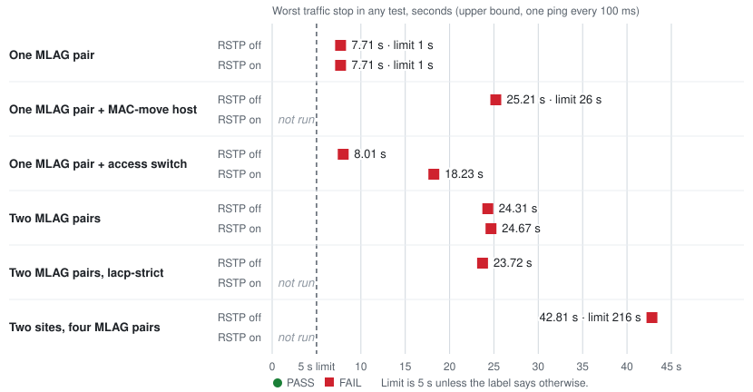

# MikroTik MLAG test suite

This suite measures how long traffic stops when a switch or link fails in a MikroTik MLAG pair. With multi-chassis link aggregation (MLAG), a server or switch connects to two MikroTik switches over one bonded link and stays connected when one of them fails. The suite builds virtual MLAG networks and breaks them in one way at a time. A test reboots a switch, cuts its power, cuts a link or delays or drops traffic on a link. Packet captures then show how long traffic stopped.

The labs run RouterOS itself. MikroTik publishes the Cloud Hosted Router (CHR) as an official container image, [`mikrotik/chr`](https://hub.docker.com/r/mikrotik/chr) on Docker Hub, for amd64 and arm64. Each container runs the full CHR in a QEMU virtual machine, so the tests exercise RouterOS's own bridge, LACP and MLAG code. Switch-chip offload on CRS hardware is not covered.

[Containerlab](https://containerlab.dev) runs that image with its [`mikrotik_chr` kind](https://containerlab.dev/manual/kinds/mikrotik_chr/). Each lab is one folder under [`tests/`](docs/tests/README.md) with a Containerlab topology, one RouterOS startup config and one YAML file per test. [Networka](https://github.com/narrowin/networka) runs the tests with `nw test run`. It sends numbered pings every 100 ms between the test hosts and compares each stop with the limit in the test file.

The old `mlag-lab` suite was removed. Its code, and how `results/` was produced, are in git history at commit [`95c7482`](https://github.com/narrowin/mikrotik-mlag-testsuite/tree/95c7482).

[Run a lab](#quick-start), [see the results](#results) or read the [documentation](docs/README.md).

## Results

<!-- results:start -->


RSTP off means no spanning tree on any bridge (`protocol-mode=none`). RSTP on has the MLAG pair as root. RouterOS 7.26beta7; `nw test` live runs of 26 and 27 November 2026, one ping every 100&nbsp;ms per stream.

| Lab | Topology | RSTP off | RSTP on | Worst stop, RSTP off | Worst stop, RSTP on |
| --- | --- | --- | --- | --- | --- |
| [Small](tests/small/README.md) | One MLAG pair |  3&nbsp;of&nbsp;4, 1&nbsp;error |  [3&nbsp;of&nbsp;4, 1&nbsp;error](tests/small-rstp/README.md) | 2.40–2.61&nbsp;s of&nbsp;4&nbsp;s, Cable client1 to switch2 back, client1&nbsp;→&nbsp;client2 | 2.43–2.64&nbsp;s of&nbsp;4&nbsp;s, Cable client1 to switch2 back, client1&nbsp;→&nbsp;client2 |
| [Medium](tests/medium/README.md) | One MLAG pair + access switch |  5&nbsp;of&nbsp;5 |  [2&nbsp;of&nbsp;5, 1&nbsp;error](tests/medium-rstp/README.md) | 2.51–2.71&nbsp;s of&nbsp;5&nbsp;s, Reboot switch2, host1&nbsp;→&nbsp;host2 | 9.80–10.01&nbsp;s of&nbsp;5&nbsp;s, switch1 power lost, host2&nbsp;→&nbsp;host1 |
| [Medium two-pair](tests/medium-two-pair/README.md) | Two MLAG pairs |  3&nbsp;of&nbsp;6 |  [3&nbsp;of&nbsp;6](tests/medium-two-pair-rstp/README.md) | 17.93–18.13&nbsp;s of&nbsp;5&nbsp;s, Reboot switch-b1, host1&nbsp;→&nbsp;host2 | 21.54–21.75&nbsp;s of&nbsp;5&nbsp;s, Reboot switch-a1, host2&nbsp;→&nbsp;host1 |
| [Medium two-pair-strict](tests/medium-two-pair-strict/README.md) | Two MLAG pairs + `lacp-strict` |  3&nbsp;of&nbsp;6 | not run | 18.14–18.35&nbsp;s of&nbsp;5&nbsp;s, Reboot switch-a1, host2&nbsp;→&nbsp;host1 | — |
| [Large](tests/large/README.md) | Two sites, four MLAG pairs |  3&nbsp;of&nbsp;5 | not run | 16.80–17.00&nbsp;s of&nbsp;5&nbsp;s, Reboot dc1-dist1, dc1-traffic&nbsp;→&nbsp;dc2-traffic | — |

The values are generated with `nw test summary tests/results.yaml` from the runs that [tests/results.yaml](tests/results.yaml) lists.
<!-- results:end -->

[results/](results/README.md) is the frozen result of the old `mlag-lab` suite and is not regenerated.

## Quick start

Start with the [Small lab](tests/small/README.md): two CHRs as the MLAG pair, joined by the peer link, and three Linux clients bonded to both with LACP.

### What you need

- A Linux host with Docker, sudo, tcpdump, tshark, ping, nsenter and `tc` from iproute2. On a Mac with Apple Silicon, use a Linux VM such as one in [OrbStack](https://orbstack.dev/download).
- [uv](https://docs.astral.sh/uv/) and [Git](https://git-scm.com/install/).
- Containerlab with native CHR full duplex and LACP. A released Containerlab does not have it yet. Build it first as in [Containerlab version](#containerlab-version).

### Run a test

Run from the repository root. `CLAB` is the absolute path of the Containerlab build.

```sh
git clone https://github.com/narrowin/mikrotik-mlag-testsuite.git
cd mikrotik-mlag-testsuite
CLAB=/usr/local/bin/containerlab
sudo env "CLAB=$CLAB" tests/shared/start.sh tests/small
```

`start.sh` returns once the bond of every Linux host is up. It fails after 60 s and names the host whose bond is down.

Then run the cable test and replay it. `nw test run` runs as root because it captures packets in the lab containers. `lab_nw` passes your `PATH` to sudo so that root finds uv and `tc`. It keeps the Python environment outside the checkout, so root does not own a `.venv` in it.

```sh
lab_nw() {
  sudo env "PATH=/usr/sbin:/sbin:$PATH" "UV_PROJECT_ENVIRONMENT=/var/tmp/mlag-lab-venvs$PWD" \
    uv run --locked nw "$@"
}
mkdir -p test-results
RUN=$(mktemp -d test-results/run.XXXXXX)
lab_nw test run tests/small/cases/bond-member-loss.yaml --lab tests/small/lab/clab-small-mlag \
  --config tests/small/lab/devices.yml --save "$RUN"
lab_nw test replay "$RUN/bond-member-loss"
```

`nw test run` exits 0 on pass, 1 on fail and 2 when the result is not verified. `nw test replay` judges the saved evidence again and exits 2 when the result differs from the saved `result.json`. Each test writes `report.md`, `result.json`, the captures and the switch log `syslog.log` into a folder named after the test inside `$RUN`. The other Small tests are listed in the [Small lab README](tests/small/README.md#commands).

Remove the lab when you are done.

```sh
sudo "$CLAB" destroy -t tests/small/lab/topology.clab.yml --cleanup
```

### Containerlab version

The labs need Containerlab with native CHR full duplex and LACP, from [srl-labs/containerlab#3636](https://github.com/srl-labs/containerlab/pull/3636). It is not in a release yet. RouterOS gives a bond member an LACP key only when the port reports full duplex. Containerlab 0.83.0 reports CHR data ports as half duplex, so RouterOS gives the bond members no LACP key and no bond comes up. There are two ways to run the labs.

1. Build Containerlab from the pull request branch. You need Git, Make and [Go](https://go.dev/dl/) 1.26 or newer; Debian and Ubuntu packages are older. `make build` asks for your sudo password because it makes the binary setuid root.

   ```sh
   git clone -b feat/mikrotik-chr-data-speed https://github.com/mischadiehm/containerlab.git
   cd containerlab && make build
   sudo install -m 4755 bin/containerlab /usr/local/bin/containerlab
   cd ..
   ```

   `/usr/local/bin` comes before `/usr/bin` in `PATH` and in sudo's `secure_path`, so this build runs instead of the packaged one. Remove `/usr/local/bin/containerlab` to go back. The build reports version 0.0.0.

2. Use the workaround on a released Containerlab. It is cumbersome. Bind-mount a QEMU wrapper that adds `speed=10000,duplex=full` to the data NICs over `/usr/local/bin/qemu-system-aarch64` and `/usr/local/bin/qemu-system-x86_64` in the CHR kind. Then set `brport/group_fwd_mask` on the veth and tap bridge ports so that they forward LACP. The old suite did this with [`qemu-data-link.sh`](https://github.com/narrowin/mikrotik-mlag-testsuite/blob/95c7482/labs/shared/qemu-data-link.sh) and [`forward-control.sh`](https://github.com/narrowin/mikrotik-mlag-testsuite/blob/95c7482/labs/shared/forward-control.sh).

The published `nw test` results in the lab READMEs were run on the build from way 1. The frozen old-suite results in `results/` were run with the workaround on Containerlab 0.83.0.

### GitHub Codespaces and the dev container

The [dev container](.devcontainer/devcontainer.json) has uv, tshark and Containerlab 0.83.0. A GitHub Codespace uses the same container. A lab gets LACP bonds there only with one of the two ways above, so `start.sh` fails on the Codespace as it is. You need a GitHub account and available Codespaces usage.

[](https://codespaces.new/narrowin/mikrotik-mlag-testsuite?quickstart=1)

If you use Codespaces, choose **Stop codespace** when you are done to stop compute usage. [Your Codespaces](https://github.com/codespaces)

## Labs

| Lab | What it is |
| --- | --- |
| [Small](tests/small/README.md) | One MLAG pair and three Linux clients bonded to both peers. |
| [Small with a mobile host](tests/small-mobile/README.md) | The Small pair with an active-backup host. |
| [Medium](tests/medium/README.md) | One MLAG pair, an access switch with one LACP bond to both peers, and two hosts. |
| [Medium with two pairs](tests/medium-two-pair/README.md) | Two MLAG pairs joined by one LACP bond. |
| [Two pairs with lacp-strict](tests/medium-two-pair-strict/README.md) | The two-pair lab with `lacp-strict=yes` on the bond between the pairs. |
| [Large](tests/large/README.md) | Two sites, each with a core and a distribution MLAG pair, and a VRRP firewall at each site. |

## Documentation and help

- Run a lab, add a test or add a lab. [Labs and tests under tests/](docs/tests/README.md)
- Look up every lab and test field. [Networka lab test guide](https://github.com/narrowin/networka/blob/main/docs/lab-tests.md)
- File a bug report with MikroTik. The [RouterOS 7.26beta7 fault report](docs/plans/routeros-failures-report.md) has the evidence and reproduction steps for two MLAG faults. Our earlier reports to MikroTik had limited success, so we do not plan to file these ourselves. Anyone who wants to may use it.
- Report a setup issue or unexpected result. Include the command you ran and the error or verdict. [GitHub issues](https://github.com/narrowin/mikrotik-mlag-testsuite/issues)

[Documentation index](docs/README.md)

## Contributing

Results from other RouterOS versions and real hardware, new tests and fixes are welcome. See [CONTRIBUTING.md](CONTRIBUTING.md) for how to share a result or open a pull request, and [SECURITY.md](SECURITY.md) to report a security problem privately.

## License

[Apache License 2.0](LICENSE). Copyright 2026 narrowin.
