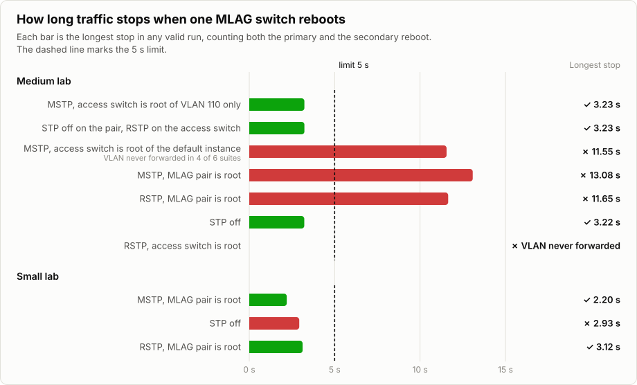

# MikroTik MLAG test suite

This suite measures how long traffic stops when a switch or link fails in a MikroTik MLAG pair. With multi-chassis link aggregation (MLAG), a server or switch connects to two MikroTik switches over one bonded link and stays connected when one of them fails. The suite builds virtual MLAG networks and breaks them in one way at a time. A test reboots a switch, cuts its power, cuts a link, blocks LACP on one link or moves a MAC address. Packet captures then show how long traffic stopped.

The labs run RouterOS itself. MikroTik publishes the Cloud Hosted Router (CHR) as an official container image, [`mikrotik/chr`](https://hub.docker.com/r/mikrotik/chr) on Docker Hub, for amd64 and arm64. Each container runs the full CHR in a QEMU virtual machine, so the tests exercise RouterOS's own bridge, LACP and MLAG code. Switch-chip offload on CRS hardware is not covered.

[Containerlab](https://containerlab.dev) runs that image natively with its [`mikrotik_chr` kind](https://containerlab.dev/manual/kinds/mikrotik_chr/). Each lab is a YAML topology file that lists the switches, test hosts and links. It names one RouterOS startup config that every CHR in the lab loads. The Small lab topology is [`labs/small/small.clab.yml`](labs/small/small.clab.yml). During each test the `mlag-lab` runner sends numbered pings every 100 ms between the test hosts and scores each phase against its limit.

[Run the lab](#quick-start), [see the results](#results) or read the [documentation](docs/README.md).

## Results

<!-- results:start -->
<!-- Generated by `mlag-lab export` from results/index/phases.jsonl. Edit the generator, not this section. -->

Tested on RouterOS 7.26beta7 (`mikrotik/chr:7.26beta7`) with Containerlab 0.83.0 on 24 November 2026. `mlag-lab export` generates this section from the [results index](results/index/schema.md).

[](results/README.md)

### Medium lab

| Result | Setup | Runs | Longest interruption |
| --- | --- | --- | --- |
| ✅ PASS | STP off on the pair, RSTP on the access switch | 25 passed, 0 failed, 1 invalid or not reached | MLAG secondary reboot, Secondary down: 3.02–3.23 s (limit 5 s) |
| ❌ FAIL | MSTP, access switch is root of VLAN 110 only | 32 passed, 4 failed | Failed: frames looped back to the sender. Loss within limit: MLAG secondary reboot, Secondary down: 2.82–3.02 s (limit 5 s) |
| ❌ FAIL | MSTP, access switch is root of the default instance | 5 passed, 5 failed, 14 invalid or not reached | VLAN never forwarded in 4 of 6 suites. Where it forwarded: MLAG secondary reboot, Secondary down: 11.35–11.55 s (limit 5 s) |
| ❌ FAIL | MSTP, MLAG pair is root | 13 passed, 4 failed, 11 invalid or not reached | MLAG primary reboot, Primary down: 12.87–13.08 s (limit 5 s) |
| ❌ FAIL | RSTP, MLAG pair is root | 12 passed, 8 failed, 1 invalid or not reached | Pair A primary reboot, Pair A primary down: 17.38–17.59 s (limit 5 s) |
| ❌ FAIL | STP off | 36 passed, 5 failed, 3 invalid or not reached | Pair A primary reboot, Pair A primary down: 23.14–23.34 s (limit 5 s) |
| ❌ FAIL | RSTP, access switch is root | 0 passed, 1 failed, 3 invalid or not reached | Baseline: VLAN traffic did not forward |

The [Medium lab results](results/README.md#medium-lab) list every setup variant and run.

### Small lab

| Result | Setup | Runs | Longest interruption |
| --- | --- | --- | --- |
| ⚠️ INCOMPLETE | MSTP, MLAG pair is root | 25 passed, 0 failed, 29 invalid or not reached | LACP partner timeout and return, LACPDUs blocked: 3.23–3.44 s (limit 4 s) |
| ❌ FAIL | STP off | 42 passed, 12 failed, 12 invalid or not reached | Failed: frames looped back to the sender. Loss within limit: MLAG primary reboot, Primary down: 2.61–2.81 s (limit 5 s) |
| ❌ FAIL | RSTP, MLAG pair is root | 35 passed, 1 failed, 16 invalid or not reached | MLAG bond member loss and return, Member down: 10.63–10.84 s (limit 3 s) |

The [Small lab results](results/README.md#small-lab) list every setup variant and run.

A setup fails if any valid run failed. It passes when none failed and every case it attempted has a valid run. Otherwise it is incomplete. Invalid runs, such as runs with a paused probe sender, count as neither pass nor fail. A setup that was never tested for looped-back frames, while another setup in the same lab was, is incomplete: its green result would only mean the check did not run.

Suites marked invalid and 6 suites that did not record their bridge mode appear only in the [results overview](results/README.md). It also gives the recommendation and the limit for each case.

<!-- results:end -->

## Quick start

Start with the **Small lab**, which connects two test hosts to the same pair of virtual switches. Your first run checks that packets reach the other host in both directions during normal operation.

### In GitHub Codespaces

You need a GitHub account and available Codespaces usage. The Codespace provides the tools and opens VS Code in your browser.

[](https://codespaces.new/narrowin/mikrotik-mlag-testsuite?quickstart=1)

Choose **Create codespace**, wait for setup to finish, then [run the baseline](#run-the-baseline).

### Run on your own machine

Start [OrbStack on Apple Silicon](https://orbstack.dev/download) or [Docker Engine on Linux](https://docs.docker.com/engine/install/). Install [Git](https://git-scm.com/install/), [VS Code](https://code.visualstudio.com/download), and its [Dev Containers extension](https://marketplace.visualstudio.com/items?itemName=ms-vscode-remote.remote-containers).

On Linux, give your user access to Docker so VS Code can start the container. [Docker post-install steps](https://docs.docker.com/engine/install/linux-postinstall/)

1. In VS Code, open **View → Command Palette** and choose **Git: Clone**. Paste `https://github.com/narrowin/mikrotik-mlag-testsuite.git` and open the cloned folder when prompted.
2. In the Command Palette, choose **Dev Containers: Reopen in Container**. VS Code builds the environment with Containerlab and the packet capture tools. When the build finishes, [run the baseline](#run-the-baseline). [VS Code guide](https://code.visualstudio.com/docs/devcontainers/create-dev-container)

Already have a dedicated Linux lab host? Follow the [manual setup](docs/test-framework.md#execute-locally).

### Run the baseline

In VS Code, choose **Terminal → New Terminal**. Run this from the repository folder in the Codespace or local dev container.

```sh
./labs/small/quickstart.sh
```

The first run downloads the virtual switch image and may take a few minutes. `01-baseline: pass` means forwarding worked in both directions. Open the `test-results/<timestamp>/README.md` path printed in the terminal to see what passed or failed.

### Measure a test interruption

Once the baseline passes, leave the lab running and try the calibration. It blocks traffic for two seconds in one direction on a separate link between the test hosts to check that the suite measures the interruption correctly.

```sh
uv run --locked mlag-lab run --case reboot-calibration
```

`01-reboot-calibration: pass` means the measured interval covered the two-second cut. The report is in the new timestamped folder under `test-results/`. [More Small lab cases](docs/cases/README.md#small-lab)

### Clean up

When you're done, remove the lab from the same terminal. Reports stay in `test-results/`.

```sh
sudo containerlab destroy -t labs/small/small.clab.yml --cleanup
```

If you used Codespaces, choose **Stop codespace** to stop compute usage. [Your Codespaces](https://github.com/codespaces)

## How it works

The Small lab has two CHRs as the MLAG pair, joined by the peer link. Two test hosts connect to both CHRs over an LACP bond. A third host has an active-backup bond to both CHRs for the MAC-move test, and a separate bypass link between the two test hosts checks the measurement itself. The Medium lab drops the MAC-move host and puts one test host behind a third CHR, an access switch with one LACP uplink to the MLAG pair. [Lab inventory](labs/README.md)


For each test the runner checks that traffic flows, keeps numbered pings running, applies one fault and later undoes it. It measures the traffic stop separately while the fault is in effect and after it is undone, and compares each with that phase's limit. The [measurement method](docs/reference/measurement.md) explains the bounds, and [`labs/campaign-image.txt`](labs/campaign-image.txt) pins the CHR image by digest.

## Documentation and help

- See how the Small and Medium labs are wired and what's planned for two sites. [Lab inventory](labs/README.md)
- Choose a test and find its command. [Case index](docs/cases/README.md)
- Run a campaign, inspect reports, or replay packet captures with the [operator guide](docs/operator-guide.md) and the [test framework](docs/test-framework.md#read-or-replay-a-run).
- Report a setup issue or unexpected result. Include the command you ran and the error or verdict. [GitHub issues](https://github.com/narrowin/mikrotik-mlag-testsuite/issues)
- File a bug report with MikroTik. The [RouterOS 7.26beta7 fault report](docs/plans/routeros-failures-report.md) has the evidence and reproduction steps for two MLAG faults. Our earlier reports to MikroTik had limited success, so we do not plan to file these ourselves. Anyone who wants to may use it.

[Documentation index](docs/README.md)

## Contributing

Results from other RouterOS versions and real hardware, new test cases and fixes are welcome. See [CONTRIBUTING.md](CONTRIBUTING.md) for how to share a result or open a pull request, and [SECURITY.md](SECURITY.md) to report a security problem privately.

## License

[Apache License 2.0](LICENSE). Copyright 2026 narrowin.
