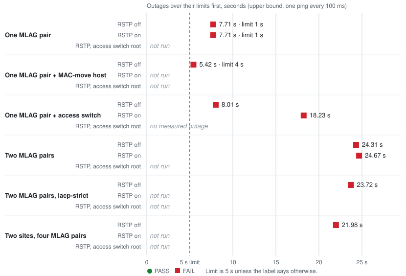

# MikroTik MLAG test suite

This suite measures how long traffic stops when a switch or link fails in a MikroTik MLAG pair. With multi-chassis link aggregation (MLAG), a server or switch connects to two MikroTik switches over one bonded link and stays connected when one of them fails. The suite builds virtual MLAG networks and breaks them in one way at a time. A test reboots a switch, cuts its power, cuts a link or delays or drops traffic on a link. Packet captures then show how long traffic stopped. The main finding on RouterOS 7.26beta7 is that [an MLAG bond whose bond member has no LACP partner keeps forwarding](docs/findings/mlag-bond-without-lacp-partner-keeps-forwarding.md): frames loop back to their sender, and traffic between two MLAG pairs stops while one MLAG primary reboots. All measured RouterOS behaviour is in the [findings](docs/findings/README.md).

The labs run RouterOS itself. MikroTik publishes the Cloud Hosted Router (CHR) as an official container image, [`mikrotik/chr`](https://hub.docker.com/r/mikrotik/chr) on Docker Hub, for amd64 and arm64. Each container runs the full CHR in a QEMU virtual machine, so the tests exercise RouterOS's own bridge, LACP and MLAG code. Switch-chip offload on CRS hardware is not covered. Current labs use our checksum-pinned public tc/startup-hook image; its RouterOS disk is unchanged from the official 7.26beta7 image.

[Containerlab](https://containerlab.dev) runs that image with its [`mikrotik_chr` kind](https://containerlab.dev/manual/kinds/mikrotik_chr/). Each lab is one folder under [`tests/`](docs/tests/README.md) with a Containerlab topology, one RouterOS startup config and one YAML file per test. [Networka](https://narrowin.github.io/networka/) runs the tests with `nw test run`. It sends numbered pings every 100 ms between the test hosts and compares each stop with the limit in the test file.

The old `mlag-lab` suite was removed. Its code, and how `results/` was produced, are in git history at commit [`95c7482`](https://github.com/narrowin/mikrotik-mlag-testsuite/tree/95c7482).

[Run a lab](#quick-start), [see the results](#results) or read the [documentation](docs/README.md).

## Results

<!-- results:start -->


RSTP off means no spanning tree on any bridge (`protocol-mode=none`). RSTP on has the MLAG pair as root; RSTP, access switch root has the Medium access switch as root. RouterOS 7.26beta7 in our CHR image pinned by digest; live runs of 28 November 2026 with Networka 0.5.2+chr.5; Small and Small strict show round 1 of five, one ping every 100&nbsp;ms per stream.

| Lab | Topology | RSTP off | RSTP on | RSTP, access switch root | Worst outage, RSTP off | Worst outage, RSTP on | Worst outage, RSTP, access switch root |
| --- | --- | --- | --- | --- | --- | --- | --- |
| [Small](tests/small/README.md) | One MLAG pair |  3&nbsp;of&nbsp;4, 1&nbsp;error |  [3&nbsp;of&nbsp;4, 1&nbsp;error](tests/small-rstp/README.md) | not run | 2.29–2.51&nbsp;s of&nbsp;4&nbsp;s, Cable host1 to switch2 back, host1&nbsp;→&nbsp;host2 | 2.29–2.50&nbsp;s of&nbsp;4&nbsp;s, Cable host1 to switch2 back, host1&nbsp;→&nbsp;host2 | — |
| [Small strict](tests/small-strict/README.md) | One MLAG pair + `lacp-strict` |  3&nbsp;of&nbsp;4, 1&nbsp;error | not run | not run | 0.93–1.14&nbsp;s of&nbsp;4&nbsp;s, Reboot switch1, host2&nbsp;→&nbsp;host3 | — | — |
| [Small with MAC-move host](tests/small-mac-move/README.md) | One MLAG pair + MAC-move host |  9&nbsp;of&nbsp;11, 1&nbsp;error | not run | not run | 2.92–3.13&nbsp;s of&nbsp;5&nbsp;s, Reboot switch1, host2&nbsp;→&nbsp;host1 | — | — |
| [Medium](tests/medium/README.md) | One MLAG pair + access switch |  5&nbsp;of&nbsp;5 |  [2&nbsp;of&nbsp;5](tests/medium-rstp/README.md) | ERROR [0&nbsp;of&nbsp;5, 5&nbsp;errors](tests/medium-rstp-access-root/README.md) | 2.71–2.92&nbsp;s of&nbsp;5&nbsp;s, Reboot switch2, host1&nbsp;→&nbsp;host2 | 34.53–34.74&nbsp;s of&nbsp;5&nbsp;s, Reboot switch1, host2&nbsp;→&nbsp;host1 | — |
| [Two-pair](tests/two-pair/README.md) | Two MLAG pairs |  4&nbsp;of&nbsp;6 |  [3&nbsp;of&nbsp;6](tests/two-pair-rstp/README.md) | not run | 16.59–16.80&nbsp;s of&nbsp;5&nbsp;s, Reboot switch-b1, host1&nbsp;→&nbsp;host2 | 22.84–23.04&nbsp;s of&nbsp;5&nbsp;s, Reboot switch-b1, host1&nbsp;→&nbsp;host2 | — |
| [Two-pair strict](tests/two-pair-strict/README.md) | Two MLAG pairs + `lacp-strict` |  4&nbsp;of&nbsp;6 | not run | not run | 19.15–19.36&nbsp;s of&nbsp;5&nbsp;s, Reboot switch-a1, host1&nbsp;→&nbsp;host2 | — | — |
| [Large](tests/large/README.md) | Two sites, four MLAG pairs |  4&nbsp;of&nbsp;6 | not run | not run | 19.68–19.89&nbsp;s of&nbsp;5&nbsp;s, Reboot dc2-core1, dc2-traffic&nbsp;→&nbsp;dc1-traffic | — | — |

The values are generated with `nw test summary tests/results.yaml` from the runs that [tests/results.yaml](tests/results.yaml) lists. Outages exceeding their limits are highlighted first; among those, the longest upper bound is shown. With no limit breach, the longest valid outage is shown. Intentional host interruptions within their combined limits are shown separately in each run report and excluded from this comparison; breaches remain eligible and are labelled.
<!-- results:end -->

[results/](results/README.md) is the frozen result of the old `mlag-lab` suite and is not regenerated.

## Quick start

Start with the [Small lab](tests/small/README.md): two CHRs as the MLAG pair, joined by the peer link, and three Linux hosts bonded to both with LACP.

### What you need

- A Linux host with Docker, sudo, tcpdump, tshark, ping, nsenter and `tc` from iproute2. On a Mac with Apple Silicon, use a Linux VM such as one in [OrbStack](https://orbstack.dev/download).
- [uv](https://docs.astral.sh/uv/) and [Git](https://git-scm.com/install/).
- curl, gzip and sha256sum. The shared launcher downloads our qualified containerlab client automatically.

### Run a test

Run from the repository root. The launcher selects our checksum-pinned public client automatically.

```sh
git clone https://github.com/narrowin/mikrotik-mlag-testsuite.git
cd mikrotik-mlag-testsuite
sudo tests/shared/start.sh tests/small
```

`start.sh` returns once the bond of every Linux host is up. It fails after 60 s and names the host whose bond is down.

Then run the cable test and replay it. `nw test run` runs as root because it captures packets in the lab containers. `lab_nw` passes your `PATH` to sudo so that root finds uv and `tc`. It keeps the Python environment outside the checkout, so root does not own a `.venv` in it.

```sh
lab_nw() {
  sudo env "PATH=/usr/sbin:/sbin:$PATH" "UV_PROJECT_ENVIRONMENT=/var/tmp/mlag-lab-venvs$PWD" \
    uv run --locked nw "$@"
}
mkdir -p test-results
RUN=$(mktemp -d test-results/run.XXXXXX)
lab_nw test run tests/small/tests/bond-member-loss.yaml --lab tests/small/lab/clab-small-mlag \
  --config tests/small/lab/devices.yml --save "$RUN"
lab_nw test replay "$RUN/bond-member-loss"
```

`nw test run` exits 0 on pass, 1 on fail and 2 when the result is not verified. `nw test replay` judges the saved evidence again and exits 2 when the result differs from the saved `result.json`. Each test writes `report.md`, `result.json`, the captures and the switch log `syslog.log` into a folder named after the test inside `$RUN`. The other Small tests are listed in the [Small lab README](tests/small/README.md#commands).

Remove the lab when you are done.

```sh
sudo tests/shared/containerlab destroy -t tests/small/lab/topology.clab.yml --cleanup
```

### Containerlab version

The suite uses our [public CHR image and qualified containerlab clients](https://github.com/narrowin/mikrotik-mlag-testsuite/releases/tag/chr-startup-hooks-7.26beta7-20261127). Every topology pins the image by digest. `tests/shared/containerlab` downloads the ARM64 or AMD64 client, verifies its pinned SHA-256 and caches it. It leaves the installed containerlab unchanged.

The suite pins a [qualified Networka source artifact](vendor/README.md) with tc NIC discovery. The kind supplies tc data connections, management provisioning and Linux IPv6 suppression. The labs require no QEMU wrapper, bridge-learning workaround or custom CHR mounts. Historical results retain the image and client used for those runs; they are not reclassified as results of this stack.

### GitHub Codespaces and the dev container

The [dev container](.devcontainer/devcontainer.json) has uv, tshark and Containerlab 0.83.0. A GitHub Codespace uses the same container. The shared launcher uses our published client there as well; Docker privileged-container support is required. You need a GitHub account and available Codespaces usage.

[](https://codespaces.new/narrowin/mikrotik-mlag-testsuite?quickstart=1)

If you use Codespaces, choose **Stop codespace** when you are done to stop compute usage. [Your Codespaces](https://github.com/codespaces)

## Labs

| Lab | What it is |
| --- | --- |
| [Small](tests/small/README.md) | One MLAG pair and three Linux hosts bonded to both peers. |
| [Small with a MAC-move host](tests/small-mac-move/README.md) | The Small pair with a MAC-move host on an active-backup bond. |
| [Small strict](tests/small-strict/README.md) | The Small lab with `lacp-strict=yes min-links=1` on the host bonds and coupled LACP control off on the hosts. |
| [Medium](tests/medium/README.md) | One MLAG pair, an access switch with one LACP bond to both peers, and two hosts. |
| [Two-pair](tests/two-pair/README.md) | Two MLAG pairs joined by one LACP bond. |
| [Two-pair strict](tests/two-pair-strict/README.md) | The two-pair lab with `lacp-strict=yes` on the bond between the pairs. |
| [Large](tests/large/README.md) | Two sites, each with a core and a distribution MLAG pair, and a VRRP firewall at each site. |

## Documentation and help

- Run a lab, add a test or add a lab. [Labs and tests under tests/](docs/tests/README.md)
- Look up every lab and test field. [Networka lab test guide](https://narrowin.github.io/networka/lab-tests/)
- File a bug report with MikroTik. The [RouterOS 7.26beta7 findings report](docs/findings/mlag-bond-without-lacp-partner-keeps-forwarding.md) has the evidence and reproduction steps for two MLAG findings. Our earlier reports to MikroTik had limited success, so we do not plan to file these ourselves. Anyone who wants to may use it.
- Report a setup issue or unexpected result. Include the command you ran and the error or verdict. [GitHub issues](https://github.com/narrowin/mikrotik-mlag-testsuite/issues)

[Documentation index](docs/README.md)

## Contributing

Results from other RouterOS versions and real hardware, new tests and fixes are welcome. See [CONTRIBUTING.md](CONTRIBUTING.md) for how to share a result or open a pull request, and [SECURITY.md](SECURITY.md) to report a security problem privately.

## License

[Apache License 2.0](LICENSE). Copyright 2026 narrowin.
