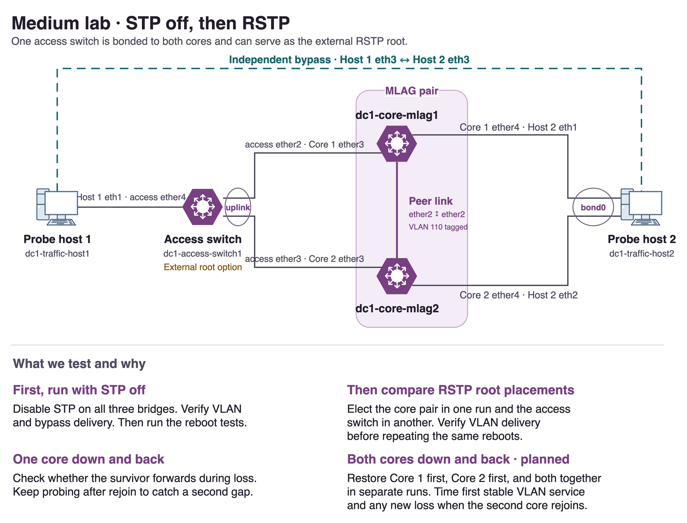

# Medium lab spanning-tree comparison

Keep the two cores, the dual-attached access switch, both probe hosts and the independent bypass connected for all three modes. Elect the access switch as the one external root. Host 1 reaches either core through the access switch’s LACP bond. Host 2 has its own two-member bond directly to the cores. [Containerlab wiring](../../labs/medium/medium.clab.yml)

| Mode | Baseline requirement |
| --- | --- |
| STP off | All three bridges report `protocol-mode=none`. Verify both bonds, zero BPDUs and one delivered copy per broadcast. |
| RSTP with core pair as root | Keep both core priorities matched. Verify the shared root ID, BPDUs and VLAN delivery in both directions. |
| RSTP with access switch as root | Give the access switch the best priority. Verify all three bridges agree on that root, then verify VLAN delivery. |

Calibrate the bypass and reboot either core in separate repeats only after that mode passes its baseline. Leave the cabling and root configuration fixed during each fault. For both cores down, repeat with either core booting first, then both together. [Commands](../operator-guide.md#introduce-rstp-after-the-all-bridges-off-run) · [Whole-pair case](../validation-plan.md#both-dc1-cores-down-and-return)

## Archived diagnostics

In the earlier three-CHR trial, both cores recognized the access switch as root and neither VLAN direction delivered any of 62 probes. The five-CHR diagnostic fixture used two single-homed root bridges. Its STP-off reboots passed for both core roles in two repeats. The five-CHR RSTP readiness run failed VLAN forwarding and withheld the reboot. Earlier five-CHR RSTP reboots on passing baselines exceeded the five-second target for both core roles. These results describe their original wiring. [Three-CHR access-root capture](../../results/2026-11-24-medium-lab-pair-root/witness-root-baseline-evidence.tar.gz)

The five-CHR bundles are retained with the local campaign evidence. Use the [offline replay procedure](../test-framework.md#replay-the-stp-off-reboots) with the saved bundle.
