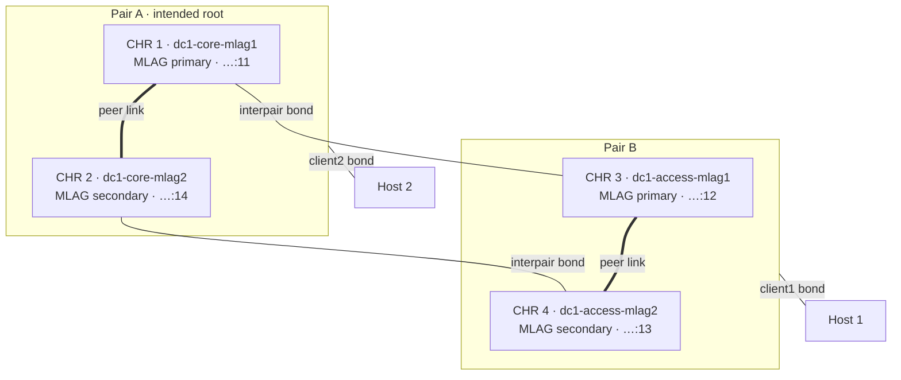

# MEDIUM-08 · Two MLAG pairs: does STP root stay put when a pair's primary reboots?

## Why this case exists

Every other lab has one MLAG pair, so a root fight between pairs cannot happen there. Two field sources say it does happen:

- **Field failure.** An operator ran six MLAG pairs on RouterOS 7.19.3/7.19.4. The pairs used the same STP priority and fought over the root. Each time the root moved, all four switches of the two pairs dropped traffic while STP relearned the ports. Giving each pair its own priority fixed it at once. [sirbryan, post #6, 20 March 2026](https://forum.mikrotik.com/t/mlag-between-crs326-24s-2q-rm-with-more-than-1-000-hosts-macs/269294)
- **Deployed design.** The field OT network sets one bridge priority per pair: Site A cores `0x2000` (root), Site B cores `0x4000` (backup root), access switches `0x8000`. Both cores of a pair share the priority. Each core has a fixed `admin-mac` so its bridge ID never changes. Source: the field Ansible inventory (core `host_vars/*/interface_bridge.yml`) and `mkdocs/docs/design/topologie.md` in the original checkout. [Original project sources](../reference/original-project-sources.md)
- **Vendor rule.** Both MLAG peers must use the same priority. The pair uses the primary's bridge ID for STP. [RouterOS MLAG manual](https://manual.mikrotik.com/docs/high-availability-solutions/multi-chassis-link-aggregation-group/)

The case answers two questions:

1. With every switch on the same priority, does rebooting the root pair's primary move the root to the other pair and cut traffic?
2. With the field priorities, does the root stay on pair A?

## Setup



- One distributed LACP bond joins the pairs: `mlag-id` 11 on pair A, 21 on pair B. The peer link and the inter-pair bond use `edge=auto`, as field does on its peer link, DCI and LWL bonds. With `edge=no` on both pairs, pair A's side stayed discarding: pair A's primary sent RSTP proposals every 2 s and pair B never answered. MikroTik advised `edge=auto` for this case. [EdPa, thread 269918, post 6](https://forum.mikrotik.com/t/mlag-configuration-for-v7-22-1/269918) With `edge=auto`, pair A's side of the bond runs as an operational edge port (`edge-port: yes`), because pair B sends no BPDUs back. Pair B's side is a normal root port. The report records both in each baseline.
- Host 1 bonds to pair B and host 2 to pair A, so both VLAN 110 streams cross both pairs. A direct bypass link between the hosts is the control stream.
- `admin-mac` per switch: CHR 1 `02:00:00:21:00:11`, CHR 2 `…:14`, CHR 3 `…:12`, CHR 4 `…:13`. The order is deliberate. With equal priorities pair A is root because `…:11` is the lowest MAC. If pair A ever presents its secondary's ID (`…:14`), pair B (`…:12`) wins and the root moves. This is the worst case of a random MAC order, and it is the condition the field report hit.
- RouterOS 7.26beta7 CHR, image pinned in [campaign-image.txt](../../labs/campaign-image.txt). Startup config [medium-two-pair.rsc](../../labs/medium/medium-two-pair.rsc), wiring [medium-two-pair.clab.yml](../../labs/medium/medium-two-pair.clab.yml).

| Setup | CHR 1, CHR 2 | CHR 3, CHR 4 | Expected root |
| --- | --- | --- | --- |
| `equal` | `0x8000` | `0x8000` | `0x8000.02:00:00:21:00:11`, by lowest MAC |
| `field` | `0x2000` | `0x4000` | `0x2000.02:00:00:21:00:11`, by priority |

The runner sets the priorities over management SSH before each case and reads them back from the running config.

## Cases and pass criteria

| Selector (replace `<setup>` with `equal` or `field`) | Fault |
| --- | --- |
| `two-pair-<setup>-baseline` | None. All four CHRs report the expected root, both pairs are connected, every bond member collects and distributes, and no probe is lost. |
| `two-pair-<setup>-calibrate` | 2 s one-way drop on the bypass. Proves the loss measurement. |
| `two-pair-<setup>-reboot-a-primary` | Reboot CHR 1, pair A's primary and the root bridge. **The main case.** |
| `two-pair-<setup>-reboot-a-secondary` | Reboot CHR 2. Control: pair A keeps its ID. |
| `two-pair-<setup>-reboot-b-primary` | Reboot CHR 3. Pair B's ID may change, but it stays higher than pair A's. |
| `two-pair-<setup>-reboot-b-secondary` | Reboot CHR 4. Control. |

A reboot case passes only if both of the following hold:

- **Root stays on pair A.** The three switches that stay up report the expected root ID in every state sample while the rebooted switch is away and while it returns. The rebooting switch is not scored, because it reports its own view while it boots.
- **Loss stays within limits.** Each VLAN 110 direction loses at most **5 s** per phase, and the bypass loses nothing.

The generated report lists every switch's root ID, bridge ID and MLAG role over time (`root_history` in `result.json`). It also lists the BPDUs on each end of the inter-pair bond.

## Measured, 24 November 2026

**Both setups fail the pair A primary reboot, and the root moves to pair B in both.**

| Setup | Primary reboot: down / back | Secondary reboot |
| --- | --- | --- |
| `equal` | 17.38–17.59 s / 6.71–6.92 s | no loss |
| `field` | 16.29–16.50 s / 4.60–4.81 s | no loss |

CHR 2 stays "connected, secondary" and sends no BPDUs while CHR 1 is away. Pair B's root information then expires and pair B elects itself root about 8 s after pair A's last BPDU. A lower priority on pair A cannot win while pair A sends nothing. The per-pair priority guards against pairs that are all up and compare equal IDs, not against this silence. [Report and analysis](../../results/2026-11-24-two-pair/README.md)

## Reproduce

Run these on the `mlag-external` OrbStack VM, from the repository root.

```sh
chr=$(cat labs/campaign-image.txt)
syslog=$(sudo docker image inspect --format '{{index .RepoDigests 0}}' rsyslog/rsyslog:latest)
sudo env MLAG_CHR_IMAGE="$chr" MLAG_SYSLOG_IMAGE="$syslog" containerlab deploy -t labs/medium/medium-two-pair.clab.yml

export UV_PROJECT_ENVIRONMENT=/var/tmp/mlag-two-pair-venv
launch_mlag() {
  sudo --preserve-env=MLAG_SSH_PASSWORD env "PATH=$PATH:/usr/sbin:/sbin" \
    "UV_PROJECT_ENVIRONMENT=$UV_PROJECT_ENVIRONMENT" uv run --locked mlag-lab run "$@"
}
for setup in equal field; do
  launch_mlag --case "two-pair-$setup-baseline" --case "two-pair-$setup-calibrate" \
    --case "two-pair-$setup-reboot-a-primary" --case "two-pair-$setup-reboot-a-secondary" \
    --output "results/2026-11-24-two-pair/$setup"
done
```

Each suite saves the topology, startup config, runner code and the `uv.lock` it ran with under `inputs/`. It also saves the image digests in `builds.json`, so a saved run can be scored again offline with `uv run --locked mlag-lab evaluate results/2026-11-24-two-pair`.

## Limits

- A CHR reboot keeps the virtual links up, so neighbours notice the reboot only through LACP and ICCP timeouts. A real switch drops carrier at once.
- The CHRs forward in software. Hardware offload on CRS switches is not covered.
- Two pairs and one inter-pair bond are the smallest setup that can show a root fight. The six-pair field network and the field two-site DCI are larger.
