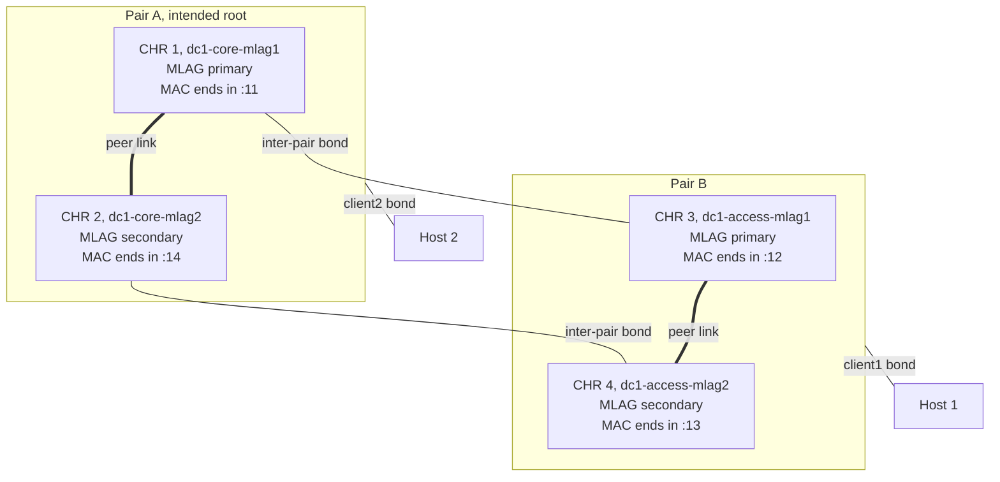

# MEDIUM-08 Two MLAG pairs and the STP root during a reboot of the root pair's MLAG primary

## What this test checks

Two MLAG pairs are joined by one LACP bond. Pair A should be the STP root bridge. The test reboots one switch of a pair and checks two things. It checks that the root stays on pair A. It checks how long traffic across both pairs stops.

The case answers two questions.

1. Every switch has the same bridge priority. When the MLAG primary of the root pair reboots, does the root move to the other pair, and does traffic stop?
2. Each pair has its own priority, as in the field network. Does the root then stay on pair A?

## Why it is needed

Every other lab has one MLAG pair. Two pairs cannot compete for the root there. Three sources show that this competition matters.

- **A failure in the field.** An operator ran six MLAG pairs on RouterOS 7.19.3 and 7.19.4. All pairs used the same STP priority and competed for the root. Each time the root moved, all four switches of the two pairs dropped traffic while STP learned the ports again. Giving each pair its own priority fixed the problem at once. The report is [post 6 by sirbryan on 20 March 2026](https://forum.mikrotik.com/t/mlag-between-crs326-24s-2q-rm-with-more-than-1-000-hosts-macs/269294).
- **The deployed field design.** The field OT network sets one bridge priority per pair. The Site A cores use `0x2000` and are the root. The Site B cores use `0x4000` and are the backup root. The access switches use `0x8000`. Both cores of a pair have the same priority. Each core has a fixed `admin-mac`, so its bridge ID never changes. The source is the deployed field configuration.
- **MikroTik's rule.** Both MLAG peers must use the same priority. The pair uses the bridge ID of the MLAG primary for STP. The rule is in the [RouterOS MLAG manual](https://manual.mikrotik.com/docs/high-availability-solutions/multi-chassis-link-aggregation-group/).

## The test in detail



| | |
| --- | --- |
| Lab | Pair A is CHR 1 and CHR 2. Pair B is CHR 3 and CHR 4. In each pair, a peer link joins the two MLAG peers. The peer link is the cable between the two MLAG peers. Host 1 has a bond to pair B. Host 2 has a bond to pair A. A direct cable between the hosts bypasses all switches. |
| Software | RouterOS 7.26beta7 CHR. The image is pinned in [campaign-image.txt](../../labs/campaign-image.txt). The startup configuration is [medium-two-pair.rsc](../../labs/medium/medium-two-pair.rsc). The wiring is [medium-two-pair.clab.yml](../../labs/medium/medium-two-pair.clab.yml). |
| Before the fault | The runner sets the bridge priorities over management SSH before each case. The baseline check reads them back through Networka. The expected state is in [two-pair.yaml](../../src/mlag_lab/intent/state/two-pair.yaml) and in the file `two-pair-<setup>.yaml` of the setup. |
| Fault | The test reboots one CHR, or it takes one cable of the inter-pair bond down and brings it back. The cases table below lists each fault. |

### How the lab is built

- One distributed LACP bond joins the two pairs. Pair A uses `mlag-id` 11 for it. Pair B uses `mlag-id` 21.
- The peer link and the inter-pair bond use `edge=auto`. The field network does the same on its peer link, its DCI bonds and its fibre (LWL) bonds.
- An earlier setup used `edge=no` on both pairs. Pair A's side of the inter-pair bond then stayed in the discarding state. The MLAG primary of pair A sent RSTP proposals every 2 s, and pair B never answered. MikroTik advised `edge=auto` for this case in [post 6 by EdPa in thread 269918](https://forum.mikrotik.com/t/mlag-configuration-for-v7-22-1/269918).
- With `edge=auto`, pair A's side of the inter-pair bond runs as an edge port. RouterOS shows it as `edge-port: yes`, because pair B sends no BPDUs back. Pair B's side is a normal root port. The report records both sides in each baseline.
- Both MLAG bonds on every switch use `path-cost=2000` and `internal-path-cost=2000`. The two peers of a pair then always have the same cost, as the [MLAG manual](https://help.mikrotik.com/docs/spaces/ROS/pages/67633179/Multi-chassis+Link+Aggregation+Group#MultichassisLinkAggregationGroup-Quicksetup) requires. Runs from before this setting used the automatic cost.
- Host 1 bonds to pair B and host 2 bonds to pair A. Both VLAN 110 streams therefore cross both pairs. The direct cable between the hosts carries the control streams.
- Each switch has a fixed `admin-mac`. CHR 1 has `02:00:00:21:00:11`. CHR 2 has `02:00:00:21:00:14`. CHR 3 has `02:00:00:21:00:12`. CHR 4 has `02:00:00:21:00:13`.
- This MAC order is deliberate. With equal priorities, pair A is root because `02:00:00:21:00:11` is the lowest MAC. If pair A ever shows the ID of its MLAG secondary, which ends in `:14`, pair B wins with `:12` and the root moves. This is the worst case of a random MAC order. It is the condition that the field report describes.

### Setups

| Setup | Priority of CHR 1 and CHR 2 | Priority of CHR 3 and CHR 4 | Expected root |
| --- | --- | --- | --- |
| `equal` | `0x8000` | `0x8000` | `0x8000.02:00:00:21:00:11`, chosen by the lowest MAC |
| `field` | `0x2000` | `0x4000` | `0x2000.02:00:00:21:00:11`, chosen by priority |
| `stp-off` | `0x8000` | `0x8000` | None. All four CHRs use `protocol-mode=none`. |
| `stp-off-strict` | `0x8000` | `0x8000` | None. All four CHRs use `protocol-mode=none` and `lacp-strict=yes` on the inter-pair bond. |

The two `stp-off` setups run the same steps without spanning tree. Their baseline requires that no BPDU is seen, instead of a root. The setup `stp-off-strict` sets `lacp-strict=yes` on the inter-pair bond of all four CHRs. A bond member whose LACP partner stops answering then stops carrying traffic, even while its link stays up.

### Cases

In each case name, replace `<setup>` with `equal`, `field`, `stp-off` or `stp-off-strict`.

| Case | Fault |
| --- | --- |
| `two-pair-<setup>-baseline` | No fault. All four CHRs report the expected root. Both pairs are connected. Every bond member is collecting and distributing. No ping is lost. |
| `two-pair-<setup>-calibrate` | The test drops pings in one direction on the direct cable for 2 s. This proves that the loss measurement works. |
| `two-pair-<setup>-reboot-a-primary` | The test reboots CHR 1. CHR 1 is the MLAG primary of pair A and the root bridge. **This is the main case.** |
| `two-pair-<setup>-reboot-a-secondary` | The test reboots CHR 2. This is a control. Pair A must keep its bridge ID. |
| `two-pair-<setup>-reboot-b-primary` | The test reboots CHR 3. The bridge ID of pair B may change, but it must stay higher than the bridge ID of pair A. |
| `two-pair-<setup>-reboot-b-secondary` | The test reboots CHR 4. This is a control. |
| `two-pair-<setup>-interpair-member-flap` | The test takes down the inter-pair bond member between CHR 1 and CHR 3 at both ends. After 8 s it brings the member back. |

## What must happen

The test measures the stop after the fault starts and the stop after it ends separately. In the result files the first is the phase `withdrawal`. The second is the phase `restoration`.

A reboot case passes only if both of these hold.

- **The root stays on pair A.** This applies to the setups `equal` and `field` only. The three switches that stay up must report the expected root ID in every state sample. This holds while the rebooted switch is away and while it comes back. If a sample has no root ID, the phase counts as an evidence error. The rebooted switch is not judged, because it reports its own view while it boots.
- **The loss stays within the limits.** Each VLAN 110 direction may stop for at most **5 s** after the switch goes down. It may stop for at most **5 s** after the switch comes back. The pings on the direct cable must lose no ping.

The case `interpair-member-flap` has its own limits.

- Each VLAN 110 direction may stop for at most **3 s** after the member goes down and at most **3 s** after it comes back.
- The pings on the direct cable must lose no ping.
- With RSTP, all four CHRs must keep the root of the baseline.

The report lists the root ID, the bridge ID and the MLAG role of every switch over time. These are in `root_history` in `result.json`. The report also lists the BPDUs seen on each end of the inter-pair bond.

## What was measured

Measured on 24 November 2026. **Both setups fail the reboot of the MLAG primary of pair A. In both setups the root moves to pair B.**

| Setup | Primary reboot: stop after it went down and after it came back | Secondary reboot |
| --- | --- | --- |
| `equal` | 17.38 to 17.59 s after it went down, 6.71 to 6.92 s after it came back | no loss |
| `field` | 16.29 to 16.50 s after it went down, 4.60 to 4.81 s after it came back | no loss |

While CHR 1 is away, CHR 2 keeps reporting the state "connected" and the role "secondary". It sends no BPDUs. Pair B's stored root information then expires. About 8 s after the last BPDU from pair A, pair B elects itself as root. A lower priority on pair A cannot win while pair A sends nothing. A separate priority per pair protects against pairs that are all up and show equal IDs. It does not protect against a pair that sends no BPDUs. The [report and analysis](../../results/2026-11-24-two-pair/README.md) have the details.

## How to read the evidence

Run these commands on the OrbStack VM `mlag-external`, from the repository root.

```sh
chr=$(cat labs/campaign-image.txt)
syslog=$(sudo docker image inspect --format '{{index .RepoDigests 0}}' rsyslog/rsyslog:latest)
sudo env MLAG_CHR_IMAGE="$chr" MLAG_SYSLOG_IMAGE="$syslog" containerlab deploy -t labs/medium/medium-two-pair.clab.yml

export UV_PROJECT_ENVIRONMENT=/var/tmp/mlag-two-pair-venv
launch_mlag() {
  sudo --preserve-env=MLAG_SSH_PASSWORD env "PATH=$PATH:/usr/sbin:/sbin" \
    "UV_PROJECT_ENVIRONMENT=$UV_PROJECT_ENVIRONMENT" uv run --locked mlag-lab run "$@"
}
for setup in equal field; do
  launch_mlag --case "two-pair-$setup-baseline" --case "two-pair-$setup-calibrate" \
    --case "two-pair-$setup-reboot-a-primary" --case "two-pair-$setup-reboot-a-secondary" \
    --output "results/2026-11-24-two-pair/$setup"
done
```

Each suite saves its inputs under `inputs/`. These are the topology, the startup configuration, the runner code and the `uv.lock` it ran with. It also saves the image digests in `builds.json`. A saved run can therefore be scored again offline with `uv run --locked mlag-lab evaluate results/2026-11-24-two-pair`.

## What this lab cannot show

- A CHR reboot keeps the virtual links up. The neighbours notice the reboot only when LACP and ICCP time out. ICCP is the protocol that the two MLAG peers use to talk over the peer link. A real switch loses its link at once when it reboots.
- The CHRs forward traffic in software. Hardware offload on CRS switches is not covered.
- Two pairs and one inter-pair bond are the smallest setup that can show two pairs competing for the root. The field network with six pairs and the two-site DCI of the field network are larger.
