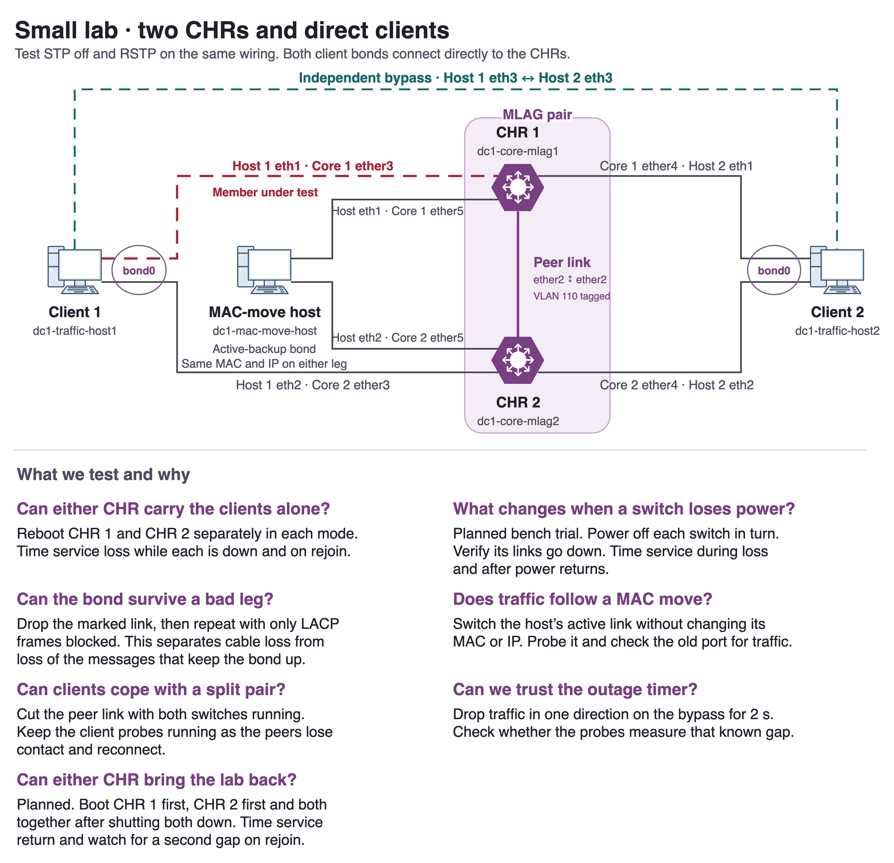

# SMALL-03 Client link loss and return

The drawing can be edited in the [Small lab tab](../diagrams/mlag-scenarios.drawio). The [evidence diagrams](../diagrams/README.md#small-lab-evidence) show the verdict and the packet timeline of this case.

## What this test checks

Client 1 is connected to both MLAG peers, CHR 1 and CHR 2, with one cable to each. The two cables form one bond. MLAG is meant to keep traffic flowing when one of the two cables fails.

This test takes down the cable between client 1 and CHR 1 and brings it back later. It measures how long traffic stops each time.

## Why it is needed

A lost cable is the most common fault of a host that is connected to two switches. Two MikroTik forum threads report problems with this fault. In one of them, traffic was no longer rerouted after a cable outage. Both threads are linked in row L2 of the [list of cases](../case-catalog.md#spanning-tree-and-lacp).

The return of the cable matters as much as its loss. A peer must not send traffic on the cable again before both ends have agreed to use it. Otherwise traffic is lost a second time.

## The test in detail

| | |
| --- | --- |
| Name | The test runner calls this case `carrier`. The case catalogue calls it `bond-member-loss`. |
| Lab | CHR 1 and CHR 2 are the MLAG peers. Client 1 and client 2 each have one cable to each peer, joined into a bond. The MAC-move host is a third Linux host. It has one cable to each peer and uses one of them in this test. A direct cable between client 1 and client 2 bypasses both peers. |
| Before the fault | The test checks that both client bonds carry traffic and that no ping is lost. |
| Fault | The test takes down the cable between client 1 and CHR 1. On CHR 1 this is port `ether3`. The test takes the cable down at both of its ends. The pings keep running. After 8 s the test brings the cable back. |

## What must happen

- After the test takes the cable down or brings it back, both ends of the cable must report the new link state within 0.5 s. If they do not, the fault did not happen as planned. The run then counts as an error and is not judged.
- The three ping streams that use the bond of client 1 may stop for at most **3 s** after the cable goes down, and for at most **3 s** after it comes back. These are stream 101 from client 1 to the MAC-move host, stream 201 in the other direction, and stream 302 from client 1 to client 2.
- The streams that do not use the bond of client 1 must lose no ping. These are streams 102 and 202 between client 2 and the MAC-move host, and streams 301 and 303 on the direct cable between the clients.
- Once the cable is down, CHR 1 must send no more pings for client 1 out of port `ether3`.

## What was measured

Two archived runs on RouterOS 7.26beta7 gave these results.

- After the cable went down, traffic stopped for at most 0.22 s.
- After the cable came back, traffic stopped for **2.18 to 2.52 s**.
- The streams of client 2 and the streams on the direct cable lost no ping.

These two runs were judged against an earlier limit of 1 s. Their saved verdict is therefore a fail for the return of the cable. The measured stop is below the limit of 3 s that the case catalogue sets today.

## How to read the evidence

Open the timeline next to the verdict. Find the first ping that arrives over the cable after it came back. Compare its time with the time at which both ends show the LACP flags collecting and distributing for that cable. A cable can have a link again some time before pings pass over it.

- [Verdict of the first run](../../results/2026-11-24-small-lab/reports/01-carrier/result.json)
- [Timeline of the first run](../../results/2026-11-24-small-lab/reports/01-carrier/timeline.tsv)
- [Verdict of the second run](../../results/2026-11-24-small-lab/reports/02-carrier/result.json)

The [Small lab README](../../labs/small/README.md#deploy) explains how to run this case.
