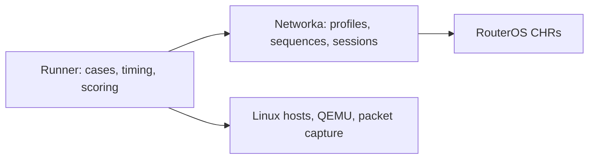

# Plan for making Networka the runner's RouterOS device layer

The runner must not rebuild what Networka already provides. Networka is a Python library as well as a CLI, and its documented entry point is `NetworkaClient`. This plan replaces the runner's own device list, state command lists and SSH code with that client, in three steps with a review after each. Defects and gaps found in Networka on the way are fixed in Networka, not worked around in the runner. [Networka](https://github.com/narrowin/networka) · [Operator guide](../operator-guide.md#collect-a-networka-checkpoint)

## Problem and desired outcome

**Problem.** The runner hand-builds seven jobs that Networka already does, and the lab's device addresses and state commands exist in two places.

**Desired outcome.** Networka makes every RouterOS call in every published run. The Networka profiles and sequences in `labs/networka/` are the only source for device addresses and state reads. The runner keeps orchestration, fault injection, timing and scoring.



## Proof of overlap

Runner paths are in `src/mlag_lab/`. Networka paths are in its `network_toolkit` package, release v0.2.0.

| Job | Runner's own code | Networka already has |
| --- | --- | --- |
| Device names and addresses | `run.py:37`, `direct_topology.py:8`, `root_topology.py:6-8`, `two_pair_topology.py:11` | `NetworkaClient.devices` and `.groups`, loaded from `labs/networka/*.yml` |
| SSH sessions | `run.py:145-151`, `open_ssh` `run.py:192`, `close` `run.py:250`, `sshpass` plus a shared SSH connection | `NetworkaClient` keeps one open session per device and closes them with `close()`, `client.py:25` |
| Credentials | `SSHPASS` environment variable, `run.py:128` | `interactive_creds=InteractiveCredentials(username, password)` on `client.run()` |
| Run one command | `ros()`, `run.py:188` | `client.run(device, command)`, `client.py:82` |
| Run on several switches at once | `ThreadPoolExecutor` around `ros()`, `run.py:272` | `client.run(group, command)` runs the group's devices in parallel |
| State command lists | `run.py:43-52`, `root_run.py:24-33`, `external_run.py:215-218` | Sequences, read through `client.sequence_manager` |
| Fresh login check | `check_logins`, `run.py:208` | A new `NetworkaClient` logs in with the given credentials |
| Host key handling | Per-run known-hosts file, `run.py:149-150` | `no_strict_host_key_checking` on `client.run()` |

All 45 RouterOS call sites go through the single method `ros()`. The duplicated SSH code is about 150 lines. Networka's library docs are in `docs/library/` of its repository: overview, quickstart, sessions and recipes. They say to use `NetworkaClient` and to use `DeviceSession` only to bypass the client's session handling. This plan does not need `DeviceSession`.

**What stays in the runner.** Linux namespace work, QEMU power and link faults, packet capture, probes, timing, evaluation and reports. Case-specific RouterOS commands also stay next to their case: bridge resets, reboot, log markers, `CONFIG`, `UPTIME`, and the extra reads in `PEER_LINK_STATE`, `FLAP_STATE` and `HOST_COUNT`.

## Starting state

Steps 1 and 3 are committed together on the branch `networka-device-layer`, checked offline only. Step 1 added the Medium groups, the pair-root and two-pair profiles, the per-role sequences and `src/mlag_lab/networka.py`, and the runner reads its addresses and base state reads from them. Step 3 sends every RouterOS command through `NetworkaClient` and removes the runner's own SSH code. Step 2 and the live checks of steps 1 and 3 have not run.

Facts checked on 25 November 2026:

- The device addresses in all four profiles equal the runner's hard-coded addresses.
- `NetworkaClient` loads each profile from the runner's own uv environment. `client.devices`, `client.groups` and `client.sequence_manager` return the expected devices, groups and commands.
- One `client.run()` call spends a median of 18 ms, at most 24 ms, on setup before it talks to a device. It rebuilds the sequence manager on every call, `api/run.py:447`.
- Networka's library path is synchronous. Async code exists only in the CLI and the terminal UI. The transport calls scrapli's `send_input` under a lock, `transport/scrapli_sync.py:138-145`, so one session runs one command at a time.
- The session pool holds exactly one session per device, `session_pool.py:52`.
- Step 2 passed on 25 November 2026: a 76 ms median state read (maximum 158 ms), a 151 ms maximum wait for a short command while polling, parsed state equal to plain SSH, and recovery of the same client after a reboot.
- Networka appends `+ct511w4098h` to the RouterOS username, `transport/scrapli_sync.py:35`. That gives a 511-column console without colours, so multi-port monitor output is not wrapped at 80 columns.
- A local Networka checkout exists at `~/git/narrowin/networka`, on branch `codex/networka-0.2`, one commit after v0.2.0. It has one uncommitted file that this plan must not touch.

Baseline of the current SSH code, from a saved Medium power-loss run:

| Measure | Current value |
| --- | --- |
| Healthy state read | Median 83–101 ms, 95th percentile 105–152 ms, maximum 155–177 ms |
| Polling period | Median 351 ms |
| Error samples while the CHR is off | One about every 6 s, at most 8.3 s apart |

## Development loop

Build and test the runner and Networka together on this machine. Publish nothing and change no dependency entry until everything works. The operator approved running this loop directly on 25 November 2026.

**Setup, once.**

1. The runner work lives in the worktree `/Users/md/git/narrowin/mikrotik-mlag-testsuite.worktrees/networka-device-layer`, on the branch `networka-device-layer`. The shared checkout `/Users/md/git/narrowin/mikrotik-mlag-testsuite` belongs to another session; do not change it. The Networka worktree already exists, so the uncommitted file in Networka's main checkout stays untouched:

    ```sh
    export NETWORKA=/Users/md/git/narrowin/networka.worktrees/mlag-device-layer
    ```

2. Run every runner command with `--with-editable "$NETWORKA"`. The runner then imports Networka straight from the worktree. `pyproject.toml` and `uv.lock` stay unchanged. This was verified on macOS against the main checkout:

    ```sh
    uv run --locked --with-editable "$NETWORKA" python -c "import network_toolkit; print(network_toolkit.__file__)"
    ```

    The printed path must be inside `$NETWORKA`.

3. Live checks run in the OrbStack VM `mlag-external`. It is ARM64 Debian with uv, Containerlab and `sshpass` installed, and it sees both checkouts at the same `/Users/md/git/narrowin/` paths. It was stopped and had no lab deployed when checked. `orb -m mlag-external <command>` starts it and runs a command in it. Deploy a lab as [labs/README.md](../../labs/README.md) describes. Inside the VM, run the runner like this:

    ```sh
    export NETWORKA=/Users/md/git/narrowin/networka.worktrees/mlag-device-layer
    export UV_PROJECT_ENVIRONMENT=/var/tmp/mlag-validation-venv
    sudo env "PATH=$PATH:/usr/sbin:/sbin" "UV_PROJECT_ENVIRONMENT=$UV_PROJECT_ENVIRONMENT" \
      uv run --locked --with-editable "$NETWORKA" mlag-lab run --case medium-stp-off-baseline \
      --output "test-results/loop-$(date -u +%Y%m%dT%H%M%SZ)"
    ```

    First repeat the import check from point 2 inside the VM. The lab CHRs keep Containerlab's default login, which the runner uses unless `MLAG_SSH_PASSWORD` is set.

**The loop.**

1. Change code in the runner, in the Networka worktree, or in both.
2. Run Networka's own checks in the worktree, as its `CONTRIBUTING.md` and `Taskfile.yml` require.
3. Run the offline checks of the current step in the runner.
4. Run the live check of the current step in the VM.
5. Read the results. Repeat until every check of the step passes.

## Rules for the implementer

- Use `uv` for every Python command, as [AGENTS.md](../../AGENTS.md) requires.
- Do not add test suites, mocks, fixtures or helper scripts to the runner repository. The inline commands in this plan are run once and not saved.
- Run the loop directly. Do not ask before each run. Live runs use spanning tree off and the campaign RouterOS image only.
- Use MikroTik terms: peer link, MLAG primary, MLAG secondary, bond member.
- Report after each step and continue, unless a check in this plan fails. Commit locally when a step's checks pass, with a body that states why, what changed, verification and known limits.
- Do not push the runner and do not publish Networka before the Finish section. The runner's `main` must always install and run from a clean checkout.
- Do not change `ARCHIVED_EXTERNAL_MANAGEMENT` or `EXTERNAL_NODES` in `external_topology.py`. They replay an archived five-CHR lab.
- Do not publish packet captures.

## Step 1: one source for devices and state reads

The runner reads addresses and base state reads from `labs/networka/`. SSH stays as it is. The commands sent to RouterOS must be byte-identical before and after.

### 1.1 Leave the dependency entry alone

Do not change `pyproject.toml` or `uv.lock` in this step. During the loop, `--with-editable "$NETWORKA"` provides Networka. The dependency entry changes once, in the Finish section.

### 1.2 Replace the sequence file

Each sequence holds exactly the base read the runner sends today for one switch role, in the same order and spelling. Replace `labs/networka/sequences/mikrotik_routeros/common.yml` with:

```yaml
sequences:
  mlag_small_state:
    description: Base state read for a Small lab MLAG peer
    commands:
      - /interface/ethernet/monitor ether3 once
      - /interface/bonding/monitor-slaves bond=client1 once=yes
      - /interface/bonding/monitor-slaves bond=client2 once=yes
      - /interface/bridge/monitor bridge once
      - /interface/bridge/port/monitor [find where bridge=bridge] once
      - /interface/bridge/host/print detail without-paging where mac-address=02:00:00:11:00:11
      - /interface/bridge/host/print detail without-paging where mac-address=02:00:00:11:00:12
      - /interface/bridge/host/print detail without-paging where mac-address=02:00:00:11:00:50
  mlag_direct_state:
    description: Base state read for a Small lab MLAG peer in the reboot and power-loss cases
    commands:
      - /interface ethernet monitor ether2 once
      - /interface ethernet monitor ether3 once
      - /interface ethernet monitor ether4 once
      - /interface ethernet monitor ether5 once
      - /interface bridge monitor bridge once
      - /interface bridge port monitor [find where bridge=bridge] once
      - /interface bridge host print detail without-paging where mac-address=02:00:00:11:00:11
      - /interface bridge host print detail without-paging where mac-address=02:00:00:11:00:12
      - /interface bonding monitor-slaves bond=client1 once=yes
      - /interface bonding monitor-slaves bond=client2 once=yes
  mlag_medium_core_state:
    description: Base state read for a Medium or pair-root MLAG peer
    commands:
      - /interface ethernet monitor ether2 once
      - /interface ethernet monitor ether3 once
      - /interface ethernet monitor ether4 once
      - /interface bridge monitor bridge once
      - /interface bridge port monitor [find where bridge=bridge] once
      - /interface bridge host print detail without-paging where mac-address=02:00:00:11:00:11
      - /interface bridge host print detail without-paging where mac-address=02:00:00:11:00:12
      - /interface bonding monitor-slaves bond=access-uplink once=yes
      - /interface bonding monitor-slaves bond=client2 once=yes
  mlag_medium_access_state:
    description: Base state read for the Medium or pair-root access switch
    commands:
      - /interface ethernet monitor ether2 once
      - /interface ethernet monitor ether3 once
      - /interface ethernet monitor ether4 once
      - /interface bridge monitor bridge once
      - /interface bridge port monitor [find where bridge=bridge] once
      - /interface bridge host print detail without-paging where mac-address=02:00:00:11:00:11
      - /interface bridge host print detail without-paging where mac-address=02:00:00:11:00:12
      - /interface bonding monitor-slaves bond=uplink once=yes
  mlag_two_pair_core_state:
    description: Base state read for a core MLAG peer in the two-pair lab
    commands:
      - /interface ethernet monitor ether2 once
      - /interface ethernet monitor ether3 once
      - /interface ethernet monitor ether4 once
      - /interface bridge monitor bridge once
      - /interface bridge port monitor [find where bridge=bridge] once
      - /interface bridge host print detail without-paging where mac-address=02:00:00:11:00:11
      - /interface bridge host print detail without-paging where mac-address=02:00:00:11:00:12
      - /interface bonding monitor-slaves bond=interpair once=yes
      - /interface bonding monitor-slaves bond=client2 once=yes
  mlag_two_pair_access_state:
    description: Base state read for an access MLAG peer in the two-pair lab
    commands:
      - /interface ethernet monitor ether2 once
      - /interface ethernet monitor ether3 once
      - /interface ethernet monitor ether4 once
      - /interface bridge monitor bridge once
      - /interface bridge port monitor [find where bridge=bridge] once
      - /interface bridge host print detail without-paging where mac-address=02:00:00:11:00:11
      - /interface bridge host print detail without-paging where mac-address=02:00:00:11:00:12
      - /interface bonding monitor-slaves bond=interpair once=yes
      - /interface bonding monitor-slaves bond=client1 once=yes
```

Identity and resource reads leave the lab sequences. Operators get them from Networka's built-in `system_info` sequence.

### 1.3 Add one small loader module

Create `src/mlag_lab/networka.py`. It uses only `NetworkaClient`. Keep it this small:

```python
"""Device addresses and base state reads from the lab's Networka profiles."""

from functools import cache
from pathlib import Path

from network_toolkit import NetworkaClient

PROFILES = Path(__file__).resolve().parents[2] / "labs" / "networka"


@cache
def profile(name):
    return NetworkaClient(PROFILES / f"{name}.yml")


def addresses(name, devices):
    """Management address per runner node, from the device names in the given profile."""
    hosts = profile(name).devices
    return {node: hosts[device].host for node, device in devices.items()}


@cache
def reads(sequence):
    """The RouterOS commands of one lab sequence, in file order."""
    sequences = profile("small").sequence_manager.list_vendor_sequences("mikrotik_routeros")
    return tuple(sequences[sequence].commands)
```

These clients only read the profiles. They never connect.

### 1.4 Prove equality before deleting anything

With 1.2 and 1.3 in place and the old constants still present, run this once. Every line must print `True`. Do not continue otherwise.

```sh
uv run --locked --with-editable "$NETWORKA" python - <<'EOF'
from mlag_lab.networka import addresses, reads
from mlag_lab.direct_topology import DIRECT_NODES
from mlag_lab.root_topology import MEDIUM_NODES, ROOT_NODES
from mlag_lab.two_pair_topology import TWO_PAIR_NODES
from mlag_lab.root_run import STATE as ROOT_STATE
from mlag_lab.run import PEERS, STATE

core = {"p1": "dc1-core-mlag1", "p2": "dc1-core-mlag2"}
access = {"witness": "dc1-access-switch1"}
pair = {"q1": "dc1-access-mlag1", "q2": "dc1-access-mlag2"}
print(addresses("small", core) == PEERS == DIRECT_NODES)
print(addresses("medium-pair-root", core | access) == ROOT_NODES)
print(addresses("medium", core | access) == MEDIUM_NODES)
print(addresses("medium-two-pair", core | pair) == TWO_PAIR_NODES)

def old(ports, bonds):
    return (*(f"/interface ethernet monitor ether{port} once" for port in ports), *ROOT_STATE[4:],
            *(f"/interface bonding monitor-slaves bond={bond} once=yes" for bond in bonds))

print(";".join(reads("mlag_small_state")) == STATE)
print(reads("mlag_direct_state") == old((2, 3, 4, 5), ("client1", "client2")))
print(reads("mlag_medium_core_state") == old((2, 3, 4), ("access-uplink", "client2")))
print(reads("mlag_medium_access_state") == old((2, 3, 4), ("uplink",)))
print(reads("mlag_two_pair_core_state") == old((2, 3, 4), ("interpair", "client2")))
print(reads("mlag_two_pair_access_state") == old((2, 3, 4), ("interpair", "client1")))
EOF
```

### 1.5 Swap the definitions

Keep every constant name, so no use site changes. Write each device name once per lab.

| Constant | File | Profile | Nodes |
| --- | --- | --- | --- |
| `PEERS` | `run.py:37` | `small` | `p1`, `p2` |
| `DIRECT_NODES` | `direct_topology.py:8` | `small` | `p1`, `p2` |
| `ROOT_NODES` | `root_topology.py:6` | `medium-pair-root` | `p1`, `p2`, `witness` |
| `MEDIUM_NODES` | `root_topology.py:8` | `medium` | `p1`, `p2`, `witness` |
| `TWO_PAIR_NODES` | `two_pair_topology.py:11` | `medium-two-pair` | `p1`, `p2`, `q1`, `q2` |

One more literal copy exists. `evidence.py:164` compares syslog sources with both Small lab addresses. Replace the literal set with `set(DIRECT_NODES.values())`, imported from `direct_topology`. Do not import from `run.py` there; `run.py` imports `evidence.py`.

State lists:

- `run.py:43-52`: `STATE = ";".join(reads("mlag_small_state"))`. `PEER_LINK_STATE` and `FLAP_STATE` stay as they are.
- `external_run.py:215`: change `observe_ports(lab, peer, ports, bonds, extra=())` to `observe_ports(lab, peer, sequence, extra=())`. It sends `";".join((UPTIME, *reads(sequence), *extra))`.
- Callers pass the sequence. `MediumLab.read_router` and `RootLab.read_router` use `mlag_medium_access_state` for `witness` and `mlag_medium_core_state` otherwise. `DirectLab.read_router` uses `mlag_direct_state`. `TwoPairLab.read_router` uses `mlag_two_pair_core_state` for `p1` and `p2` and `mlag_two_pair_access_state` for `q1` and `q2`, and keeps `HOST_COUNT` as `extra`.
- Delete `STATE` in `root_run.py:24-33` and its import in `external_run.py:21`.

### 1.6 Archive the Networka files with each run

In `run.py:822`, add the lab's profile, `labs/networka/<topology_name>.yml`, and `common.yml` to `inputs`. Then restore this sentence in `labs/README.md`: "The runner copies these files into each run's `inputs/` folder and records their SHA-256."

### 1.7 Update the operator guide

Update the profile table and the sequence description in `docs/operator-guide.md`. Add `mlag_direct_state`. State that identity and resource come from `system_info`. Say that the OrbStack verification covered the earlier eight-command list.

### Step 1 is done when

- The check in 1.4 printed ten `True` lines before the swap.
- `uv run --locked --with-editable "$NETWORKA" python -c "import mlag_lab.run, mlag_lab.external_run, mlag_lab.root_run, mlag_lab.two_pair_run, mlag_lab.evaluate, mlag_lab.external_evaluate, mlag_lab.two_pair_evaluate"` exits 0.
- `grep -rn "172.30.21[5689]" src/mlag_lab` returns nothing.
- `npx --yes markdownlint-cli2@0.24.2` reports 0 issues.
- In the lab VM, one baseline case passes on the Small lab, the Medium lab, and the pair-root and two-pair variants, and each run's `inputs/` folder contains the profile and `common.yml`.

## Step 2: measure Networka at the runner's polling rate

This step changes no file. It decides how step 3 is built. Run it in the lab VM with the Small lab deployed.

One console session runs one command at a time. The runner polls each CHR every 0.35 s and also sends case commands to the same CHR, for example the reboot command at `root_run.py:162` and the carrier checks at `root_run.py:222`. Today each command is its own SSH call, so they overlap freely. Through one Networka session, a case command waits while a poll is in flight. This step measures that wait.

```sh
uv run --locked --with-editable "$NETWORKA" python - <<'EOF'
import os, statistics, subprocess, threading, time
from network_toolkit import InteractiveCredentials, NetworkaClient
from mlag_lab.networka import PROFILES
from mlag_lab.root_state import router_members, router_state
from mlag_lab.run import PEERS, STATE

DEVICE = "dc1-core-mlag1"
password = os.environ.get("MLAG_SSH_PASSWORD", "admin")
creds = InteractiveCredentials("admin", password)

def timed(client, command):
    start = time.monotonic()
    result = client.run(DEVICE, command, interactive_creds=creds,
                        no_strict_host_key_checking=True).command_results[0]
    return (time.monotonic() - start) * 1000, result

def show(label, times):
    print(label, "median ms", round(statistics.median(times)), "max ms", round(max(times)))

def plain(command):
    return subprocess.run(
        ["sshpass", "-e", "ssh", "-o", "StrictHostKeyChecking=no", "-o", "UserKnownHostsFile=/dev/null",
         f"admin@{PEERS['p1']}", command],
        capture_output=True, text=True, env={**os.environ, "SSHPASS": password})

with NetworkaClient(PROFILES / "small.yml") as client:
    timed(client, STATE)
    show("state read", [timed(client, STATE)[0] for _ in range(100)])
    show("short command alone", [timed(client, ":put ok")[0] for _ in range(100)])
    stop = threading.Event()
    def poll():
        while not stop.is_set():
            spent = timed(client, STATE)[0] / 1000
            stop.wait(max(0.0, 0.35 - spent))
    poller = threading.Thread(target=poll)
    poller.start()
    waits = []
    for _ in range(100):
        waits.append(timed(client, ":put ok")[0])
        time.sleep(0.13)
    stop.set()
    poller.join()
    show("short command while polling", waits)
    raw = timed(client, STATE)[1].output
    bad = timed(client, "/interface bogus")[1]

reference = plain(STATE).stdout
print("bridge and ports equal", router_state(raw) == router_state(reference))
print("bond members equal", router_members(raw) == router_members(reference))
print("bad command through Networka: error", bad.error, "output", bad.output)
wrong = plain("/interface bogus")
print("bad command through plain SSH: exit", wrong.returncode, "output", wrong.stdout.strip())
EOF
```

Then run the state read in a loop for 120 s while the MLAG secondary reboots. Record how far apart the failed reads are and whether reads recover without a new client.

| Check | Pass | If it fails |
| --- | --- | --- |
| Healthy state read | Median at most 150 ms and maximum at most 300 ms | Stop and report |
| Parsed bridge, port and bond member state | Equal to the plain SSH read | Stop and report |
| Short command while polling | Maximum at most 300 ms. The operator accepted up to about 0.2 s | Stop and report. Several sessions per switch then become necessary |
| Bad command | Networka reports an error | N3 is required before step 3 |
| During a reboot | Failed reads return within 8 s each, and reads recover on the next call with the same client | N4 is required before step 3 |

Report all numbers. Do not tune the runner around a failed check.

## Networka improvements

Improving Networka is part of this work. Make these changes in the Networka worktree, following that repository's `CLAUDE.md` and `CONTRIBUTING.md`. Test each one through the development loop. Paths are below `src/network_toolkit/`.

| ID | Finding in v0.2.0 | Where | Required behaviour | Evidence |
| --- | --- | --- | --- | --- |
| N1 | A group run exits 0 when devices failed | `commands/run.py`, both group branches, near line 441 and at the end of the command branch | Exit 1 when `totals.failed` is above 0 | Read in code |
| N2 | A failed sequence loses the outputs collected so far | `api/run.py`, the sequence run | The device's sequence result carries an error when any command failed, and keeps the outputs collected so far. `DeviceSession.execute_commands` in `device.py` is used only by tests | Read in code |
| N3 | RouterOS error replies count as success. Scrapli's RouterOS definition has no failure patterns | `transport/scrapli_sync.py:138-155`, `send_command` | For RouterOS, mark the result failed when the reply starts with a RouterOS error such as `syntax error`, `bad command name`, `expected end of command`, `input does not match any value`, `failure:` or `no such item` | Read in code. Step 2 confirms the strings |
| N4 | A pooled session that dies after it connected is never replaced. The retry wraps only `connect()`, and `connect()` returns at once when the session is flagged connected | `api/run.py:236-272`, `device.py:126` | When a command fails because the transport is gone, drop and disconnect the session; the next call opens a new one. The failed command is not retried: Networka commit 48da724 removed that retry after it sent one command twice | Read in code. Step 2 confirms with a reboot |
| N5 | No option for a known-hosts file. Scrapli has `known_hosts_path`, `scrapli/transport.py:138`, and Networka does not set it | `transport/scrapli_sync.py:44-48`, `config.py:164` | A `general.ssh_known_hosts_file` setting that Networka passes to scrapli | Read in code |
| N6 | `client.run()` rebuilds the sequence manager on every call | `api/run.py:447`, `client.py:82` | The client passes its cached sequence manager to the run | Measured: 18 ms median per call |
| N7 | Containerlab writes platform `mikrotik_chr` for CHR nodes. Networka's platform map knows `mikrotik_ros` only, so CHR nodes from a Containerlab inventory get no RouterOS driver or sequences | `inventory/nornir_simple.py:576-583`, `_map_platform` | Map `mikrotik_chr` to `mikrotik_routeros` | Observed: `nw --inventory labs/small/clab-mlag-small … list devices` shows type `mikrotik_chr` |
| N8 | The name-clash errors tell the user to use `--prefer`, but the option is `--inventory-prefer`. The docs describe a `merge_mode` setting that no code reads | `config.py:1620`, `config.py:1643`, `docs/nornir-inventory.md:20-31,77-82`, `docs/configuration.md:47` | Name the real option in both messages and remove `merge_mode` from the docs | Read in code |

N1 to N8 are worth doing whatever step 2 shows. N7 and N8 make Networka's existing Containerlab inventory support usable for CHR labs from the `nw` command line.

Networka keeps one session per device, `session_pool.py:52`, so a case command waits while a state read is in flight. The cost is small. A Medium power-loss case polls each CHR 189 times and sends about 16 case commands while polling runs. A state read is in flight about a quarter of the time, so about four of those commands wait, on average half a read. That adds up to about 0.2 s over a 70 s case. Loss is measured from packets, and every state sample keeps its own timestamps, so the wait does not change a result. The operator accepted this wait on 25 November 2026.

## Step 3: Networka runs every RouterOS command

Start after step 2 was reported and the Networka changes it requires pass in the loop.

- `Lab.__init__`, `run.py:125`: create one `NetworkaClient` for the lab's profile and one `InteractiveCredentials(username, password)`. Keep the `--username` option and `MLAG_SSH_PASSWORD`.
- `ros()`, `run.py:188`: call `client.run(device, command, interactive_creds=…)`, take `command_results[0]`, raise `RuntimeError` when it has an error, and return its output. Also raise `RuntimeError` for every `NetworkToolkitError`, so the existing `except (RuntimeError, subprocess.SubprocessError)` handlers keep working.
- Use one session per CHR, shared by polling and case commands. A case command can then wait for one state read, which the operator accepted. Do not open a second client in the runner.
- `poll_peer`, `run.py:379`, and each `read_router`: keep sending the joined command line as one command, so one sample is one round trip. Keep one polling thread per CHR. Do not poll a group in one call; a dead CHR would then delay the samples of the healthy ones. Keep `started_ns` and `done_ns` in the runner.
- Use group runs for reads that are not timed: `versions()` at `run.py:309` and the `CONFIG` capture at `run.py:656`.
- `check_logins`, `run.py:208`: open a new `NetworkaClient`, send `:put login-ok`, and close it.
- `close()`, `run.py:250`: call `client.close()`.
- `observe_router`, `root_run.py:55`: delete the branch that closes the SSH connection after an error. N4 drops a dead session, so the read recovers on the next call with the same client.
- Host keys: the runner turns strict host key checking off, because Networka records no keys in that mode. Live runs already check each RouterOS peer's address against `docker inspect`.
- Delete the SSH argument list at `run.py:145-151`, `open_ssh`, the `SSHPASS` environment at `run.py:128`, and `sshpass` from `HOST_TOOLS` at `run.py:41`. Keep `ssh`; Networka's system transport uses it.
- Remove `sshpass` from `.devcontainer/Dockerfile:7` and from the prerequisites in `docs/operator-guide.md:23` and `docs/test-framework.md:27`.
- Set `timeout: 3`, `connection_retries: 1` and `command_timeout: 5` in the four profiles, to match today's 3 s connect timeout and 5 s stall limit.

### Step 3 is done when

- `grep -rn "sshpass\|ControlPath\|\"-S\"" src/mlag_lab` returns nothing.
- `grep -rn "DeviceSession\|SessionPool\|load_config" src/mlag_lab` returns nothing. The runner uses only `NetworkaClient` and `InteractiveCredentials`.
- In the lab VM, a baseline, a reboot and a power-loss case run on the Small and Medium labs with spanning tree off, and a baseline case runs on the pair-root and two-pair variants. The Large lab has no topology yet, so it cannot be run.
- In those runs the polling period median is 351 ms within 10 ms, healthy reads show no errors, and each verdict matches the last published run of the same case.

## Finish: publish and pin

Do this only when steps 1 to 3 and the Networka changes pass every check in the loop.

1. **Networka.** Commit the worktree branch and hand it to the operator for review. The operator publishes the new version: pushing a `v*` tag makes Networka's release workflow build the files and publish them to GitHub and PyPI.
2. **Runner dependency.** In `pyproject.toml`, move `networka` from the `checkpoints` extra into `dependencies`, delete `[project.optional-dependencies]`, and point `[tool.uv.sources]` at the new release file. Run `uv lock`.
3. **Runner docs.** Remove `--extra checkpoints` from the seven commands in `docs/operator-guide.md` and `docs/reference/measurement.md`, and remove the two v0.2.0 warnings from `docs/operator-guide.md`.
4. **Final check without the worktree.** In the lab VM, run `uv sync --locked` and one baseline case without `--with-editable`. It must pass from the published version alone.
5. Commit and push the runner.

## Decision and scores

**Classification:** Two-way door for each step. Git reverts the code in both repositories, and nothing is published before the Finish section.

ICE is Impact × Confidence × Ease, each from 1 to 10.

| Work | Impact | Confidence | Ease | ICE |
| --- | ---: | ---: | ---: | ---: |
| Step 1 | 8: removes both duplicates and makes the Networka files real run inputs | 9: addresses and commands compared by script, client calls run in the runner's environment | 8: one small module and five definitions, no SSH change | 576 |
| N1 to N8 | 8: Networka stops reporting success on failure and recovers dead sessions, for every user | 8: each finding is located at an exact line, N6 is measured | 7: eight small changes in one repository | 448 |
| Step 3 | 9: every RouterOS call in every published run goes through Networka | 6: client, session reuse and per-call setup verified, speed and reconnect on a live CHR not yet measured | 6: one method on top of `NetworkaClient`, 45 call sites unchanged | 324 |

Step 3 is limited by Confidence until step 2 has run. A passing step 2 raises it to 8 and the score to 432.

**Recommendation:** Set up the loop, then do step 1, step 2, N1 to N8 with whatever step 2 adds, step 3, and the Finish section.

Decided on 25 November 2026: the work runs in a direct development loop, Networka becomes a required dependency at the end, and a wait of up to about 0.2 s for a case command is accepted.

## Not in this plan

- **Several sessions per switch in Networka.** It would save about 0.2 s per case. Build it only if step 2 measures a wait above 300 ms. Scrapli's `extra_open_args` could then let the extra sessions share one SSH connection.
- **Containerlab inventory as the runner's address source.** Researched on 25 November 2026 and rejected. The generated inventory exists only after a deploy and git ignores it, but offline evaluation needs committed addresses. Medium and pair-root also share one deploy folder with different subnets, so a stale file would give wrong addresses. The committed profiles stay the source, and a live run already checks each RouterOS peer address against `docker inspect`.
- **An inventory argument on `NetworkaClient`.** Nothing needs it while the runner keeps the committed profiles.
- **An async library client for Networka.** The library path is synchronous today. The runner does not need an async client.
