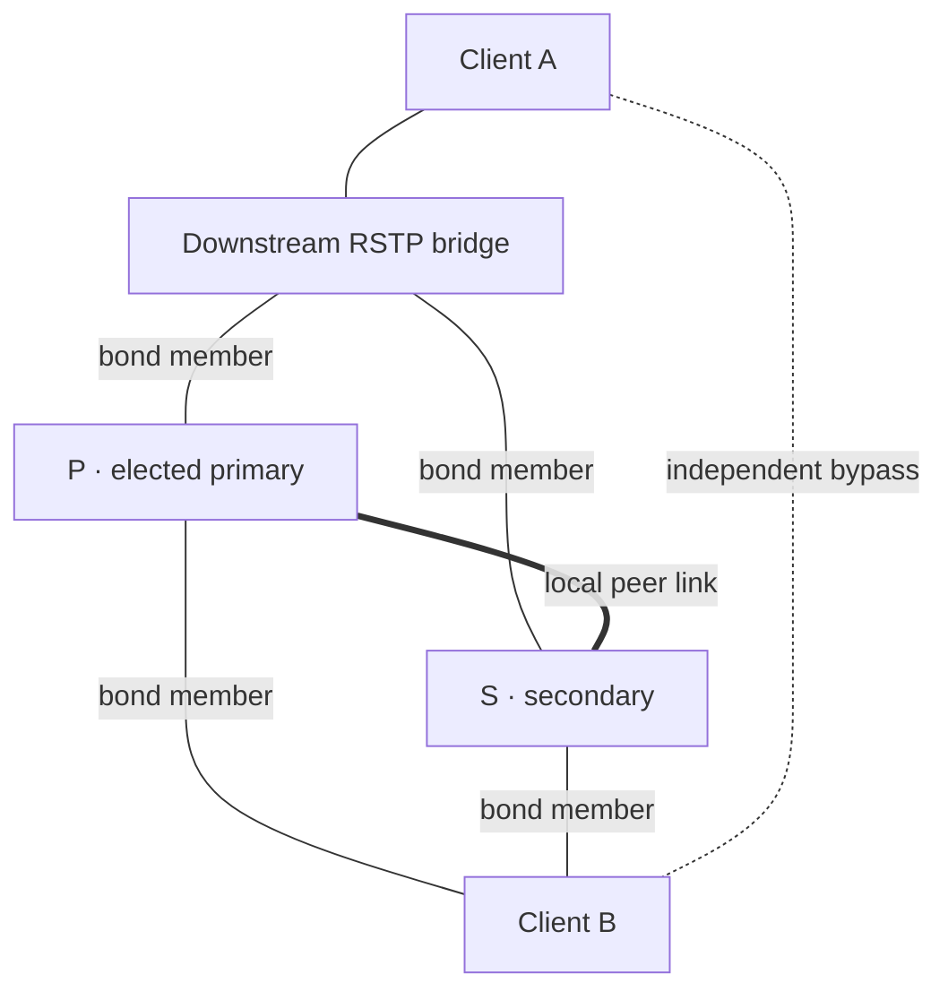

# Plan for testing loss and return of the MLAG primary while the pair is the STP root

Run this plan on the **latest RouterOS development build only**, currently **7.26beta7**. Pin one version and image digest for the full campaign, including the calibration, both reboot roles, repeats and follow-ups. [Version policy](../validation-plan.md#routeros-version-for-live-tests) · [Root reboot case](../cases/medium-core-reboot.md) · [Plain-language results and archived evidence](../../results/2026-11-24-medium-lab-pair-root/README.md)

## Problem and desired outcome

When the primary core rebooted while its MLAG pair was the spanning-tree root, clients lost service for about 12 seconds. They lost service again when the core returned. Rebooting the other core caused a much shorter interruption. We want to establish whether the asymmetry persists on current RouterOS, whether the surviving peer assumes forwarding responsibility, and which transition accounts for the missing packets in each direction.

A successful experiment lets a second engineer replay the evidence and answer three questions. Which clients lost how much traffic? Which surviving port was still discarding or ineligible to forward, and for how long? Had the MLAG role, advertised root, LACP membership and MAC egress already converged at that point? The experiment can succeed while the network fails its service target.

## Recovered tests and their limits

| Whole device rebooted | Interruption on failure | Interruption on return | Evidence from the original run |
| --- | ---: | ---: | --- |
| Site A core 1 | 12 s | 12 s | The report identifies this chassis as MLAG master and STP root. The working note says “due to spanning tree limbo.” |
| Site A core 2 | 1–2 s | 1–2 s | The working note attributes this shorter interruption to MLAG bonding. This is the closest historical control. |
| Site B core 1 | 1–2 s | 1–2 s | Recorded separately. The working note attributes this interval to spanning tree. |
| Site B core 2 | 1–2 s | 1–2 s | Same recorded interval and attribution as Site B core 1. |

The two records agree on all four timings. The original checks covered local VLAN reachability, tunnels and end-to-end service. The available timing entries do not identify the individual flow, sampling cadence, blocked interface or exact port-state transition. The working note also mentions an edge-port setting as a setup task. Treat the effective port configuration at the time as unknown. 

On current RouterOS, a connected pair uses a shared system ID for the RSTP bridge ID and the LACP system ID. When the pair is elected root, **both peers report themselves as root**. The MLAG active role distinguishes primary from secondary. MikroTik also documents LACP identity changes at primary loss under the default fallback behavior, and a bond initialization delay at rejoin. Each can interrupt traffic. Record the literal roles and IDs that this build exposes while the peer is absent. A survivor forwarding as root and a survivor explicitly reporting promotion are separate observations. [MikroTik MLAG overview and monitoring](https://manual.mikrotik.com/docs/high-availability-solutions/multi-chassis-link-aggregation-group/)

## What to keep from the existing lab

| Existing building block | What it proves or provides | Gap for this experiment |
| --- | --- | --- |
| OrbStack Linux VM, two CHRs, distributed Linux endpoints and independent bypass | One topology already exercises seven sequence-numbered probe streams at roughly 100 ms cadence. Known two-second one-way cuts validate the measured loss bounds. | The client bonds are configured as edge ports. The topology lacks a downstream bridge participating in RSTP on a switch-facing uplink. |
| Management UDP syslog on port 1514, persistent SSH sampling and native RouterOS monitors | A management-side log survives a data-path interruption. The collector has captured guest carrier, LACP flags, bridge state and FDB entries. | Add per-port observations at the downstream bridge. Keep collecting on independent nodes across the target’s reboot and accommodate its expected absence. |
| Packet captures, TShark, offline evaluator, JSON and JUnit | The latest archived suite has eight case executions, two passes and six network assertion failures. It contains 112 captures. The calibration passed twice. | The evaluator currently reads ICMP, ARP and LACP. Its display filter omits BPDUs. It infers the case from the directory name, and its completeness checks assume two available peers. |

The existing `carrier` case produced a 2.18–2.52 s interruption on restoration. That test changes one member and leaves both chassis alive. Keep it as a comparison with its own case ID. Keep the one-shot Networka and NUTS checks for inventory and steady-state validation. The continuous probes, captures and state samples already supply the timing instruments. [Operator guide](../operator-guide.md) · [Existing cases and archive results](../test-framework.md#verified-on-orbstack) · [Evaluator](../../src/mlag_lab/evaluate.py) · [RouterOS startup configuration](../../labs/small/small.rsc)

## Design decision

**Classification — Two-way door.** Either topology can be deployed independently. **Problem —** The historical records name the failed chassis but leave the affected port unidentified. **Desired outcome —** Place an independent observer where it can measure root advertisements, port state and surviving traffic throughout the reboot.

| Option | Impact | Confidence | Ease | ICE |
| --- | --- | --- | --- | ---: |
| Root pair plus one downstream RSTP bridge | 9 — directly exposes the fault and the surviving path | 8 — the recovered note identifies the trigger and control, and the small suite already measures distributed loss | 8 — reuse both CHRs, the endpoints and the collector, adding one observable bridge | 576 |
| Rebuild the four-core Site A/Site B design first | 9 — also captures dependencies on the remote site | 6 — the drawing and reboot results exist, but the port and effective settings involved in the 12 s pause remain unidentified | 4 — requires wiring and validating both pairs and the DCI before interpreting the first outage | 216 |

**Recommendation —** Start with the root pair and witness. It makes both protocol explanations observable in the same run with fewer independent state changes. Preserve the original four-core design for the comparison that needs its inter-site links.

## Smallest experiment that can answer the question

Put A behind a third, observable bridge speaking RSTP. Give the bridge one logical 802.3ad uplink with one member on each core. B is dual-attached on the opposite side of the measured path. A-to-B and B-to-A continue to have a physical path through S while P is down. Use a non-edge bridge-facing bond on each peer, matching STP settings on both, and ordinary host-facing settings on endpoint ports. Record both the logical bridge port and its physical LACP members. This design preserves the bond seen in the historical design and exposes its STP state. A reduced experiment with two independent non-edge uplinks can subsequently expose a designated/alternate transition. It has a different expected port map and gets a separate case. [Current topology](../../labs/small/small.clab.yml)

## Implementation sequence and acceptance gates

| Order | Problem to solve | Work for Sol | Verify before advancing |
| --- | --- | --- | --- |
| 1. Establish replay parity | The evaluator mixes capture I/O, time arithmetic, verdicts and report writing. A cleanup could change historical conclusions. | Extract the archived suite to a fresh directory. Give the lab a `uv` project entry point. Separate evidence reading, named case checks, shared flow measurements and report output. Keep the four established case IDs and use an explicit case ID for new evidence. | Replay as an ordinary user. The eight result files, eight timelines and two suite reports match the archive byte-for-byte. An unknown case or missing original capture manifest is an evidence error. Preserve the archive and the pre-refactor reference outputs. |
| 2. Establish a trustworthy root baseline | Either chassis can win MLAG primary election. A configured priority or a node named “p1” does not prove who won or which root the neighbor sees. | Deploy the reduced topology on a dedicated lab instance. Set equal STP configuration on the pair, prefer it over the access switch as root, and make the intended primary deterministic by MLAG election priority. Start collection before any fault. | Both peers show the same root ID, root status and complementary MLAG roles. The access switch receives BPDUs for that root. Each live bond has the expected collecting/distributing members, data flows both ways, and both bypass directions are clean. Run a two-second one-way cut on the bypass and verify its bounds before the reboot series. |
| 3. Reboot the secondary as the control | A guest reboot can itself disturb LACP, virtual carrier, collectors or traffic. | Reboot the observed secondary through RouterOS. Mark request, observed loss, boot and rejoin. Prove the reboot with guest uptime or boot identity after return and independent peer-side observations. Keep every probe running. | Primary identity and the forwarding path are accounted for throughout. Report the failure and restoration intervals even if zero. Check capture continuity, re-established peer state and stable traffic before the next case. |
| 4. Reboot the primary while the pair is root | This is the historical fault. We need the role takeover and any downstream block on departure **and** return. | Run the same procedure against the observed primary with identical wiring, timers, build and probe placement. Record the survivor’s MLAG role, root advertisements and eligible forwarding path while the former primary is absent. On return, record who actually wins the election. | Produce a per-flow loss table and a per-port timeline for both phases. Demonstrate whether service resumed while the original primary was still absent. Repeat the control and primary runs from the same verified starting roles at least twice each. Preserve every attempt and its raw evidence. |
| 5. Isolate the cause | BPDU convergence, bond renegotiation and FDB changes can all occur during the same outage. | Follow the decision table below. If boot returns before isolated recovery can be observed, perform a separate sustained chassis-stop case on a disposable instance, keeping the survivor and its witness up, then restore it. | Identify the first transition that made each lost direction usable, or name the unresolved alternatives and missing observation. Record both endpoint carrier observations. Guest reboot, hard stop, a member withdrawal and a peer-link partition each retain their own case identity. |
| 6. Make the result usable in CI | A single good result, an empty suite or a broken collector can all produce misleading summaries. | Add the new case, control, topology diagram, provenance, commands and verdict semantics to the README, case catalogue and operator guide. Provide a fresh run directory, immutable raw inputs, per-attempt manifests and machine-readable output. | A second operator can deploy, select the case, interpret the affected directions, replay it offline, and recover its artifacts from a failed CI job. Repeats start only after roles, bonds, traffic and collectors recover. Reports account for every scheduled or skipped case. |

Use `uv` for all Python entry points, including examples and CI. The proposed operator interface is `uv run mlag-lab run` and `uv run mlag-lab evaluate`. Typer supplies typed case selection, validation and help across the two commands. Rich can render the interactive verdict table if it makes the rows easier to read. All calculations and JSON/JUnit writers should work without a terminal. Resolve current tools and the latest development CHR image for a new campaign, then record the resolved versions, image digest, timers and effective config for every repeat. [uv project synchronization](https://docs.astral.sh/uv/concepts/projects/sync/) · [Existing operator workflow](../test-framework.md)

## What must be on one timeline

| Evidence source | Required observation |
| --- | --- |
| Actuator and host | Timestamp fault request, first independent confirmation of chassis loss, boot and first peer rejoin. Record actual carrier at both accessible ends. A stopped QEMU guest can leave an adjacent Linux link up. Report that as carrier-up peer loss. Keep captures on the survivor, access switch or host so their lifetimes span the reboot. |
| MLAG and spanning tree | On both CHRs before the fault and throughout on each reachable device, record active role, peer state, bridge/root IDs, root port and topology changes. On the access switch and survivor collect per-port role, learning and forwarding. Decode BPDUs per leg with transmitting bridge ID, advertised root, port ID, flags and timers. A root ID can stay the same while a forwarding port goes through discarding. |
| LACP and forwarding database | Capture both members’ LACPDUs and monitor actor/partner system IDs, synchronization, collecting and distributing. Record where the observed source and destination MACs are learned for the test VLAN, and the actual egress for missing request/reply sequences. Capture peer-link ICCP activity separately from user traffic. |
| Endpoint traffic | Use identifiable continuous traffic in both directions and a simultaneous independent control. Match request and reply at both endpoints and each candidate egress. Report first miss, last miss, first success, stable delivery, duplicates, unexpected egress and the affected client. Define stable recovery as ten consecutive on-time successes, retaining the timestamp of the first. |
| Logs and timing quality | Keep the existing permanent management-plane UDP syslog receiver and supported bridge, STP and interface debug topics. Record receiver arrival time, poll start/end, observed cadence and any capture drops. Use one host clock for monotonic durations and UTC correlation. A poll brackets a transition between samples. A silent UDP log provides no timing bound. [Verified debug topics and receiver](../syslog/README.md) |

For each contiguous outage give the lower bound from the first to last missed transmitted probes and the upper bound between the surrounding good probes. Preserve a gap spanning rejoin as one outage and show its overlap with each phase. If recovery never occurs before observation ends, report a lower bound and the open interval. Report timing uncertainty when testing a threshold. Apply the existing provisional **5 s per phase** chassis service target for the fast-LACP configuration and flag a threshold-straddling result as inconclusive for that target. The historical 12 s is a comparison point. It is neither a required duration nor an IEEE timing guarantee. [Lab acceptance criteria](../validation-plan.md)

## How to interpret the evidence

| Observation | Conclusion to record | Next comparison |
| --- | --- | --- |
| The access switch or survivor shows the required live port discarding, and forwarding resumes when that port transitions to forwarding. LACP and the FDB already permit delivery. | Name the device and logical port, its old and new roles, and bounds on the blocking interval. The normal alternate discarding on a two-path topology is expected. | Repeat the primary and secondary cases with the same roles, root and timers. If the historical pattern needs two independent logical links, run that variant explicitly. |
| The required bridge ports forward, but the survivor changes LACP identity and the partner withdraws collecting/distributing until service returns. | Attribute the observed interval to bond renegotiation where packet and state evidence agree. | On builds supporting it, change only `mlag-lacp-fallback` for a paired run. For a return-only issue, separately inspect the configured `mlag-init-delay`. |
| RSTP and LACP have recovered, but matching unicasts still leave on the former path. | Record the first and last misdirected sequences, egress, MAC and VLAN. Compare with the FDB on the survivor. | Repeat with the destination attached to the opposite surviving path, preserving the same root. |
| The control also loses traffic, or the only observer goes offline with the target. | Data or timing is inconclusive for the affected assertion. Keep the evidence and repair collection. | Recalibrate before repeating on the same build. Expected loss of sessions to the rebooted peer is recorded separately. |
| The reduced topology stays healthy across repeats. | This build and wiring did not reproduce the historical symptom. Report measured bounds and roles for both reboots. | Reconstruct the original four-core Site A/Site B wiring, logical bundles, effective edge settings and root placement from the original design. Repeat the four recorded reboots individually. |

For CI, exit `0` for a complete passing selection, `1` for valid evidence of a network failure and `2` for an infrastructure fault or incomplete evidence needed for the verdict. Keep a well-observed service-target failure even if the precise protocol cause remains undetermined. CHR results establish software forwarding and the observed virtual link semantics. Physical loss-of-signal propagation and switch-chip behavior require a hardware run.

## Scope after the first result

Once the reduced replay is interpretable, use the four-core site-local MLAG pairs to compare the two-member and four-member DCI and to repeat individual core loss, DCI loss and whole-site loss. Then add the separate distribution MLAG tier and first-hop routers with VRRP. Keep local and remote clients so an outage at one site can be distinguished from loss of a stretched service. Each stage changes one topology variable per comparison and reuses the same evidence format. [Two-site design and wiring variants](two-site-design.md) · [Case catalogue](../case-catalog.md)
