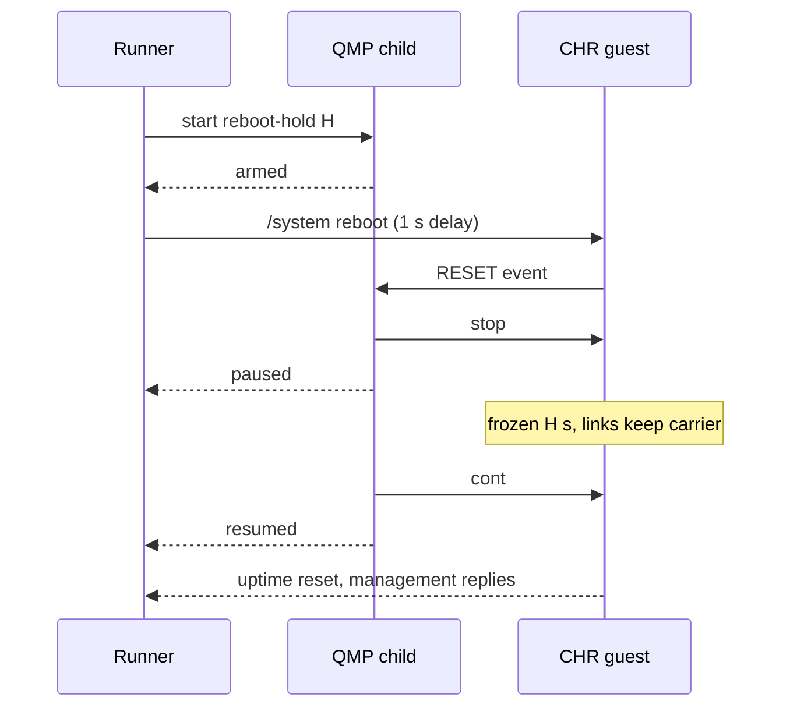

# Plan for holding a rebooted switch away before it boots

The reboot cases reboot a CHR with `/system reboot`. The CHR is back long before a physical switch would be. This plan adds an option that keeps the rebooted guest paused in QEMU for a fixed time after its reset, so it stays away well past the MLAG heartbeat timeout. The option is off by default. The power-loss cases stay as they are. [Reboot fault](../../src/mlag_lab/root_run.py) · [QMP helper](../../src/mlag_lab/qmp.py) · [Networka device-layer plan](networka-device-layer-plan.md)

## Problem and desired outcome

**Problem.** A rebooted CHR is away for about 15 s, which is right at the MLAG heartbeat timeout, so the survivor sees the timeout only at the edge or not at all.

**Desired outcome.** With the option on, a rebooted MLAG peer stays away about 35 s, well past the heartbeat timeout, while its links keep carrier as in a real reboot. With the option off, every reboot run behaves and scores as today.

Measured facts:

- `mlag-heartbeat=5s` on every lab. MLAG reports missed heartbeats after three intervals, 15 s (`src/mlag_lab/run.py:60-61`). The baseline gate requires it (`src/mlag_lab/external_evaluate.py:66-67`).
- The operator measured a CHR back 14.7 to 15.3 s after `/system reboot`. The saved management-ping absences are a little longer, because they start at the first missed probe and end at the first reply:

| Lab, STP off | Saved suite | Guest away | Worst loss per phase |
| --- | --- | --- | --- |
| Small, reboot | `results/2026-11-24-small-search/none-default-reboot` | 15.34–15.42 s | withdrawal 2.93 s, restoration 0.21 s |
| Medium, reboot | `results/2026-11-24-medium-search/stp-off`, `stp-off-repeat` | 15.62–15.74 s | withdrawal 2.19–2.73 s, restoration 0.21–0.32 s |
| Two-pair, reboot of pair A's MLAG primary | `results/2026-11-24-two-pair/stp-off` | 20.39 s | withdrawal 19.88 s (fail) |
| Small, power loss | `results/2026-11-24-power-loss/small-stp-off` | 37.00–38.34 s | 0.59 s at most |
| Medium, power loss | `results/2026-11-24-power-loss/medium-stp-off` | 38.04–38.22 s | 0.21 s at most |

- A reboot spends about 8–10 s shutting down and about 7 s from kernel start to the first management reply. Kernel start comes 8.1–10.5 s after the reboot request on Medium and 8.3–8.8 s on Small.
- On a reboot every virtual link keeps carrier. The survivor stays `connected` and only logs `MLAG: remote heartbeat timeout`, in some runs only. 38 of 52 saved Medium reboot runs never left `connected`.
- Power loss already holds the guest off for `POWER_OFF_HOLD_S = 20` s (`src/mlag_lab/root_topology.py:27`) and drops carrier on every data link.

## Decision

**Classification — Two-way door.** The option is off by default and git reverts the change. Saved results stay as they are.

**Keep both kinds of case.** The operator decided this. A reboot is the common real event and the harder one: links keep carrier, so partners notice it only through the LACP timeout, and the saved STP-off runs lose 2.19–2.93 s. A power loss drops carrier at once, partners withdraw the bond member at once, and the saved runs lose at most 0.59 s. Both answer different questions, so neither replaces the other.

**Where the freeze must land.** It must land after RouterOS has shut down and the guest has reset. A freeze before that wakes a guest with stale LACP and MLAG state, which is the existing hung-guest case `primary-sustained-stop` (`src/mlag_lab/root_run.py:267-283`). A QMP `stop` sent right after the reboot acknowledgement lands inside the 1 s `:delay` of the reboot command (`src/mlag_lab/root_run.py:140`), so it is that wrong case.

| Option | Impact | Confidence | Ease | ICE |
| --- | --- | --- | --- | ---: |
| A. Reboot as today; one QMP connection, opened before the reboot, waits for QEMU's `RESET` event, sends `stop`, holds, sends `cont` | 9 — the freeze lands right after the reset by construction, links keep carrier and RouterOS boots from scratch after the hold | 7 — `stop`, `cont` and `query-status` work on this image (`qmp.py:41-43`, used by power loss and the sustained stop). The CHR launcher already reacts to the `RESET` event of `/system reboot` on its second QMP port 5002 and notes two resets per reboot, milliseconds apart (deployed copy `labs/small/clab-mlag-small/dc1-core-mlag2/chr-launch.sh:751-792`, not compared with the image's own launcher). Whether a `stop` on the first `RESET` boots cleanly after `cont` is not yet seen | 6 — one new helper action in `qmp.py`, one child process held open across the reboot, new marks and one evaluator check | 378 |
| B. Before the reboot, set QEMU `set-action reboot=shutdown,shutdown=pause`; the guest pauses itself on reset; hold, then `system_reset` and `cont`; restore the actions | 8 — same effect, and no event timing to catch | 3 — needs QEMU 6.0 or later; the image's QEMU version and the paused status name are not checked; a run that dies before the restore leaves a guest that pauses on its next reboot | 6 — same size as A plus a restore step that must run on every error path | 144 |
| C. Reboot, then send `stop` when the management probe stops answering | 3 — the probe stops during the 8–10 s shutdown, so the freeze lands while RouterOS still runs; that repeats the hung-guest case | 7 — every part exists today (`qmp.py:42`, probes in `external_run.py`) | 8 — a few lines in `reboot_guest` | 168 |

**Recommendation — A.** It is the only option that is correct by construction. Its open facts, the `RESET` event on port 5001, a `stop` within 0.5 s of it, the second `RESET` and a clean boot after `cont`, are cheap to prove on a live Small lab before any code is written (step 1). If step 1 shows no `RESET` event, step 1 tries B with the same command and `mode=B`. C is rejected, because it tests a different fault.



## What stays unchanged

- The power-loss cases. `power_loss` (`src/mlag_lab/root_run.py:223-264`), `POWER_OFF_HOLD_S` and `check_power_loss` (`src/mlag_lab/reboot_checks.py:210-226`) are not changed. The new option has no effect on them.
- The default. `--reboot-hold` defaults to 0. With 0 the runner sends exactly the same commands, writes the same `attempt.json` fields and the same marks as today.
- The saved results. No `result.json`, `events.jsonl` or `attempt.json` under `results/` changes. The evaluator adds new checks and fields only to runs whose `attempt.json` records a hold or whose events contain hold marks. The only generated change is one new `setup.reboot_hold_s` field, `null` for every saved run, in `results/index/phases.jsonl` and its line in `results/index/schema.md`.
- The case IDs, titles, phase limits (5.0 s per reboot phase, set in each case spec, for example `src/mlag_lab/cases.py:131-152`, with the reason in the comment at `cases.py:13-16`) and expected texts.
- The pair-root lab and the Small legacy runner. Their kinds `root` and `small` (`select_topology`, `run.py:695-711`) reject the option. The `medium-pair-root-*`, `medium-access-root-*` and MSTP cases are of kind `medium`, so the code accepts the option for them; this plan runs them only with spanning tree off, so it never uses it there.

## Step 1: prove the mechanism on a live Small lab

Write no code before this step passes. The command runs once and is not saved in the repository.

**Before you start.**

1. Run `orb -m mlag-external sudo containerlab inspect --all` and `orb -m mlag-external sudo docker ps -a --filter label=containerlab=mlag-small --format '{{.Label "clab-topo-file"}}'`. `labs/campaign.sh` never deploys from the worktree's `labs/`: it syncs that folder to `MLAG_LABS_COPY` (default `/var/tmp/mlag-labs`) when the lab is not running, deploys from that copy and refuses a lab deployed from any other path (`labs/campaign.sh:54-88`). Every worktree shares that copy, so the path alone does not tell this session's deployment from another's. If `mlag-small` runs from a path other than `/var/tmp/mlag-labs/small/small.clab.yml`, or the operator has not confirmed that no other session uses the VM, stop and ask the operator.
2. Run the Small baseline with spanning tree off and require a pass. From this worktree on the Mac: `orb -m mlag-external labs/campaign.sh small test-results/hold-proof "before:--bridge-mode none --case baseline"`. The script deploys `mlag-small` from the copy with the image in `labs/campaign-image.txt` if the lab is not running. Record whether it deployed the lab.

**Command.** It reboots CHR 2 (MLAG secondary) once and freezes it on the first `RESET` event for 20 s. It records every QMP event it sees until 2 s after `cont`, so a second `RESET` shows. It prints every number the pass rule needs. `mode=A` tests option A; `mode=B` tests option B with the same script. The listener carries the tag `hold-proof` in its arguments, so the recovery command can find it.

```sh
orb -m mlag-external bash -s <<'SH'
set -eu
mode=A hold=20 c=clab-mlag-small-dc1-core-mlag2 ip=172.30.215.12
uv=$(command -v uv)
pid=$(sudo docker inspect -f '{{.State.Pid}}' "$c")
echo "QEMU shutdown options: $(sudo docker exec "$c" ps -o args | grep qemu-system- | grep -oE -- '-(no-shutdown|action [^ ]+)' | tr '\n' ' ')"
work=$(mktemp -d)
echo "work $work"
sudo ping -n -D -O -i 0.2 -w 100 "$ip" > "$work/ping.log" &
pinger=$!
sudo nsenter -t "$pid" -n "$uv" run --no-project python - hold-proof "$hold" "$mode" \
    > "$work/hold.json" 2> "$work/hold.err" <<'PY' &
import json, socket, sys, time
hold, mode = float(sys.argv[2]), sys.argv[3]
conn = socket.create_connection(("127.0.0.1", 5001), timeout=60)
stream = conn.makefile("rwb")
events = []
def wait(match):
    while True:
        message = json.loads(stream.readline())
        if "event" in message:
            events.append({**message, "seen_ns": time.time_ns()})
        if match(message):
            return message
def ask(command, ident, arguments=None):
    request = {"execute": command, "id": ident, **({"arguments": arguments} if arguments else {})}
    stream.write((json.dumps(request) + "\n").encode())
    stream.flush()
    return wait(lambda message: message.get("id") == ident)
wait(lambda message: "QMP" in message)
ask("qmp_capabilities", 1)
out = {"mode": mode, "qemu": ask("query-version", 2)["return"]["qemu"], "events": events}
if mode == "B":
    out["set_action"] = ask("set-action", 3, {"reboot": "shutdown", "shutdown": "pause"})
print("armed", file=sys.stderr, flush=True)
out["event"] = wait(lambda message: message.get("event") in ("RESET", "SHUTDOWN", "STOP"))
out["event_ns"] = time.time_ns()
if mode == "A" and out["event"]["event"] != "RESET":
    print(json.dumps(out))
    sys.exit(1)
try:
    if mode == "A":
        ask("stop", 4)
    elif out["event"]["event"] != "STOP":
        wait(lambda message: message.get("event") == "STOP")
    out["stopped_ns"] = time.time_ns()
    out["paused"] = ask("query-status", 5)["return"]
    time.sleep(hold)
finally:
    out["cont_ns"] = time.time_ns()
    if mode == "B":
        ask("system_reset", 6)
    ask("cont", 7)
    if mode == "B":
        ask("set-action", 8, {"reboot": "reset", "shutdown": "poweroff"})
out["running"] = ask("query-status", 9)["return"]
conn.settimeout(2)
try:
    wait(lambda message: False)
except OSError:
    pass
print(json.dumps(out))
PY
listener=$!
for _ in $(seq 60); do grep -q armed "$work/hold.err" && break; sleep 0.5; done
if ! grep -q armed "$work/hold.err"; then
    echo "listener not armed after 30 s"; cat "$work/hold.err"; sudo pkill -f 'python - hold-proof' || true; exit 1
fi
opts="-o StrictHostKeyChecking=no -o UserKnownHostsFile=/dev/null -o LogLevel=ERROR"
sshpass -p admin ssh $opts admin@"$ip" ':execute { :delay 1s; /system reboot }'
requested=$(date +%s.%N)
if ! wait "$listener"; then
    echo "listener failed"; cat "$work/hold.err" "$work/hold.json"; exit 1
fi
wait "$pinger" || true
until uptime=$(sshpass -p admin ssh $opts -o ConnectTimeout=3 admin@"$ip" ':put [/system resource get uptime]'); do sleep 1; done
read_at=$(date +%s.%N)
"$uv" run --no-project python - "$work" "$requested" "$uptime" "$read_at" <<'PY'
import json, re, sys
work, requested, uptime, read_at = sys.argv[1], float(sys.argv[2]), sys.argv[3].strip(), float(sys.argv[4])
hold = json.load(open(f"{work}/hold.json"))
lines = open(f"{work}/ping.log").read().splitlines()
misses = [float(m[1]) for line in lines if (m := re.match(r"\[(\d+\.\d+)\] no answer yet", line))]
replies = [float(m[1]) for line in lines if (m := re.match(r"\[(\d+\.\d+)\] \d+ bytes from", line))]
back = next(stamp for stamp in replies if stamp > misses[-1])
if ":" in uptime:
    h, m, s = uptime.split(":")[-3:]
    up = int(h) * 3600 + int(m) * 60 + float(s)
else:
    units = {"w": 604800, "d": 86400, "h": 3600, "m": 60, "s": 1}
    up = sum(float(n) * units[u] for n, u in re.findall(r"(\d+)([wdhms])", uptime))
cont = hold["cont_ns"] / 1e9
print("mode", hold["mode"], "QEMU", hold["qemu"])
print("event", json.dumps(hold["event"]))
print("events", [(e["event"], round(e["seen_ns"] / 1e9 - cont, 3)) for e in hold["events"]], "s from cont")
print(f"reset after request {hold['event_ns'] / 1e9 - requested:.2f} s")
print(f"stop after reset {(hold['stopped_ns'] - hold['event_ns']) / 1e9:.3f} s, status {hold['paused']}")
print(f"held {(hold['cont_ns'] - hold['stopped_ns']) / 1e9:.2f} s, status {hold['running']}")
print(f"management away {back - misses[0]:.2f} s, first reply {back - cont:.2f} s after cont")
print(f"uptime {up:.0f} s, time since cont {read_at - cont:.1f} s")
PY
SH
```

**Pass.** Every line must hold:

| Printed line | Pass value | Why |
| --- | --- | --- |
| `event` | A: `"event": "RESET"` with `"guest": true`; B: `"event": "SHUTDOWN"` with `"reason": "guest-reset"` | The guest reset itself; the freeze lands after RouterOS shut down |
| `events` | Record every entry. A second `RESET` before or after `cont` passes; note where it fell | The launcher notes two resets per reboot. One after `cont` makes the launcher's `after_reboot` run twice, which only repeats its NIC check |
| `reset after request` | 5–15 s | Matches the 8.1–10.5 s kernel start of the saved runs |
| `stop after reset` | at most 0.5 s, status `paused` (B: a status that is not running) | The guest is frozen in firmware, before RouterOS starts |
| `held` | at least 20 s, status `running` | QEMU held and resumed the guest |
| `first reply … after cont` | 5–20 s | A normal boot takes about 7 s to management |
| `management away` | 30–45 s | About the hold plus today's 15 s |
| `uptime` | at most time since cont plus 2 s | RouterOS booted after the hold, not before |

Then run the Small baseline with spanning tree off again into a new sub-folder: `orb -m mlag-external labs/campaign.sh small test-results/hold-proof "after:--bridge-mode none --case baseline"`. The runner refuses an existing output folder (`run.py:746`), so do not reuse `before`. It must pass, with both MLAG peers `connected`.

**If it fails.** If the guest stays paused, first stop the listener, because QEMU's port 5001 may serve one client at a time and the launcher's own `qmp()` uses that port too (`chr-launch.sh:492-494`). Then resume the guest and restore the default actions; on a QEMU without `set-action` that reply is an error, which is harmless:

```sh
orb -m mlag-external bash -s <<'SH'
sudo pkill -f 'python - hold-proof' || true
sleep 1
pid=$(sudo docker inspect -f '{{.State.Pid}}' clab-mlag-small-dc1-core-mlag2)
sudo nsenter -t "$pid" -n "$(command -v uv)" run --no-project python - <<'PY'
import json, socket
stream = socket.create_connection(("127.0.0.1", 5001), timeout=5).makefile("rwb")
stream.readline()
for command, arguments in (("qmp_capabilities", None), ("cont", None), ("query-status", None),
                           ("set-action", {"reboot": "reset", "shutdown": "poweroff"})):
    request = {"execute": command, **({"arguments": arguments} if arguments else {})}
    stream.write((json.dumps(request) + "\n").encode())
    stream.flush()
    print(stream.readline().decode().strip())
PY
SH
```

Then decide:

- No `RESET` event, a `SHUTDOWN` or `STOP` event instead, or a failed boot after `cont`: run the command again with `mode=B`. QEMU must print a version of 6.0 or later. The pass values are those for B in the table.
- If B also fails, stop. Report the printed lines to the operator and do not write code. Option C is not a fallback.

Record the printed lines and the chosen option in the body of the first code commit. The rest of this plan describes option A. With option B the helper sets the actions before arming, waits for `STOP` instead of sending `stop`, sends `system_reset` before `cont` and restores the actions in its `finally`; marks, checks and reports stay the same.

## Step 2: the code change

Do this step only after the rebase in the Dependencies section. The `--settle` code is not in this worktree at `f9b0077`; it is in `main` at `5929968`. Line numbers in `cli.py`, `export.py`, `overview.py` and `summary.py`, which only `5929968` changed, refer to `main` at `5929968`. Line numbers in `run.py` and `external_run.py`, which both sides changed, give both where they differ. All other line numbers refer to this worktree at `f9b0077`. After the rebase find each place by its function name. Add no test suites, mocks, fixtures or helper scripts.

### 2.1 The option

- `src/mlag_lab/cli.py:36-48` (`main`), in `run()`: add after the `settle` option at line 45:

    ```python
    reboot_hold: Annotated[int, typer.Option(min=0, max=60, help=(
        "Reboot cases on the Medium, Small direct and two-pair labs: seconds QEMU keeps the guest paused "
        "after its reset before it boots. 0 reboots without a hold."))] = 0,
    ```

- `src/mlag_lab/cli.py:59-60` (`main`): pass `reboot_hold` as the last argument to `restart_as_root` and `run_suite`.
- `src/mlag_lab/cli.py:67-77` (`main`), `restart_as_root`: add the parameter `reboot_hold=0` and append `"--reboot-hold", str(reboot_hold)` to `arguments`, as `--settle` does.
- `src/mlag_lab/run.py`, class `Lab` (`f9b0077` lines 82-86, `main` lines 111-115): add the class attribute `reboot_hold_s = 0` next to `bridge_mode`. Every lab class inherits it.
- `src/mlag_lab/run.py`, `run_suite` (`main` line 769): add the parameter `reboot_hold=0` after `settle`. Right after `kind = select_topology(...)` raise `ValueError("--reboot-hold applies to the Medium, Small direct and two-pair labs")` when `reboot_hold` is set and `kind` is not `medium`, `two-pair` or `direct`. This runs before any directory is made, so the check also works on the Mac.
- `src/mlag_lab/run.py` (`main` lines 813-814): set `lab.reboot_hold_s = reboot_hold` next to `lab.settle_s` and `lab.bridge_mode`.

### 2.2 The QMP helper

`src/mlag_lab/qmp.py`. Keep the standard-library-only rule from its docstring.

- Add `hold_after_reset(seconds, wait_s=30)`. It opens one connection to `127.0.0.1:5001`, reads the greeting and sends `qmp_capabilities` and `query-version`. Do not copy the fixed `timeout=3` of `qmp_client` (`qmp.py:16`) for the whole connection: use 3 s for the connect, the greeting and each command reply, and set the socket timeout to the time left until `wait_s` before each read while it waits for the `RESET` event, which comes 8–10 s after the request. It prints one JSON line per step to stdout and flushes after each:
  1. `{"step": "armed", "qemu": …, "armed_epoch_ns": …, "armed_mono_ns": …}`. The names must not be `epoch_ns` or `mono_ns`, because `Capture.mark` builds `{name, epoch_ns, mono_ns, **data}` and data under those names would silently replace the mark's own timestamps (`run.py:285-289`). The same holds for every field of the later lines.
  2. It waits up to `wait_s` for a `RESET` event. On a `SHUTDOWN` or a timeout it prints `{"step": "error", "detail": …}` and exits 1 without sending `stop`.
  3. It sends `stop` and `query-status` at once on the first `RESET`, then prints `{"step": "paused", "event": <the RESET message>, "reset_epoch_ns", "reset_mono_ns", "stopped_epoch_ns", "stopped_mono_ns", "status": <query-status return>}`.
  4. It sleeps `seconds`, measured from `stopped_mono_ns`.
  5. In a `finally`, so the guest never stays frozen, it sends `cont` and `query-status`. It then reads events for 2 s more, closes the connection and prints `{"step": "resumed", "cont_epoch_ns", "cont_mono_ns", "status": …, "resets_epoch_ns": [...]}`. `resets_epoch_ns` lists the time of every `RESET` event seen from arming to close, so the second reset of a reboot, which the launcher notes (`chr-launch.sh:786-792`), is on record wherever it falls. A second `RESET` after `cont` makes the launcher's `after_reboot` run twice; that only repeats its NIC check.
- Use one connection for every step. Do not open a second QMP client while the hold runs. QEMU's TCP monitor may serve one client at a time, which is not checked. The launcher holds port 5002 for its own `RESET` watcher and uses port 5001 itself only in `replug_nic`, after RouterOS answers (`chr-launch.sh:492-526`); by then the helper has closed its connection. The launcher's boot wait is `CHR_BOOT_WAIT`, 300 s by default (`chr-launch.sh:93`), so a 20 s hold does not remove its ready marker.
- `__main__` (`qmp.py:36-45`): before the NIC parsing add a branch for `sys.argv[2] == "reboot-hold"` with `len(sys.argv) == 4` and `sys.argv[3]` matching `[1-9][0-9]?` and at most 60. Every other form keeps exiting with `Unknown lab QMP action`.

### 2.3 Starting the helper

`src/mlag_lab/run.py:219-222`, next to `qmp_action`, add `Lab.qmp_hold(target, seconds)`. It starts the same command as `qmp_action` with the action `reboot-hold` and `str(seconds)` through `subprocess.Popen(..., stdout=subprocess.PIPE, text=True)`, not through `run()`, whose 12 s timeout (`run.py:78-79`) is shorter than the hold. It starts a daemon thread that reads the child's stdout line by line into a `queue.Queue`, so no read can block the runner. It takes the first line from the queue with a 15 s timeout, requires `step == "armed"` and returns the child, the queue and that line. On a timeout it kills the child and raises `RuntimeError`.

### 2.4 The hold in the reboot fault

`src/mlag_lab/root_run.py:134-142`, `reboot_guest`. With `lab.reboot_hold_s == 0` the function stays line for line as it is. With a hold `H`:

1. `lab.verify_qemu(target)`, as `power_loss` does at `root_run.py:243`.
2. `child, lines, armed = lab.qmp_hold(target, H)`, then mark `reboot_hold_armed` with `target`, `seconds=H`, `qemu`, `armed_epoch_ns` and `armed_mono_ns`.
3. Mark `down_start`, send the same `:execute { :delay 1s; /system reboot }` and mark `reboot_request_acknowledged`, as today. `down_start` stays the start of the withdrawal phase.
4. Take the child's lines from the queue with one deadline, `H + 60` s after the reboot request: each `get` uses the time left as its timeout. On `paused` mark `reboot_hold_paused` with `target` and every field of the line. On `resumed` mark `reboot_hold_resumed` with `target` and every field. On `error` raise `RuntimeError` with its detail.
5. After `resumed`, wait for the child with the time left until the same deadline. If the deadline passes in step 4 or 5, kill the child, wait until it has exited, so it no longer holds port 5001, send `cont` with `lab.qmp_action(target, "cont")` and raise `RuntimeError`. Wrap steps 3 to 5 in `try`/`finally` so the child never outlives the attempt.
6. Call `await_boot(capture, target, prior, requested["epoch_ns"], samples)` as today. It now runs after the resume, so its 90 s deadline (`root_run.py:147`) still covers the about 7 s boot. Its uptime test, returned uptime at most elapsed time plus 2 s (`root_run.py:157`), still holds, because the elapsed time grows by the hold and the uptime does not.

### 2.5 What the attempt records

- `src/mlag_lab/external_run.py`, next to `run_fault` (`f9b0077` lines 239-255): add `reboot_case(name)`, true when `run_fault` would call `reboot_guest`: not `-calibrate`, not `-interpair-member-flap`, no `-power-loss-`, not `-baseline`. Use it in `run_fault` so the two never disagree.
- `src/mlag_lab/external_run.py`, `external_attempt` (`main` lines 296-305, next to `settle_s`): when `lab.reboot_hold_s` and `reboot_case(name)`, write `manifest["reboot_hold_s"] = lab.reboot_hold_s`. Baseline and calibration runs in a hold suite record nothing, because they are the same as without the hold.
- `events.jsonl` gets the three marks of 2.4, only in held runs.

### 2.6 Checks, limits and phase boundaries

`src/mlag_lab/reboot_checks.py`, next to `check_power_loss`:

- Add `HOLD_MARKS = ("reboot_hold_armed", "reboot_hold_paused", "reboot_hold_resumed")`.
- Add `check_reboot_hold(marks, target, hold, check)`. All checks are level `error`:
  - `hold > 0`: "attempt.json records the reboot hold that events.jsonl shows".
  - All `HOLD_MARKS` and `guest_boot_observed` present and naming `target`.
  - The `RESET` event came after `reboot_request_acknowledged` (`reset_epoch_ns` against its `epoch_ns`).
  - `stop` within 0.5 s of the reset (`stopped_mono_ns - reset_mono_ns`).
  - QEMU reported `paused` after `stop` and `running` after `cont`.
  - The hold lasted at least `hold` s (`cont_mono_ns - stopped_mono_ns`).
  - The guest booted after the resume: `guest_boot_observed.uptime_ns <= query_end_ns - cont_epoch_ns + 2 s`. Do not also require `query_start_ns >= cont_epoch_ns`, as `check_power_loss` does for power on (`reboot_checks.py:225-226`): a state read that starts during the freeze and ends after the boot would fail it, although the uptime proves the boot came after `cont`.
  - Record the number of `RESET` events in `resets_epoch_ns`; it is not a check.
  - Return `{"seconds": hold, "reset_after_request_s", "stop_after_reset_s", "paused_s", "boot_after_resume_s", "resets"}`.
- `src/mlag_lab/external_evaluate.py:374-380`: read `hold = manifest.get("reboot_hold_s", 0)`. When `hold` is set or any `HOLD_MARKS` name is in `marks`, set `result["reboot_hold"] = check_reboot_hold(marks, target, hold, check)`. Otherwise add nothing, so saved runs replay with the same checks.
- `src/mlag_lab/two_pair_evaluate.py:234-236`: the same, with that file's `manifest`.

These stay as they are, each for the reason given:

| Item | Where | Why it needs no change |
| --- | --- | --- |
| Guest absence | `guest_window`, `reboot_checks.py:15-37` | It needs one closed absence of at least 3 missed requests and has no upper limit; the hold only lengthens that absence |
| Phase boundaries | `external_evaluate.py:353-387`, `two_pair_evaluate.py:226-240` | Withdrawal runs from `down_start` to the first management reply, restoration from there to `recovery_start`; the hold falls inside withdrawal |
| Loss limit | 5.0 s per reboot phase, set in each case spec (`cases.py:131-152`) | The service target does not depend on how long the switch is away |
| Sender pause rule | `reboot_checks.py:95-126` | Its gaps must lie between `down_start` and `recovery_end`, which still holds |
| Boot deadline | `await_boot`, 90 s | It starts after the resume (2.4 step 6) |
| Return tail | 16 s plus 3 s recovery window, `external_run.py:255`, `377-379` | Measured from the boot, as today |
| Baseline gate | `mlag-heartbeat=5s`, `mlag-init-delay=1m`, `external_evaluate.py:66-67` | The configuration does not change |
| Power-loss check | `check_power_loss` | Not called for reboot cases |

These need no code change, but the hold changes what they see. Each is reported as measured in step 4; a fail there is a finding, not a broken run:

| Item | Where | What the hold changes |
| --- | --- | --- |
| Restoration check | `baseline_restored` at `recovery_end` (`external_run.py:385-387` on `f9b0077`), graded at `external_evaluate.py:434-437` and `two_pair_evaluate.py:276-280` | `lab.readiness()` and `check_baseline` still run about 19.5 s after the boot, as today. Every issue, such as MLAG not established as primary or secondary, is a `fail` with the prefix "Restoration:". After a real heartbeat timeout MLAG may resync more slowly than today, when 38 of 52 Medium reboot runs never left `connected`. Not verified |
| Survivor and carrier observations | `peer_observations`, `reboot_checks.py:40-92`, called at `external_evaluate.py:376-377`; `two_pair_evaluate.py` does not call it | Its three `error` checks use samples inside the absence `first_miss` to `last_miss`: survivor MLAG state, host carrier including the target's TAPs, RouterOS carrier. The absence grows by about 20 s. That a frozen guest's TAP keeps `LOWER_UP` is expected, because QEMU keeps the TAP open, but not verified |
| Forwarding grade | `forwarding` and `grade`, `forwarding_checks.py:186-247` | Outside delivery against `FLOOD_LIMIT_S` and reflected copies are graded per phase. The withdrawal phase grows by about 20 s and now spans the survivor's heartbeat timeout |
| State coverage and cadence | `read_root_state`, `root_evidence.py:98-138` | The 1.5 s cadence check skips only the target. The survivor and the other observers are held to it while the survivor handles the heartbeat timeout |
| Next attempt's baseline gate | `wait_for_baseline_state`, 8 s on Medium STP off (`external_run.py:117` on `main`); a baseline fail or rejection stops a Medium, two-pair or direct suite (`run.py:826-831` on `f9b0077`) | The next case starts about as long after the boot as today. Whether a held reboot delays MLAG readiness for it is not verified |

### 2.7 Reports

Held runs must never fold into the saved reboot runs. Copy the `--settle` pattern from `5929968` for the index, overview and fault counts. `5929968` did not change `readme.py`, and the campaign README groups runs by lab, title and bridge mode only (`readme.py:92-96`, `117-121`), so it needs its own change.

- `src/mlag_lab/evaluate.py:154`: after `result.update(...)`, read `reboot_hold_s` from `attempt.json`. When set, store `result["reboot_hold_s"]` and append this sentence to `result["action"]`, with a space before it and `H` replaced by the number: "With `--reboot-hold H` QEMU pauses the guest as soon as it resets and resumes it H s later, so RouterOS boots after the hold." Without it, `result.json` stays byte for byte the same.
- `src/mlag_lab/readme.py`, `group_runs` (`readme.py:117-121`): make the third part of the group key `run.mode` plus `, reboot held {H} s` when `run.result.get("reboot_hold_s")` is set. Held and unheld runs of one case in one campaign then fall into separate groups, and the heading `### {title} · {mode}` names the hold. Leave `Run.mode` itself unchanged, so the "Bridge modes" row (`readme.py:233`) still lists bridge modes only.
- `src/mlag_lab/readme.py:301-304`: when `group[0].result.get("reboot_hold_s")` is set, the text reads ``Run it with `mlag-lab run --case {command} --reboot-hold {H}`.`` Every run in a group now has the same hold, so `group[0]` speaks for the group.
- `src/mlag_lab/export.py` (`main` lines 23-35 and 142): add the field `setup.reboot_hold_s` to `FIELDS` after `setup.settle_s`, with the text "Seconds QEMU kept the rebooted guest paused after its reset, from `mlag-lab run --reboot-hold`. Null when the reboot was not held.", and `"reboot_hold_s": attempt.get("reboot_hold_s")` to `setup` in `suite_rows`.
- `src/mlag_lab/overview.py`, `group_label` (`main` lines 50-55): append `, reboot held {H} s` when `setup.get("reboot_hold_s")` is set, after the settle suffix. The reboot chart (`overview.py:124-134`, `171`) then draws held runs as their own bar against the same 5 s limit.
- `src/mlag_lab/summary.py`, `describe` (`main` lines 37-64): append `reboot held {H} s` the same way. `src/mlag_lab/faults.py:80-81` uses both labels, so the fault counts split held runs off without a change there.

### 2.8 Case documentation

- `docs/operator-guide.md`: add a section `## Hold a rebooted switch away` after `## Reboot the direct-client pair`. State in plain sentences: what the option does, that it is off by default, that it applies to reboot cases on the Medium, Small direct and two-pair labs, the reason (15 s heartbeat timeout against a 15 s CHR reboot), the event order, and one example command with `--bridge-mode none --reboot-hold 20`.
- `docs/cases/medium-two-pair-root.md:99`: add one sentence that `--reboot-hold` keeps the rebooted switch away longer, with links still up.
- Leave the static action texts in `src/mlag_lab/cases.py` as they are. The held text comes from 2.7.

## Step 3: hold value and cases

**Hold value: 20 s.**

- The guest away time becomes about the hold plus today's 15–17 s, so about 35–37 s.
- That is more than twice the 15 s heartbeat timeout, so the survivor runs alone for about 20 s after the timeout.
- It equals `POWER_OFF_HOLD_S` and matches the 37.00–38.34 s away time of the saved power-loss runs and the 35 s pause of `primary-sustained-stop`, so the two fault kinds stay comparable in time.
- It stays well below `mlag-init-delay=1m`. Do not use 0–5 s: the survivor would time out right at the guest's return, which is today's problem. 10 s is the smallest useful value; use it only if the operator asks.

**Cases, spanning tree off only.**

| Lab (`campaign.sh` argument) | `mlag-lab run` arguments | Cases held |
| --- | --- | --- |
| Small (`small`) | `--bridge-mode none --case baseline --case reboot-calibration --case secondary-reboot --case primary-reboot` | `secondary-reboot`, `primary-reboot` |
| Medium (`medium`) | `--case medium-stp-off-baseline --case medium-stp-off-calibrate --case medium-stp-off-reboot-secondary --case medium-stp-off-reboot-primary` | both reboots |
| Two-pair (`medium-two-pair`) | `--case two-pair-stp-off-baseline --case two-pair-stp-off-calibrate --case two-pair-stp-off-reboot-a-primary --case two-pair-stp-off-reboot-a-secondary --case two-pair-stp-off-reboot-b-primary --case two-pair-stp-off-reboot-b-secondary` | all four reboots |

The power-loss, `medium-core-off-*`, `two-pair-stp-off-strict-*`, pair-root and RSTP or MSTP cases are not run with the hold.

## Step 4: acceptance

### Offline, on the Mac, in this worktree

1. `uv run --locked python -m compileall -q src/mlag_lab` exits 0.
2. `uv run --locked mlag-lab run --help` lists `--reboot-hold`.
3. `uv run --locked mlag-lab run --case reboot-primary --reboot-hold 20 --output /tmp/hold-reject` exits 2 with the 2.1 message and creates no `/tmp/hold-reject`.
4. `uv run --locked python -m mlag_lab.qmp _qmp reboot-hold 0` and `… reboot-hold 61` exit with `Unknown lab QMP action`.
5. `rm -rf /tmp/hold-verify && cp -R results /tmp/hold-verify && uv run --locked mlag-lab verify /tmp/hold-verify` exits 0, so every saved run with captures replays with the same verdict and checks.
6. Run this check before the step 2 commit, with the regenerated index still uncommitted, so `base=HEAD`. If it runs after that commit, set `base=HEAD~1`. `uv run --locked mlag-lab export results`, then `git diff --name-only "$base" -- results` lists only `results/index/phases.jsonl` and `results/index/schema.md`. Prove that the only change is the new null field:

    ```sh
    uv run --no-project python - "$base" <<'EOF'
    import json, subprocess, sys
    old = subprocess.run(["git", "show", f"{sys.argv[1]}:results/index/phases.jsonl"], capture_output=True, text=True,
                         check=True).stdout
    new = open("results/index/phases.jsonl").read()
    rows = [json.loads(line) for line in new.splitlines()]
    assert all(row["setup"].pop("reboot_hold_s") is None for row in rows)
    assert rows == [json.loads(line) for line in old.splitlines()]
    print("only setup.reboot_hold_s added")
    EOF
    ```

7. `npx --yes markdownlint-cli2@0.24.2` reports 0 issues.

### Live, in the OrbStack VM `mlag-external`

Run from this worktree on the Mac with `orb -m mlag-external labs/campaign.sh <lab> <campaign dir> <suite specs>`, where `<lab>` is `small`, `medium` or `medium-two-pair` (`labs/campaign.sh:21-36`). Use the image in `labs/campaign-image.txt` only. Run one lab at a time. Before each lab, repeat the `containerlab inspect --all` check of step 1. Destroy a lab after its runs only if this plan deployed it.

Use one campaign directory, `campaign=test-results/$(date -u +%Y%m%dT%H%M%SZ)-reboot-hold`, with one sub-folder per lab and two suites per lab, the arguments from step 3:

- `<lab>-stp-off:<arguments> --repeat 2`, hold off.
- `<lab>-stp-off-hold20:<arguments> --reboot-hold 20 --repeat 3`, hold on.

**Hold off must equal the saved baseline.** Live numbers vary, so equal means:

- Same verdict and same set of checks per case as the saved suite in the first table, for every case that suite holds. The two-pair reboot of pair A's MLAG primary fails again, as saved.
- The saved two-pair STP-off suite holds only that one reboot: pair A's MLAG secondary was skipped after a runner error, and pair B's reboots were never scheduled (`results/2026-11-24-two-pair/stp-off/schedule.json`, `suite.json`, `notes.md`). For those three cases the hold-off runs have nothing to compare against. Record their verdict, away time and loss as the new hold-off reference instead.
- Guest away time within 1 s of the saved range: Small 14.3–16.4 s, Medium 14.6–16.7 s, two-pair 19.4–21.4 s for pair A's MLAG primary.
- Worst loss per phase within 1 s of the saved value.
- No `reboot_hold_s` in any `attempt.json`, no `reboot_hold_*` mark in any `events.jsonl`, and `mlag-lab export` puts the runs in the existing `STP off` group.

**Hold on is the new baseline.** Record, per run:

- `result.json` has `reboot_hold` with `paused_s` at least 20, `stop_after_reset_s` at most 0.5 and `boot_after_resume_s` set, and every hold check passes.
- Guest away time 30–45 s.
- Loss per phase, against the same 5 s limit. Report it as measured; a fail is a finding, not a broken run.
- Whether the survivor logged `MLAG: remote heartbeat timeout`. Expect it in every held run. Record it; it is not a check.
- State samples of the target during the hold are error samples, as during a power loss, and sampling recovers after the boot. This is not verified yet for a frozen guest.
- The restoration check, the survivor and carrier observations, the forwarding grade and the cadence check of the second table in 2.6, each as measured. A "Restoration:" fail or a cadence error on the survivor is a finding to report.
- Whether the next case's baseline passes after a held reboot. A baseline fail or rejection stops a Medium or two-pair suite; report it before you repeat.
- Any held run that ends in `error` because of the hold itself stops the campaign. Report it before you repeat.

**Publish.** Copy the six suites to `results/<UTC date>-reboot-hold/<lab>/<suite>/`, as the earlier campaigns are laid out. The runner has already pruned the captures; commit no `captures/`, `probes/`, `*.pcap` or `proof.tar.gz`. Write `results/<UTC date>-reboot-hold/notes.md` with the step 1 lines and what the runs showed. Run `uv run --locked mlag-lab export results`. The generated README, overview chart and fault counts must show held runs with the label `reboot held 20 s`, as their own bar and rows, never merged with the saved reboot runs or with the hold-off runs of the same campaign. In each campaign README every held case has its own section headed `· STP off, reboot held 20 s`, and its `Run it with` line names `--reboot-hold 20`. Run `npx --yes markdownlint-cli2@0.24.2` again.

## Rules for the implementer

- Use `uv` for every Python command, as [AGENTS.md](../../AGENTS.md) requires. Use `uv run --no-project` for the inline commands.
- Live runs use spanning tree off and the campaign image in `labs/campaign-image.txt` only.
- Never touch a lab, VM or checkout another session owns. The shared checkout `/Users/md/git/narrowin/mikrotik-mlag-testsuite` belongs to another session.
- Use MikroTik terms: peer link, MLAG primary, MLAG secondary, bond member.
- Add no test suites, mocks, fixtures or helper scripts. The inline commands in this plan run once and are not saved.
- One commit per step: step 2 as one code commit (option, helper, fault, checks, reports, docs), the step 4 results as one commit. Each commit body states why, what changed, verification and known limits.
- Do not push before every offline check and the live acceptance pass. Then push to `main`.
- Never publish packet captures or proof archives.

## Dependencies and order

1. This starts after the Networka device-layer work in [networka-device-layer-plan.md](networka-device-layer-plan.md) is finished and committed, including its Finish section.
2. The `--settle` option touches the same plumbing: `cli.py`, `run_suite`, `external_attempt`, `export.py`, `overview.py` and `summary.py`. The operator reported it as uncommitted work in the main checkout. On 25 November 2026 it was commit `5929968` on `main`, which this worktree does not contain. Before step 2, rebase onto whatever is on `main` at that time. If the main checkout still has uncommitted `--settle` changes, wait for that session to commit them; do not copy them.
3. Step 1, then step 2, then step 4. Each step starts only after the previous one passed.

## Not in this plan

- Changes to the power-loss cases or to `POWER_OFF_HOLD_S`.
- Held reboots on the pair-root lab, the Small legacy runner, `medium-core-off-*`, `two-pair-stp-off-strict-*`, or with RSTP or MSTP.
- A held `/system shutdown` as its own case.
- Changes to the 5 s phase limit, the case IDs or the static case texts.
- A physical CRS326 or CCR2004 boot time. The repository has none; the hold value rests on the MLAG timers, not on a hardware boot time.
- Rerunning the saved campaigns with the hold.
