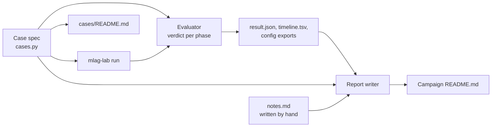

# Plan: generate test reports from the run

## Problem and desired outcome

**Problem.** Every results README, its links and the case pages are written by hand after a run. Terms drift from MikroTik's, expected behaviour is missing, and each new run needs the same rework.

**Desired outcome.** `mlag-lab run` ends by writing the campaign README. Each test starts with PASS or FAIL. Each fault test shows what MikroTik documents or the lab requires, and what was measured, separately for the **loss phase** and the **return phase**. Each result links to its verdict, packet timeline and the device config of that run. Running `mlag-lab evaluate` on saved evidence writes the same README byte for byte.

## How it fits together



## Terms, checked against the MikroTik manual

The case spec uses only these terms, so reports and case pages cannot drift. [MikroTik MLAG manual](https://manual.mikrotik.com/docs/high-availability-solutions/multi-chassis-link-aggregation-group/) · [LACP member flags](https://manual.mikrotik.com/docs/cli-reference/interface/bonding/monitor-slaves/)

| Use | MikroTik basis | Replaces |
| --- | --- | --- |
| **Peer link**, on the **peer port** `ether2` | `mlag-peer-port`; "after the peer link is lost" | "link between the two switches" |
| **MLAG peer** CHR 1 and CHR 2 | "both peer devices" | "switch" |
| **MLAG primary**, **MLAG secondary** | "the peer with the lowest priority will act as the primary device" | "primary switch" |
| **MLAG bond** (`mlag-id`) and **bond member** | "MLAG bond", "local member links" | "client link" |
| **ICCP**, `mlag-state` `connected`, `connecting`, `peer port not running` | MLAG settings and monitoring | "MLAG session" |
| **LACP system ID**, shared system ID, `mlag-lacp-fallback` | MLAG settings and monitoring | "presented itself as a separate switch" |
| LACP partner **expired**, **defaulted** | Bond member flags | "fell back to defaults" |
| **Calibration** (SMALL-02) | Existing case index | "measurement check" |

## 1. Case spec: one source for limits, expected behaviour and terms

Add `src/mlag_lab/cases.py`. Each case lists its ID, CLI selector, title, the action the runner takes, and its phases. Each phase names what happens, the expected behaviour in MikroTik terms, its source and its limit. The evaluator imports the limits from here. Today they are hard-coded in three places: 1 s and 4 s in `legacy_checks.py`, 5 s in `reboot_checks.py`, and the calibration window.

```python
Case(
    id="SMALL-07", selector="direct-reboot-primary", title="MLAG primary reboot",
    action="Reboot the MLAG primary while numbered pings run in both directions.",
    phases=(
        Phase("Primary down", limit_s=5.0, source=MLAG_MANUAL,
              expected="The MLAG secondary reverts its MLAG bonds to its own LACP system ID. "
                       "Clients renegotiate LACP, with brief loss."),
        Phase("Primary back", limit_s=5.0, source=MLAG_MANUAL,
              expected="The primary's bond members stay out of the bond until the shared system ID "
                       "syncs (mlag-init-delay). Clients renegotiate to the shared ID, with brief loss."),
    ),
)
```

| Case | Loss phase, expected | Return phase, expected |
| --- | --- | --- |
| SMALL-03 MLAG bond member loss and return | Traffic for client 1 leaves via the peer port to CHR 2's member. Limit 1 s. | The member rejoins the bond. No traffic is sent to it before LACP collecting and distributing. Limit 1 s. |
| SMALL-04 LACP partner timeout, carrier up | CHR 1 marks the partner expired after 3 × `lacp-rate=1sec` and stops using the member. Limit 4 s. | LACPDUs resume and the member rejoins. Limit 1 s. |
| SMALL-05 MAC move between MLAG peers | Move to CHR 2. Zero loss and no unicast to the old port after the GARP. | Move back to CHR 1. Same expectations. |
| SMALL-06 MLAG secondary reboot | Clients keep the member to the primary. Limit 5 s. | The secondary's members stay out until the system ID syncs. Limit 5 s. |
| SMALL-07 MLAG primary reboot | As in the example above. Limit 5 s. | As in the example above. Limit 5 s. |
| SMALL-08 Peer link loss and return (new, catalogue P1) | `mlag-state` leaves `connected` on both peers. With `mlag-lacp-fallback=yes`, the secondary stops using the shared system ID. Clients renegotiate. No loop or duplicate delivery. Limit **to decide**. | ICCP returns to `connected` on both peers and the shared system ID is restored. Clients renegotiate. Limit **to decide**. |

SMALL-01 baseline and SMALL-02 calibration have a single phase.

## 2. A verdict for each phase in `result.json`

The evaluator already sorts every outage into the loss or return phase, but it stores only a flat list of checks. Add a structured verdict:

```json
"phases": [
  {"name": "Member down", "limit_s": 1.0, "worst_loss_s": [0.0, 0.211], "verdict": "PASS"},
  {"name": "Member back", "limit_s": 1.0, "worst_loss_s": [2.288, 2.497], "verdict": "FAIL",
   "flows": {"101": [2.288, 2.497], "201": [2.303, 2.516], "302": [2.303, 2.516]}}
],
"verdict": "FAIL"
```

The loss phase runs from the fault action until the device or link is restored. For a reboot, it ends when the CHR answers management probes again. The return phase runs from there to the end of the recovery window. An outage that spans both phases counts in both, as today. Verdicts are PASS, FAIL, INVALID (evidence error) and NOT RUN.

## 3. Report writer

`mlag-lab run` and `mlag-lab evaluate` both finish by calling the report writer. It reads `builds.json`, `inputs/`, every `result.json` and the case spec. It writes no timestamps of its own, so replaying saved evidence gives an identical file.

The generated README contains:

- **Setup**: lab name and drawing, device count and names from the saved topology, RouterOS version and build time, image digest, Containerlab version, STP mode, date. Links to each CHR's exported config, the startup config, the topology and the Linux host setup for that run.
- **Summary table**, with PASS or FAIL in the first column:

  | Result | Case | Loss phase: limit → measured | Return phase: limit → measured | Runs |
  | --- | --- | --- | --- | --- |
  | ✅ PASS | SMALL-06 MLAG secondary reboot | 5 s → 0 s | 5 s → 0 s | 1 of 1 passed |
  | ❌ FAIL | SMALL-03 MLAG bond member loss | ✅ 1 s → 0.21 s | ❌ 1 s → 2.61 s | 0 of 3 passed |

- **TL;DR**: one generated line per case, failures first, such as "FAIL · SMALL-03 MLAG bond member loss and return: return phase lost up to 2.61 s against 1 s in 3 of 3 runs."
- **One section per case**: the action, then one row per phase with expected behaviour, source and limit, then one column per run. Each cell shows PASS or FAIL and the measured loss, and links to the failed check's line in `result.json` and to `timeline.tsv`.
- **Analysis**: copied word for word from `notes.md` when it exists and labelled as written by hand. This is the only place for explanations of why something failed. Without it, the report says no analysis has been written.
- **Evidence**: links to every run folder and capture archive.

The same spec also generates `cases/README.md`, the case index with both phases, expected behaviour and limits. Hand-written case pages keep only wiring and procedure notes.

## 4. Runner changes

1. **Save each CHR's running config** with `/export` at the start of every case, as `config-p1.rsc` and `config-p2.rsc`. The runner changes settings such as `protocol-mode` during a run, so the startup config alone does not show what was tested.
2. **Write the campaign folder directly** under `results/<date>-<lab>/`. Each run folder holds `result.json`, `timeline.tsv`, the config exports and one `captures.tar.gz`. Nothing is copied out of archives by hand.
3. **Add SMALL-08 peer link loss and return.** Cut the peer link at both ends, the way SMALL-03 cuts a member, hold it for 15 s and restore it. Check `mlag-state` and the LACP system ID on both peers, duplicate delivery, and loss per phase.
4. **Shorten the run command** to `uv run mlag-lab run --case carrier`. The runner asks for the RouterOS password when `MLAG_SSH_PASSWORD` is not set, restarts itself with `sudo`, and defaults to a dated output folder.

## Order of work and verification

| Step | Work | Verified by |
| --- | --- | --- |
| 1 | Case spec, limits read from it, verdict per phase | Replaying the three saved small-lab archives gives the same pass and fail outcomes as before |
| 2 | Report writer and generated case index | Regenerating the 24 November small-lab report from the archives; two runs give identical files |
| 3 | Replace the hand-written small-lab README and its hand-copied `reports/` files | Every link in the generated file resolves |
| 4 | Config export, campaign folder layout, shorter command | One live `direct-calibrate` run on the OrbStack lab |
| 5 | SMALL-08 peer link loss and return | Two live repeats on the OrbStack lab |

Manual runs 1 to 3 and the link-cut diagnosis have no runner output. They move to `notes.md` as earlier, unscored work.

## Decisions needed

1. **SMALL-08 limits.** MikroTik documents "brief packet loss" but no number. Using 5 s per phase, as for reboots, keeps the lab consistent.
2. **Spec format.** A Python module lets the evaluator import limits directly with no parser. TOML would be easier for people who don't read Python to edit.
