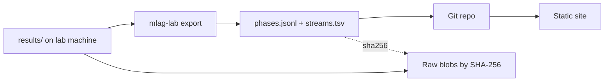

# Proposal: make the MLAG lab results usable online

Status: step 1 is built. `mlag-lab export` writes `results/index/` (see "Step 1 as built" below). Decision 2026-11-24: packet captures stay local on the lab machine; they are not uploaded to GitHub or object storage. The index lists each capture by SHA-256. Steps 2 and 3 are not planned.

## Step 1 as built

`uv run --locked mlag-lab export` reads every suite under `results/` and writes three files to `results/index/`; [`schema.md`](../../results/index/schema.md) is the field reference. The code is in `src/mlag_lab/export.py`. It differs from the schema proposed below in these points:

- The suite name stands for the variant; there is no separate `setup.variant` field.
- MLAG and bond settings are stored per RouterOS device as `setup.devices.<node>.bridge` and `.bonds`, read from the saved running config. That includes the access switch, whose bridge priority decides the root placement.
- `setup.stp_root_id` holds the elected root ID where the case checks it; the root placement is not stored as a separate field.
- Evidence links carry the run folder path and no commit; read them at the same commit as the export. Blobs carry only the name and SHA-256, so the output does not depend on whether the captures exist on the machine that runs the export.
- Runs that stopped before grading (skipped or invalid, 70 runs) get one row with `phase` null, so they stay visible.
- With the device settings copied onto every row, `phases.jsonl` is about 1.2 MB for 292 rows.

Checked against the saved results: two exports in a row are byte-identical; the graded phases match each campaign's `measurements.tsv` (102 Medium and 112 Small phases); worst loss bounds match the README Summary tables of `rstp-pair-root-run2` and `stp-off`. Rows from the archived Small lab and from suites without `builds.json` have no RouterOS version (28 rows).

## Problem today

The results are good evidence but hard to use from outside the lab machine.

- The repository is private on GitHub (`narrowin/mikrotik-mlag-testsuite`).
- Committed results take about 190 MB in 4,428 files and about 980,000 lines. Most of it is per-run evidence: state logs (`state-*.jsonl`), syslog, timelines, probe and capture logs, running configs, and a copy of the runner code in each suite's `inputs/`.
- The packet captures (`*.pcap`) are git-ignored and exist only on the lab machine: 2,151 files, about 315 MB. Each run already records their SHA-256 in `pcap.sha256`.
- The verdicts live in `result.json` (one per run, 64 checks and the graded phases) and `measurements.tsv` (one per campaign, one row per run, phase and stream). The generated `README.md` adds the setup, but it reads part of it from other files:
  - RouterOS version, CHR image and Containerlab version from `builds.json`;
  - MLAG and bond settings (`lacp-strict`, `up-delay`, `mlag-priority`, `mlag-lacp-fallback`, `mlag-init-delay`) with regular expressions from `config-p*.txt`;
  - MLAG roles from `state-p*.jsonl`;
  - the variant under test (for example `none-lacp-strict-up-delay-3s-l2` or `mstp-fallback-off-pair-root-clean`) only from the suite folder name.

So no single file answers "which setup, which case, which phase, what was expected, what was measured, pass or fail". That answer is what should go online.

## 1. Minimal structured result record

### Principles

- **Derived, not hand-written.** The record is generated from the saved results in the same way as `README.md` and `measurements.tsv`. Rerunning the writer on the same results gives the same file.
- **One row per run and phase.** This is the unit the report already grades: each phase has an expected behaviour, a limit, measured loss bounds and a verdict.
- **Setup is stored on the row, not looked up.** Lab, RouterOS version, bridge mode and the MLAG and bond settings are copied onto each row, so a filter such as "all MLAG primary reboots with `mlag-lacp-fallback=no`" needs no join.
- **Evidence is referenced, not embedded.** Committed files are referenced by repository path and git commit. Packet captures and other bulky files are referenced by SHA-256.
- **Nothing lab-internal that a reader does not need.** Management IPs, container names and host names stay in the raw evidence.

### Phase record (`phases.jsonl`, one JSON object per line)

| Field | Type | Source today | Meaning |
| --- | --- | --- | --- |
| `schema` | int | new | Record format version, starting at 1. |
| `campaign` | string | campaign folder | For example `2026-11-24-medium-search`. |
| `suite` | string | suite folder | For example `rstp-pair-root-run2`. |
| `run` | string | `result.json` `run` | For example `01-medium-pair-root-reboot-primary`. |
| `started` | ISO time | `builds.json` `started` | Suite start, UTC. |
| `code_revision` | string | `builds.json` `git_revision` | Runner commit that produced the run. |
| `setup.lab` | string | `result.json` `lab` | `Small lab` or `Medium lab`. |
| `setup.variant` | string | suite folder name today | Short name of the configuration under test. Should become an explicit field written by the runner. |
| `setup.routeros` | string | `builds.json` `routeros` | For example `7.26beta7`. |
| `setup.chr_image` | string | `builds.json` `campaign_image` | Image reference with digest. |
| `setup.containerlab` | string | `builds.json` `containerlab` | For example `0.83.0`. |
| `setup.bridge_mode` | string | `result.json` `bridge_mode` | `none`, `rstp` or `mstp`. |
| `setup.stp_root` | string | case name and `election.root` | Which bridge is root (`mlag-pair`, `access-switch`, `none`) and the root ID. |
| `setup.mlag` | object | `config-p1.txt`, `config-p2.txt` | `mlag-priority` per peer, `mlag-lacp-fallback`, `mlag-init-delay`, `mlag-heartbeat`, `mlag-peer-port` (the peer link). |
| `setup.bond` | object | `config-p*.txt` | `lacp-rate`, `lacp-strict`, `up-delay`, `transmit-hash-policy`. |
| `setup.roles` | object | `state-p*.jsonl` | Which CHR was MLAG primary and which was MLAG secondary at the start of the run. |
| `case` | string | `result.json` `name` | Case command name, for example `medium-pair-root-reboot-primary`. |
| `case_title` | string | `result.json` `title` | Human title. |
| `fault` | string | `result.json` `action` | What the runner did. |
| `phase` | string | `phases[].key` | `baseline`, `calibration`, `withdrawal` or `restoration`. |
| `phase_name` | string | `phases[].name` | For example `Primary down`. |
| `expected` | string | `phases[].expected` | Expected behaviour from `cases.py`. |
| `source` | string | `phases[].source` | MikroTik manual or standard link, or `lab target`. |
| `limit_s` | number or null | `phases[].limit_s` | Loss limit; `0` means no loss; null for calibration (the gap must enclose the 1.9–2.3 s cut). |
| `window_s` | [number, number] | `phases[].window_s` | Phase window in seconds from the baseline. |
| `measured.lower_s` | number | `phases[].worst_loss_s` | Shortest outage consistent with the 0.1 s probe spacing (worst graded stream). |
| `measured.upper_s` | number or null | `phases[].worst_loss_s` | Longest consistent outage; null means open-ended. |
| `measured.lost_probes` | int or null | `phases[].worst_loss_s` | Probes lost in that gap. |
| `measured.spans_both_phases` | bool | `phases[].worst_loss_s` | One outage across the loss and return phases. |
| `verdict` | string | `phases[].verdict` | `pass`, `fail`, `error` (invalid evidence) or `skipped`. |
| `run_status` | string | `result.json` `status` | Verdict of the whole run. |
| `failed_checks` | [string] | `phases[].failed_checks` plus failed run checks | Plain-language reasons, for example `101 withdrawal loss ≥ 11.439 s exceeds 5 s`. |
| `evidence` | object | see below | Links to the raw files. |

Per-stream bounds stay in a second, long table with the existing `measurements.tsv` columns (`stream`, `role` graded or control, `loss_lower_s`, `loss_upper_s`, `lost_probes`) plus the `campaign`, `suite`, `run` and `phase` keys. The phase record carries only the worst graded stream, which is what the README shows.

### Evidence references

```json
"evidence": {
  "repo": "results/2026-11-24-medium-search/rstp-pair-root-run2/01-medium-pair-root-reboot-primary",
  "commit": "<commit that added the results>",
  "files": {
    "verdict": "result.json",
    "timeline": "timeline.tsv",
    "config_p1": "config-p1.txt",
    "config_p2": "config-p2.txt"
  },
  "blobs": [
    {"name": "captures/c1-eth1.pcap", "sha256": "15a524e27d27e7ec9599e31f20b9a4af5b6f0586e41ec226b654fa35e44a49d4", "bytes": 152688}
  ]
}
```

- `files` are paths inside the repository; with `commit` they form a stable GitHub link that stays correct after later reruns.
- `blobs` are files that are not in git. The SHA-256 values already exist in `pcap.sha256`; only the size needs adding. Anyone who fetches a blob can verify it against the hash, wherever it is stored.

### Example row (abridged, real values)

```json
{"schema": 1, "campaign": "2026-11-24-medium-search", "suite": "rstp-pair-root-run2",
 "run": "01-medium-pair-root-reboot-primary", "started": "2026-11-24T13:08:40Z",
 "code_revision": "75be3481db74",
 "setup": {"lab": "Medium lab", "variant": "rstp-pair-root", "routeros": "7.26beta7",
           "bridge_mode": "rstp", "stp_root": {"placement": "mlag-pair", "root_id": "0x1000.02:00:00:21:00:11"},
           "mlag": {"mlag-priority": {"p1": 10, "p2": 20}, "mlag-lacp-fallback": "yes",
                    "mlag-init-delay": "1m", "mlag-heartbeat": "5s", "mlag-peer-port": "ether2"},
           "bond": {"lacp-rate": "1sec", "lacp-strict": "no", "up-delay": "0ms", "transmit-hash-policy": "layer-2"},
           "roles": {"p1": "primary", "p2": "secondary"}},
 "case": "medium-pair-root-reboot-primary", "phase": "withdrawal", "phase_name": "Primary down",
 "limit_s": 5.0, "measured": {"lower_s": 11.439, "upper_s": 11.647, "lost_probes": null, "spans_both_phases": false},
 "verdict": "fail", "run_status": "fail",
 "failed_checks": ["101 withdrawal loss ≥ 11.439 s exceeds 5 s", "201 withdrawal loss ≥ 11.342 s exceeds 5 s"]}
```

### Size

The Small and Medium search campaigns have 247 `measurements.tsv` rows. All campaigns together give a few hundred phase rows: well under 1 MB as JSON Lines, small enough to open in a spreadsheet, DuckDB, pandas or a browser.

### Gaps to close in the runner (later, separate change)

- Write `setup.variant` explicitly instead of encoding it in the suite folder name.
- Write the MLAG and bond settings and the MLAG roles into `result.json` from the device readback, so the export does not parse configs with regular expressions.
- Record blob sizes next to `pcap.sha256`.

## 2. Options to publish and work with the records

All options start from the same generated `phases.jsonl`, `streams.tsv` and a short `schema.md`. They differ in where the records and the raw evidence live and who can see them.



### Option A: dataset committed in the repository

Add `results/index/phases.jsonl`, `results/index/streams.tsv` and `results/index/schema.md`, generated by a small `mlag-lab export` command next to the README writer.

- **Effort:** small. One writer of about 100–150 lines that reuses the readers in `readme.py` and `measurements.py`.
- **Cost:** none.
- **Privacy and access:** same as the repository today: private, GitHub collaborators only. Management IPs are left out of the export.
- **Working with it:** GitHub renders TSV as a table; DuckDB, pandas or a spreadsheet read both files directly; the file diff in each commit shows what a rerun changed.
- **Raw evidence:** committed files are one link away. Packet captures stay on the lab machine only, so they are not retrievable by anyone else.

### Option B: static site from the repository (GitHub Pages)

Build HTML pages from the generated READMEs plus a filterable table over `phases.jsonl` (plain HTML and a small script, or DuckDB-WASM or Datasette Lite for SQL in the browser), built by a GitHub Actions job.

- **Effort:** medium. A build job and a page template; the content is already generated.
- **Cost:** free on GitHub Pages limits (1 GB site, soft 100 GB per month bandwidth). Pages from a private repository needs a paid GitHub plan.
- **Privacy and access:** a Pages site is public, even from a private repository, unless the organization is on GitHub Enterprise Cloud, which can restrict it to members. Check the narrowin plan before choosing this. A public site publishes the findings (for example the RSTP and MSTP primary-reboot outages on RouterOS 7.26beta7); once published it can be cached and indexed.
- **Working with it:** best for readers who do not use git: filter by lab, bridge mode, case and verdict, and follow links to the evidence.
- **Raw evidence:** links to committed files only work for readers with repository access. Captures need option D.

### Option C: hosted database or dashboard

Load the records into a hosted Datasette, Grafana with PostgreSQL, or a hosted database service.

- **Effort:** high for this data size: a server or service to run, a loader, sign-in, updates and backups.
- **Cost:** about 5–25 USD per month for a small VM or managed tier, plus upkeep time.
- **Privacy and access:** can have proper sign-in and per-user access, but it is one more system holding the results.
- **Working with it:** SQL queries and charts over time. With a few hundred rows this gives little that DuckDB on the JSONL file does not.
- **Raw evidence:** still needs option D.

### Option D: raw evidence in blob storage, addressed by SHA-256

Upload each packet capture (and optionally a per-run tarball of the state logs) once, under its hash, for example `sha256/15/15a524e2….pcap`. The phase record's `blobs` list names the hash; anyone with access fetches and verifies it.

Two places fit:

- **GitHub Release assets** on the private repository, one release per campaign with one tarball per suite. Up to 2 GB per file, access follows repository permissions, no extra account. Retrieval: `gh release download <campaign> -p <suite>.tar.gz`, then check against the hashes.
- **Object storage**, for example Cloudflare R2, AWS S3 or a Swiss provider such as Exoscale SOS. A private bucket with time-limited presigned links. At about 0.3 GB (0.5 GB including the state logs), cost is cents per month; R2 has no egress fees.

- **Effort:** small to medium: an upload script that skips hashes already present, plus the `blobs` field in the export.
- **Privacy and access:** private; access through GitHub permissions or bucket credentials. The captures contain only lab traffic (CHR, Linux container and lab MAC and IP addresses), but they are still raw data and should stay private.
- **Raw evidence on demand:** yes. This is the only option that makes the captures retrievable for someone other than the lab machine.
- **Side benefit:** once the bulky per-run files have a verified home, the repository can stop committing them. For example, the `inputs/` copies of runner code (815 files) are already identified by `git_revision` and `input_sha256` in `builds.json`. That is a later decision, not part of this proposal.

Git LFS is not recommended for this: it puts the files back into the repository workflow, and the free quota (1 GiB storage and transfer) is smaller than the existing captures.

## 3. Recommendation

**Classification:** two-way door for the export and the in-repository dataset (generated files that git can revert). Publishing anything outside the private repository (a Pages site, bucket uploads, release assets) is a one-way door: once uploaded or public, it may be copied or cached. Confirm with the operator before that step.

**Problem:** the verdicts, setup and evidence are spread over several files per run, and the packet captures exist only on the lab machine.

**Desired outcome:** one small structured file answers setup, case, phase, expected, limit, measured and verdict for every run, readable online by the team, with any raw file retrievable and verifiable on demand.

**Options (ICE, 1–10, higher is better):**

| Option | Impact | Confidence | Ease | ICE |
| --- | --- | --- | --- | --- |
| A. Dataset in repo | 7: answers the main question in one file and works with standard tools | 9: every field was found in existing files; only the setup fields need parsing like `readme.py` already does | 8: one generator, no new service | 504 |
| A + D. Dataset plus blobs by SHA-256 | 9: adds retrievable captures for other team members | 8: hashes already exist; GitHub release and bucket limits are documented, not yet tried here | 6: upload script, credentials, and an operator decision on where blobs live | 432 |
| B. Static site (on top of A) | 6: easier reading for non-git readers | 5: access control depends on the GitHub plan, which is not checked | 5: build job, templates, and a public-or-not decision | 150 |
| C. Hosted database or dashboard | 4: little extra value for a few hundred rows | 6: standard tools, but no access or hosting decided | 2: a service to run and secure | 48 |

The scores rank the options; small differences between A and A + D do not matter.

**Recommendation:** do A now and D next.

1. Add `mlag-lab export` that writes `results/index/phases.jsonl`, `results/index/streams.tsv` and `results/index/schema.md` from the saved results, and commit the output with the results. This is reversible and needs no decision about publishing.
2. After the operator decides where blobs live, add the `blobs` field and an upload script. GitHub Release assets on the private repository are the simplest start because access follows the existing repository permissions; object storage is the choice if people without GitHub access need the captures.
3. Consider B only when there is a reader who cannot use the repository, and only after the GitHub plan shows whether Pages can be kept private.

**Verification for step 1:** the export is rerun twice on the same results and produces identical files; the phase rows match the README Summary table for `rstp-pair-root-run2` and `stp-off`; the row count per campaign matches the phases in `measurements.tsv`.

**Known limitations:** the setup fields depend on parsing configs until the runner writes them into `result.json`; runs from the archived five-CHR layout and older Small lab runs have fewer fields and will have nulls; prices and GitHub limits are from public documentation and should be checked before step 2.

## Next action

None. Rerun `uv run --locked mlag-lab export` after new runs. Revisit step 2 only if someone without lab access needs raw captures.
