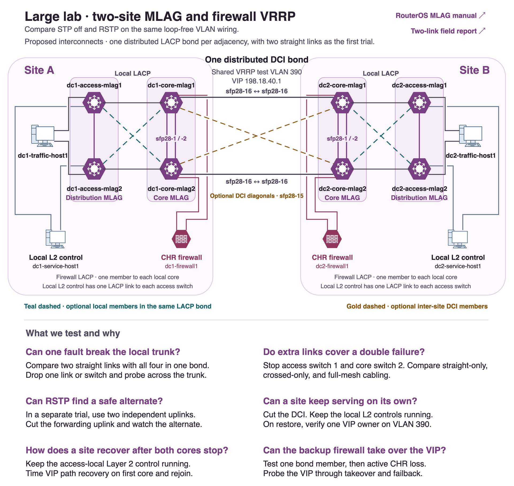
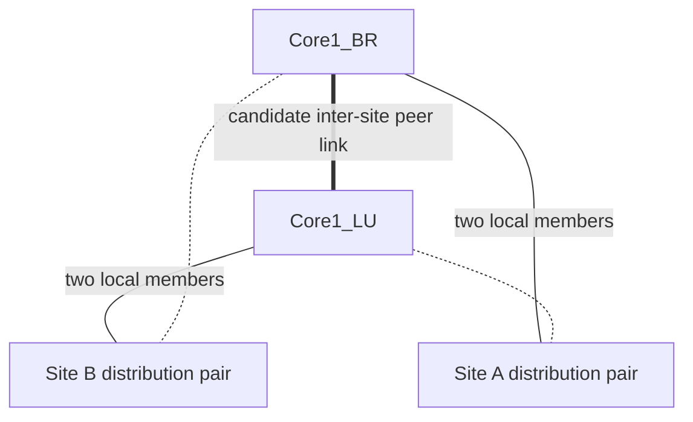

# Two-site MLAG design and test stages

This design follows the two Site A/Site B sketches. The proposed four-CHR comparison uses two cores per site and varies the number of links in one inter-site LACP aggregate. The two-CHR lab provides the control. The four-CHR wiring is a design proposal with vendor confirmation and live qualification pending. [Interconnect evidence](#interconnecting-two-mlag-pairs) · [Current lab configuration audit](#current-lab-configuration-audit)

## First drawing — a local core pair at each site

Site A and Site B each have two core switches and their own direct peer link, drawn as two members on `sfp28-1` and `sfp28-2`. The DCI is the set of cross-site links that connect the core domains. Appliance bonds attach to both local cores and host bonds attach to both local distribution switches. Use one Linux 802.3ad endpoint per site for the initial core-only experiment.

The diagram shows both cable members of each CHR firewall bond. For the initial four-core trial, attach each client bond directly to its local core pair. Teal diagonals extend each site's distribution-to-core LAG. Gold diagonals extend the Site A–Site B DCI LAG. [Editable drawing · Large lab tab](../diagrams/mlag-scenarios.drawio) · [Outage test procedures](../reference/site-cases.md#core-and-data-center-outage-matrix)

The two-link candidate uses the solid DCI members `Core1_BR ↔ Core1_LU` and `Core2_BR ↔ Core2_LU`, shown as the straight `sfp28-16` paths. The full mesh adds both dashed diagonals on the illustrated `sfp28-15` paths. The port inventory should confirm both ends of each circuit. A crossed two-link candidate changes which double failures disconnect the sites.

One logical DCI aggregate means **one local DCI bond on each of the four switches**. In Site A, both local bonds use the same Site A `mlag-id`. In Site B, both use the same Site B `mlag-id`. Each site forms its own MLAG domain and presents its own system ID. After adding the cross-links each local DCI bond has two physical members and the same local MLAG ID it had before. Record what each neighbor actually advertises and which members collect and distribute. MikroTik documents matching IDs within a pair and local-only egress hashing. [RouterOS MLAG manual](https://manual.mikrotik.com/docs/high-availability-solutions/multi-chassis-link-aggregation-group/)

The sketch’s `MLAG1` and `MLAG2` labels may describe two separate uplinks, each reaching a different Site B switch. Compare the actual bond and bridge configs against the single-aggregate and T4 configurations below. [Operator report on two interconnected CRS326 pairs](https://forum.mikrotik.com/t/two-interconnected-mlag-pairs-on-crs326-which-routeros-versions-are-stable/274258)

### What the extra circuits buy

The table counts surviving **physical DCI members**. An eligible link still needs working LACP, peer state, VLAN membership and forwarding.

| Failure | Two straight links, one aggregate | Four-link full mesh, one aggregate |
| --- | ---: | ---: |
| No fault | 2 | 4 |
| One DCI circuit | 1 | 3 |
| One core at either site | 1 | 2 |
| Same-index cores fail, for example BR1 and LU1 | 1 | 1 |
| Opposite-index cores fail, for example BR1 and LU2 | 0 | 1 |
| Both cores at one site, or complete DCI loss | 0 | 0 |

I checked all four possible one-core-per-site failures. Two straight links leave a path in two of them. Four links leave a path in all four. Two links are the fiber-saving candidate if the requirement is any **single** core or DCI circuit failure and the surviving link can carry the required load. Use four if the requirement includes **any one core at each site failing simultaneously**, or if two links’ worth of capacity must survive a single core loss. Under a two-core failure the four-link design has just one circuit left. A local switching or site-wide service still needs its own redundant path.

Before counting redundancy, record circuit capacity, physical route, optics, patch panels, carrier service and any shared-risk conduit or equipment. Two links through the same conduit may fail together. Count circuits separately from fiber strands. Duplex optics and single-fiber BiDi have different strand budgets. In RouterOS an ingress flow on one core hashes only over its active **local** members. Use several conversations and prove link utilization from capture or counters before relying on capacity. Size each peer bond for the load that crosses it when a local member is unavailable. [MikroTik MLAG forwarding behavior](https://manual.mikrotik.com/docs/high-availability-solutions/multi-chassis-link-aggregation-group/) · [RouterOS optics and Ethernet monitoring](https://manual.mikrotik.com/docs/wired-connections/ethernet/)

## Interconnecting two MLAG pairs

**Vendor status on 24 November 2026.** The RouterOS manual shows one link from each MLAG peer to a common LACP client. It also documents how two local members per peer forward. The manual and public replies reviewed give no explicit MikroTik approval or recommendation for two straight links between **two** MLAG pairs. The drawing retains the two-link case as a comparison proposal. The full mesh is the candidate when any simultaneous one-chassis loss per tier must leave a physical path. [RouterOS MLAG quick setup](https://manual.mikrotik.com/docs/high-availability-solutions/multi-chassis-link-aggregation-group/#quick-setup) · [Four-switch support question](https://forum.mikrotik.com/t/7-25-1-stable-is-released/274226/22)

**What MikroTik documents.** The RouterOS manual shows a pair presenting one LACP system ID to a dual-connected client and documents two active local members per chassis in a four-member MLAG. Each peer link is direct, and MikroTik recommends bonding multiple physical peer members. Tag every extended VLAN on both peers’ peer ports and match spanning-tree settings within each pair. Forwarding hashes over the eligible members on the ingress chassis. The peer port provides a path when the chassis has no active local member for that bond. Treat each peer link as its own ICCP adjacency. [RouterOS MLAG setup and forwarding](https://manual.mikrotik.com/docs/high-availability-solutions/multi-chassis-link-aggregation-group/) · [RouterOS spanning tree and port roles](https://manual.mikrotik.com/docs/bridging-and-switching/#spanning-tree-protocol)

**Pair-to-pair field reports.** One operator published the exact straight two-link peer-to-peer arrangement with one local member per chassis. They observed 5–7 s of loss after a remote core rejoined. A November follow-up from a separate four-CRS326 deployment reported instability after member changes on 7.25.1 and stable operation with one interconnect member disconnected while awaiting a maintenance window. Forum participants also reported success with a four-member aggregate and shorter failover with a full mesh in their setups. These reports establish configurations and failure modes worth comparing. [Exact two-link config and rejoin observation](https://forum.mikrotik.com/t/mlag-what-happens-when-member-interface-joins/263166) · [November CRS326 follow-up](https://forum.mikrotik.com/t/two-interconnected-mlag-pairs-on-crs326-which-routeros-versions-are-stable/274258) · [Four-member setup](https://forum.mikrotik.com/t/mlag-vlan-filtering-rstp-breaks-everything/269081/2) · [Full-mesh reboot comparison](https://forum.mikrotik.com/t/connect-mlag-to-another-mlag/184077/5)

**Release context.** MikroTik lists 7.26beta7 as the current development build and 7.25.2 as the current stable release. Both include MLAG fixes. The development announcement explicitly includes additional fixes for wrong-bond BPDU delivery and external-root path-cost calculations. The CHR campaign uses the pinned development image. Four-chassis behavior and hardware forwarding need their own measurements. [Development build and fixes](https://forum.mikrotik.com/t/7-26beta-development-is-released/273582) · [Stable release notes](https://forum.mikrotik.com/t/7-25-2-stable-is-released/274638) · [Pinned campaign image](../../labs/campaign-image.txt)

| Local distribution-to-core option | Wiring and logical configuration | When to use it |
| --- | --- | --- |
| Two straight members | `dist1–core1` and `dist2–core2` in one distributed 802.3ad trunk. One local member per switch. | Smaller comparison topology. Vendor confirmation and live qualification are pending. |
| Two crossed members | `dist1–core2` and `dist2–core1` in one distributed trunk. Use the diagonals alone for this comparison. | Same single-failure coverage as two straight members. Changes which simultaneous chassis failures leave a path. |
| Four members, full mesh | Both straight links and both teal diagonals in the **same** distributed trunk. Each switch has one local bond with two members, one to each remote peer. | Candidate for any one simultaneous chassis loss in each tier. Verify that each leg collects and distributes and carries real traffic. |
| Two independent Layer 2 uplinks | Give each logical uplink its own bond. For example, dual-home each core to the distribution pair in an ordinary LACP bond and use a separate matching MLAG ID within the distribution pair for each core. | T4 comparison. Both uplinks in the same bridged VLAN form parallel paths. Keep RSTP active, plan non-edge ports and costs, and prove the expected forwarding and discarding roles before failing a link. |

In the single-aggregate design, use matching `mlag-id` on the two distribution peers for their uplink and matching `mlag-id` on the two cores for their corresponding downlink. For example, distribution can use `21` on both peers and core can use `31` on both peers. Give unrelated bonds on the same pair distinct IDs. Keep each pair’s peer bond ordinary LACP with no `mlag-id`. Use equal-speed, full-duplex members, MII link monitoring, and `lacp-rate=1sec`. Carry the required tagged VLANs on the logical interconnect and both pair-local peer links. Set `edge=no` on the interconnect on all four switches and match spanning-tree settings within each pair. Verify the expected remote system ID and compatible actor and partner keys across the members. Check that BPDUs, RSTP roles, and traffic agree before and after each member flap and chassis rejoin. [RouterOS bonding](https://manual.mikrotik.com/docs/high-availability-solutions/bonding/#8023ad) · [RouterOS bonding CLI](https://manual.mikrotik.com/docs/cli-reference/interface/bonding/) · [Four-switch non-edge advice](https://forum.mikrotik.com/t/two-interconnected-mlag-pairs-on-crs326-which-routeros-versions-are-stable/274258/4)

| Local fault | Two straight | Two crossed | Four-member mesh |
| --- | ---: | ---: | ---: |
| One cable | 1 | 1 | 3 |
| One chassis | 1 | 1 | 2 |
| `dist1` and `core1` | 1 | 0 | 1 |
| `dist1` and `core2` | 0 | 1 | 1 |
| Both chassis in one tier | 0 | 0 | 0 |

The counts are surviving physical links. On the pinned RouterOS build, replay the same faults on two and four members with 100 ms probes and independent local controls. Record each member’s LACP state, spanning-tree roles, MAC learning, duplicate broadcast delivery, affected and unrelated-flow outage, and return to a healthy baseline. Include both complementary chassis pairs for the crossed-failure condition. Repeat on the target switches to qualify hardware forwarding and capacity. [Planned faults and pass conditions](../reference/site-cases.md#core-and-data-center-outage-matrix) · [Measurement rules](../reference/measurement.md)

## Current lab configuration audit

All three Containerlab files deploy one MLAG pair. The access switch is a regular RSTP bridge with an ordinary LACP uplink. In the revised Medium lab, the access switch is also the external RSTP root candidate. Site A/Site B and the distribution-to-core interconnect exist in the design and test plan. [Small lab](../../labs/small/small.clab.yml) · [Medium lab · pair-root variant](../../labs/medium/medium-pair-root.clab.yml) · [Medium lab](../../labs/medium/medium.clab.yml)

| Documented behavior | Checked in the startup files |
| --- | --- |
| Direct peer link, with a bond recommended for peer-link resilience | All three fixtures connect the two peers directly on RouterOS `ether2` and admit tagged traffic there. Each uses one physical peer member so its behavior can be isolated. The manual documents this form. |
| Matching `mlag-id` on the two local peers, fast LACP, and VLAN membership on the peer link | Both peers use IDs `11` and `12` for their two separate distributed bonds, `mode=802.3ad`, and `lacp-rate=1sec`. VLAN filtering is enabled and VLAN 110 is tagged on both peer ports. |
| Matching RSTP configuration within a pair and edge ports for end systems | The peers in each lab have the same bridge priority and client bond settings. Linux-facing ports use `edge=yes`. The bond toward the access switch and external-root links use `edge=no`. The access-switch links carry untagged VLAN 110 as configured in this fixture. |
| Peer rejoin and LACP system-ID continuity | The startup files use the build’s defaults. MikroTik documents a one-minute `mlag-init-delay` and `mlag-lacp-fallback=yes`. The pair-root runner tests `fallback=no` separately and restores the original setting. MikroTik advises choosing an initialization delay longer than boot plus peer synchronization on the target device. |

RSTP is the startup mode. The Medium runner applies STP off for the designated comparison cases. The Small direct-client runner uses RSTP. The saved evidence contains the runtime bridge, bond, and packet observations. [Small startup config](../../labs/small/small.rsc) · [Pair-root startup config](../../labs/medium/medium-pair-root.rsc) · [External-root startup config](../../labs/medium/medium.rsc) · [Bridge CLI defaults](https://manual.mikrotik.com/docs/cli-reference/interface/bridge/) · [Evidence index](../diagrams/README.md#small-lab-evidence)

## Second drawing — a core pair stretched between sites

The second sketch shows one core chassis in Site A and one in Site B, with a link between them. Each site has a local `dsw` pair, and each distribution switch is cabled to both cores. The endpoints attach to the distribution pair. This is a six-switch comparison in which the cores form one stretched MLAG domain, **if** the upper core-to-core link is intended as its peer link. Confirm that purpose, the number of physical peer members and the lower-right switch label. The position and links suggest a Site B distribution switch despite the `dsw2_br` label.

Each dotted path represents two inter-site uplinks, one to each member of the far distribution pair.

With the pictured full connectivity, each site’s two distribution switches contribute two cross-site uplinks to the opposite core. That is **four inter-site distribution uplinks plus the core-to-core link members**. If the upper link is a two-member inter-site peer bond, the drawing implies six inter-site circuits, before any provider or optical-layer protection. The local distribution peer links do not consume inter-site circuits.

MikroTik says the peer ports must be directly connected. ICCP uses untagged link-local Ethernet frames. For a stretched pair, qualify the actual direct transport and have MikroTik confirm any proposed carrier service that sits between the peer ports. Measure carrier behavior, latency, FEC or optical errors, complete partition, and both rejoin orders. Keep both ends’ management reachable independently and check whether either site loses local service when the core peer disappears. A CHR link can exercise forwarding and timing logic. The actual transport and switch hardware need a separate bench check. [MikroTik peer-port requirements](https://manual.mikrotik.com/docs/high-availability-solutions/multi-chassis-link-aggregation-group/) · [MikroTik forum discussion of a proposed 1 km multi-pair design](https://forum.mikrotik.com/t/multiple-mlag-pairs/273236)

## Target — local distribution and firewall VRRP

This is the full Two-site test scenario. Run STP off and RSTP on the same Site A/Site B wiring, services and probe paths. Use one distributed bond per adjacency for the loop-free comparison. [Two-site bridge-mode plan](../validation-plan.md#large-lab-bridge-mode-comparison)

Each site has one RouterOS CHR firewall bonded to **both local core switches**. This follows the reference cabling and gives each firewall access to the shared VLAN while either local core can forward it. The firewall uses ordinary two-member 802.3ad LACP. Its two local core peers use the same switch-side `mlag-id` for that bond. [Firewall attachments](../../labs/large/README.md#firewall-attachments) · [MikroTik MLAG quick setup](https://manual.mikrotik.com/docs/high-availability-solutions/multi-chassis-link-aggregation-group/#quick-setup)

The two firewalls share VRRPv3 VIP `198.18.40.1` on test VLAN 390, carried over the DCI. Site A has priority 150 and Site B has priority 100. Preemption is enabled so the return of Site A also exercises failback. Permit VRRP advertisements between the peers on this VLAN if the CHRs have an input filter. The supplied CHR startup config covers the local bond, tagged interface and VRRP. Stateful session synchronization and firewall policies are separate from this gateway ownership test. [CHR startup config](../../labs/large/large-firewall.rsc) · [MikroTik VRRP examples](https://manual.mikrotik.com/docs/high-availability-solutions/user-guides/vrrp-configuration-examples/#basic-setup)

Keep the access-local Layer 2 control on a separate site-local VLAN. The client and service host each remain dual-attached to distribution. Probe the VIP from both sites over VLAN 390 and measure first stable delivery during each firewall bond-member cut, during each core reboot, and when stopping and restoring the active firewall. Check the VRRP state and virtual MAC location. A complete DCI cut can leave one active owner in each isolated site. When it heals, verify a single owner and stable VIP delivery again. Losing both local cores disconnects that site’s firewall and VIP path, while its access-local control can stay up.

Use the same firewall pair for the Large lab’s G2-style remote core rejoin check. Keep the measured client-to-VIP flow local to the active site and timestamp any interruption when the remote core returns. Score routed-service checks only where the trial has a defined service path and return route through the active firewall. [Original forum observation](https://forum.mikrotik.com/t/mlag-what-happens-when-member-interface-joins/263166) · [Gateway-specific cases](../case-catalog.md#first-hop-redundancy-peer-loss-and-edits)

## Lab order and stopping points

| Stage | Minimum build | Prove before adding the next dependency |
| --- | --- | --- |
| **Two cores per site** | Four switches, one local peer link per site initially, two straight DCI members and one Linux client bond per site. No gateway is needed for an L2 test. | Start with one inter-site member to prove local bonding and tagged forwarding. Add the second member, check the peer and LACP identities and capture both directions. Flap each member and remove each core one at a time. Then try one same-index and both opposite-index two-core failures. Local control on a surviving pair must stay healthy. Reuse M4, DC-02, DC-03 and DC-06. |
| **More DCI paths** | Same four switches. Add both diagonal members to the same aggregate. | Replay the same faults and prove exactly which survivor carries traffic. Compare the alternate two-independent-uplink design separately if it matches the deployed bond configuration. Run S1–S4 on their smallest applicable topology, including the three-pair chain where S1 needs it. |
| **Local distribution tier** | Add one local distribution pair on one side, then mirror it. Six switches first, eight when mirrored. | Use two straight local members, then add both local diagonals to the same aggregate. Move the clients below distribution and retain local and cross-site probes. Compare single-member, opposite-index chassis loss and rejoin on both wirings. Hold DCI cabling fixed during the local comparison. |
| **Firewall VRRP** | One firewall CHR per site, each dual-homed to the local core pair. Carry VLAN 390 between the sites. | Measure VIP delivery and owner changes during member loss, core loss, active firewall loss and return, and DCI partition and heal. Keep the access-local control running. |
| **Stretched core comparison and physical qualification** | Six switches for the second drawing. Use representative transport, optics, partners and switches for hardware claims. | Run complete core peer partition, reconnection and each site's local control. Compare capacity, shared physical risk, outage and restoration with the site-local reference. |

On every inter-switch trunk use consistent VLAN lists and matching STP port settings within each pair. Keep inter-switch bonds non-edge, choose the RSTP root in advance, and carry all required VLANs tagged on the corresponding peer ports. For the matched comparison, verify that each test VLAN is loop-free, qualify the STP-off baseline on the pinned development build, and repeat with RSTP on the same wiring. Capture the peer and data paths out of band and collect both peers’ actor and partner IDs, VLAN/MAC entries, CPU and RSTP roles when active. Reuse the 100 ms independent probes and one-way calibration from the two-CHR lab. Record both sides of each failure and restoration. Run the documented default for `mlag-lacp-fallback` first and record the effective value. Compare `no` in a separate reboot and peer-partition trial because it preserves the shared system ID after peer loss. [MikroTik MLAG configuration](https://manual.mikrotik.com/docs/high-availability-solutions/multi-chassis-link-aggregation-group/) · [RouterOS bridge settings](https://manual.mikrotik.com/docs/cli-reference/interface/bridge/) · [Larsa’s interconnect advice](https://forum.mikrotik.com/t/two-interconnected-mlag-pairs-on-crs326-which-routeros-versions-are-stable/274258/2) · [Evidence procedure](../reference/measurement.md#procedure-for-every-run)
