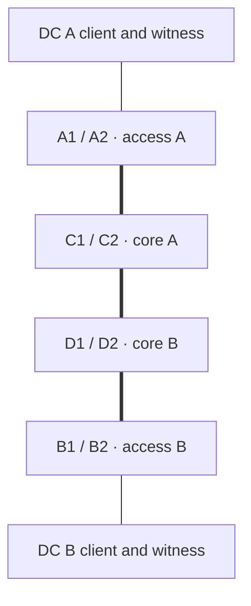

# Topology selection

[Validation plan](../validation-plan.md) · [Case catalogue](../case-catalog.md)

## Build up to the two-site topology

**Problem statement.** A two-switch test can establish whether a client has redundant access. It takes additional independent pairs to expose a peer-port learning error or topology change that propagates from a distant tier.

The proposed four-switch comparison uses the two Site A/Site B core pairs and varies the number of inter-site members in one LACP aggregate. Vendor confirmation for the two-link interconnect is pending. The same four-switch layout can serve as an access-to-core reproduction with different endpoint placement. Add the diagonal links, the distribution tier, and a VRRP-enabled CHR firewall per site as separate stages. [Site A/Site B drawings and lab order](../plans/two-site-design.md) · [Vendor and field evidence](../plans/two-site-design.md#interconnecting-two-mlag-pairs)

The distinction goes back to the original four-CRS326 report. One operator saw addresses oscillate between the inter-switch peer port and an LACP port after moving from 7.6 to 7.7–7.9. A related reply reported a working two-device setup on 7.9. Keep the two-pair wiring and the simpler control in the same campaign. [Four-device report, SUP-115519](https://forum.mikrotik.com/t/mlag-bridge-not-work-in-ros-7-7-7-8-7-9-ok-in-ros-7-6/166477) · [Two-device comparison](https://forum.mikrotik.com/t/mlag-hopelessly-broken/167137/2)

| ID | Topology and purpose |
| --- | --- |
| T0 — controls | Two Linux endpoints through one ordinary LACP switch, then through one physical member. Keep VLANs, addresses, probe rates and client timers identical. Add an independent observer port. Use this to detect client, VM carrier, timing and capture artifacts. |
| T1 — one pair | Two CHRs with one peer link to start. Two Linux 802.3ad clients each connect once to each CHR. Use a passive capture for the baseline. Add a single-homed endpoint only in the deferred orphan-host case. Repeat with a two-member ordinary LACP peer link. This is the smallest MAC, peer forwarding and split-brain lab. |
| T2 — access to core | Make A1/A2 a dual-chassis access pair hosting the local VRRP gateway. C1/C2 form a separate core pair. A1–C1 and A2–C2 form **one** distributed access-to-core LACP trunk. Attach a dual-homed client below access and a service host above it on the core. Add A1–C2 and A2–C1 to the same trunk for the four-wire repeat. Run the local comparison before varying the DCI. [Wiring choices and test matrix](../plans/two-site-design.md#interconnecting-two-mlag-pairs) |
| T3 — two data centers | Use one access pair and one core pair per site. C1–D1 and C2–D2 form **one** distributed DCI trunk. Each site has a CHR firewall bonded to both local cores and a separate access-local Layer 2 control. The firewalls share a VRRP test VLAN over the DCI. Run the four-wire DCI variant separately. This gives four independent MLAG domains, eight switches and two firewall CHRs. |
| T4 — spanning-tree alternatives | On T2 or T3, replace one distributed trunk with **two independent logical uplinks** in the same L2 domain, such as one ordinary bond per upstream core terminating on the downstream pair. Draw the resulting cycle, fix costs and predict the alternate port before enabling the second path. Also run a three-pair chain to match the reported remote-switch reboot. |
| T5 — gateway placement control | On T1, place VRRP on the MLAG peers, then on two external routers each with its **own** LACP bond to the same pair. On T3, dual-home one external router to each site's local core pair and put those two routers in one VRRP group on a stretched VLAN. This reproduces the gateway placement in the remote-core rejoin report. [Two-site wiring and observed failure](https://forum.mikrotik.com/t/mlag-what-happens-when-member-interface-joins/263166) |

Each slash represents two chassis joined by a **site- and pair-local peer link**. Each thick line is a separate distributed LACP trunk. Only the C–D trunk crosses sites. Each site also needs a local destination that stays up if the entire opposite site disappears.

### Smallest lab for each question

Start on the first row that contains the failure mechanism. Add the next tier when the question depends on it. Linux probes below can run in containers. A capture on a data veth adds no CHR. Use T1 for BASE-01/02/03/05 and MOVE-01/03/04, small T4 for BASE-04, and T2 then T3 for BASE-06. MOVE-02 needs two sites, MOVE-05 needs two ESXi hosts, and MOVE-06 uses the smallest topology containing the chosen fault.

| Question | Smallest useful setup | When to go larger |
| --- | --- | --- |
| Is the probe or LACP client losing packets by itself? | **1 CHR + 2 Linux clients** (T0). An ordinary LACP switch and a known client leg change calibrate packet loss, carrier visibility and the collector. | Add a second chassis as soon as peer behavior is in question. |
| Does one MLAG pair move a MAC and survive a member or peer loss? | **2 CHRs + 2 dual-homed Linux clients** (T1). Five data cables cover two client bonds and one peer link. For M1, give the moving MAC two distinct attachment points and keep an independent sender. For M2/M6, add a passive third port to detect flooded or reflected copies. VRRP on the CHRs also gives the smallest G1 failback test. | Add a second pair for moves across an inter-pair trunk or a flush outside the affected pair. |
| Can RSTP choose and unblock an alternate? | **2 CHRs + 1 RSTP-speaking bridge + 2 endpoints** (small T4). Connect the bridge to the two peers using independent inter-switch paths in one VLAN. Predict the alternate, cut the forwarding path, then restore it. | Use **4 CHRs** to test port-state disagreement between two MLAG pairs. Use **6 CHRs in three pairs** for the reported case where rebooting a distant switch blocked an otherwise healthy uplink (S1). |
| Can first-hop access survive a core fault? | **4 CHRs + 2 Linux traffic endpoints** (T2). Two access switches own the VRRP gateway and connect by distributed LACP to two cores. Add the local witnesses specified in §4 when testing unrelated-flow loss. This is the first lab in which M4 has the reported four-switch wiring. | Add sites when a local-only flow must survive a remote event. |
| Can a remote core rejoin interrupt a local gateway? | **4 core CHRs + 2 gateway CHRs + Linux client and service** (reduced T5). Use two core pairs connected by a DCI. Dual-home each site's router to its own cores. Put the routers in one stretched VRRP group, keep the measured payload inside site A, then return the secondary core in B. | Add access pairs for G2 if the reduced lab stays clean or the field path specifically traverses MLAG access. |
| What survives a core pair, DCI or whole-site outage? | **8 switching CHRs + 4 Linux endpoints** (T3, Layer 2 stage). Use an access pair and core pair per site, with an access-local Layer 2 flow at each site. Compare the two-wire and four-wire DCIs. | Add the two core-attached firewall CHRs and probe their shared VRRP VIP. |

### Wiring and forwarding contract

1. **Make the path unambiguous.** For a two-wire trunk between pairs X and Y, cable X1–Y1 and X2–Y2. For four wires add X1–Y2 and X2–Y1 to the same trunk. Each peer uses the same `mlag-id` as its partner for a given downstream or upstream bond. Give different logical bonds on that pair distinct IDs. The peer link is an ordinary port or ordinary LACP bond. Record both endpoints and each member interface. For the CHR kind, reserve `ether1` for management. [RouterOS MLAG example](https://manual.mikrotik.com/docs/high-availability-solutions/multi-chassis-link-aggregation-group/) · [Containerlab CHR interface mapping](https://containerlab.dev/manual/kinds/mikrotik_chr/)
2. **Give each path a witness.** In T3, put the local client and control in the same site-local VLAN so the probe can stay at access during loss of both cores. Probe the shared firewall VIP on test VLAN 390 and record the active owner. Keep MAC-move traffic on its own Layer 2 test VLAN. [Firewall attachments and VRRP](../plans/two-site-design.md#target--local-distribution-and-firewall-vrrp)
3. **Set the expected control state.** In RSTP trials, select C1/C2 as preferred root with the same bridge priority on both and predict the backup root. Record per-pair MLAG priority separately. For a VRRP fixture, also record per-VLAN priority and preemption and exercise the relevant role alignment. Both peers of the elected root pair may report root under their shared bridge ID. Two different root IDs in a connected instance need explanation. [Bridge and MLAG behavior](https://manual.mikrotik.com/docs/high-availability-solutions/multi-chassis-link-aggregation-group/) · [VRRP elections](https://manual.mikrotik.com/docs/cli-reference/interface/vrrp/)
4. **Make VLAN and STP state observable.** Enable VLAN filtering. List every carried service VLAN as tagged on both ends of every peer port it must traverse, including VLANs untagged at clients. Limit CPU-port membership to VLANs terminated by that CHR. Match trunk allowed lists, PVID/admission, STP cost, priority and edge settings across corresponding ports. Set `path-cost` and `internal-path-cost` explicitly on MLAG bonds. On CHR the automatic cost stays at the 1 Gbps value (20000) after boot and changes to the 10 Gbps value (2000) only after the link goes down and up, so the two peers can differ. Use non-edge inter-switch links and the documented peer-port admission settings. ICCP uses untagged link-local frames (EtherType `0x88b5`). Independently prove that tagged payload crosses the peer. [RouterOS forwarding and VLAN rules](https://manual.mikrotik.com/docs/high-availability-solutions/multi-chassis-link-aggregation-group/)
5. **Predict where packets should appear.** With both MLAG legs active, known unicast arriving on a peer with a local destination leg normally leaves locally. Losing the local leg can legitimately change its FDB entry to the peer port. A host attached only to the other peer also needs that path. For broadcast, unknown unicast and multicast (BUM), the peer must suppress a second copy to an already-served dual-connected bond and still serve eligible single-attached ports. Write an expected receiver list per VLAN. [RouterOS forwarding rules](https://manual.mikrotik.com/docs/high-availability-solutions/multi-chassis-link-aggregation-group/)

## First experiment — flap one member between two pairs

**Problem statement.** A routine port change on four interconnected CRS326s reportedly disrupted unrelated traffic even though the control plane remained established. This experiment can distinguish an ordinary topology change, a stale FDB, and widespread forwarding loss in a single run. [Original report](https://forum.mikrotik.com/t/7-25-1-stable-is-released/274226/22)

1. Build two core pairs with **two** wires in the inter-pair trunk. Elect one pair root and verify the path from both peers of the other pair. Use dual-attached test hosts on each pair. Start on the current development CHR. Collect state on all four switches. Save the baseline bridge and port state and expected MAC/VID/egress for several warm hosts, including two that do not use the member being changed. [Four-CHR wiring](../plans/two-site-design.md#first-drawing--a-local-core-pair-at-each-site)
2. Run a bidirectional cross-trunk flow and a local flow that stays on one pair. Confirm their paths from actual frames. Disable **one client-facing MLAG member**. Save the RSTP topology-change timestamp, the number of FDB entries lost by class and VLAN, each tracked MAC's next hop, CPU and missing sequences. Restore and capture the same data. Repeat on the opposite peer. Add the VIP and fresh TCP checks when the VRRP stage is in place.
3. Reset to baseline. Repeat with **one inter-pair trunk member**, then with an unrelated unused bridge port. Keep each event distinct. Start with a handful of MACs. If clean, replay near the reported 360–500 entries at low aggregate traffic, with continuously sourced sentinel MACs in an unrelated VLAN.
4. Record one verdict for the pinned development build. A normal topology change may cause relearning. Failure is a wrong next hop after valid learning, flooding that persists, loss above budget on an affected path, or measurable loss on the unrelated path. If the CHR result does not reproduce the reported failure, record the build and queue the CRS326 replay.
