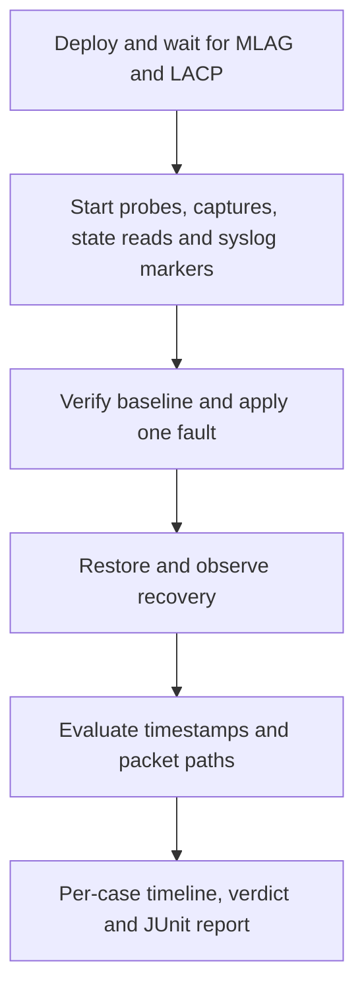

# Run the MikroTik MLAG test suite

The two-CHR suite applies the same lab faults on demand and evaluates the run from saved evidence. Run it in the Linux VM that hosts the Containerlab topology. The command and exit codes are the same for a local run and a CI job. The [case catalogue](case-catalog.md) tracks broader scenarios and their sources.

## Building blocks

| Component | Job |
| --- | --- |
| [Containerlab topology](../labs/small/small.clab.yml) | Starts two CHRs, two LACP clients, a mobile endpoint and the dedicated UDP syslog receiver. RouterOS imports [one startup config](../labs/small/small.rsc) on both peers. |
| [Test runner](../src/mlag_lab/run.py) | Checks it is attached to the selected topology, waits for MLAG and LACP, locks the lab, starts observers, applies one fault per case and restores the changed links or filters. |
| Linux traffic | Seven numbered ICMP streams at 100 ms. Both clients talk to and receive probes from the mobile endpoint, client 1 probes client 2 on VLAN 110, and the direct bypass runs in both directions. |
| Fault controls | Linux `tc` handles directional loss and LACP suppression. Linux bonding changes the active endpoint for the MAC move. Linux netlink and QEMU QMP control the two sides of virtual carrier together. [QEMU QMP reference](https://www.qemu.org/docs/master/interop/qemu-qmp-ref.html) |
| Observers | `tcpdump` records the endpoints, selected client-facing interfaces, mobile attachment ports and peer link. Networka reads RouterOS carrier, both client bonds, MLAG, STP, bridge ports and FDB entries as JSON over management SSH, one read per sample. Linux link events and both peers’ UDP syslog use the same Linux host clock. [Central syslog](syslog/README.md) · [Device state](#device-state-and-packet-grading) |
| [Evaluator](../src/mlag_lab/evaluate.py) | Uses TShark to match each ICMP request and reply by stream ID and sequence at both endpoints. It reconstructs missed packets, verifies the fault was actually applied, and grades each case against explicit criteria. It also regenerates the timeline and JUnit report from saved evidence. [TShark reference](https://www.wireshark.org/docs/man-pages/tshark.html) |



## Execute locally

Use the preconfigured [GitHub Codespace](../README.md#quick-start), an ARM64 OrbStack Linux VM, or a dedicated ARM64 or x86-64 Linux runner. On your own host, install Docker, Containerlab, uv, OpenSSH client, iproute2, iputils ping, `nsenter`, tcpdump and TShark. The kernel needs Linux bonding, veth and traffic classifier support. Refresh the upstream image references and tools for new campaigns. The evidence records the actual versions, local image IDs, topology and test script hashes for each run. [Containerlab CHR requirements](https://containerlab.dev/manual/kinds/mikrotik_chr/)

Deploy using the [Small lab instructions](../labs/small/README.md#deploy). From the repository root inside the Linux VM, run `uv sync --locked` as the operator to prepare the project environment, then set the lab password and run the suite. The example passes the operator’s uv executable to `sudo`. If sharing the checkout with macOS, set `UV_PROJECT_ENVIRONMENT` to a Linux-local directory before syncing. The runner uses a fresh known-hosts file for the two validated container addresses. Set `--username` if the lab uses a different account.

```bash
(
  read -rsp 'Lab RouterOS password: ' MLAG_SSH_PASSWORD
  export MLAG_SSH_PASSWORD
  printf '\n'
  sudo --preserve-env=MLAG_SSH_PASSWORD,UV_PROJECT_ENVIRONMENT "$(command -v uv)" run --no-sync mlag-lab run \
    --output "test-results/$(date -u +%Y%m%dT%H%M%SZ)"
)
```

With credentials set as above, specify one or more `--case` arguments to select cases. Use `--repeat 2` to repeat the selected set under the same policy. A new output directory preserves both artifacts and verdicts.

```bash
sudo --preserve-env=MLAG_SSH_PASSWORD,UV_PROJECT_ENVIRONMENT "$(command -v uv)" run --no-sync mlag-lab run \
  --case carrier --case silent-lacp --repeat 2 --output test-results/link-isolation
```

Use `--lab-dir /path/to/deployed/checkout/labs` when the source checkout and deployed lab are in separate paths. The runner checks Containerlab’s topology labels, the peer addresses, the veth pair, and the QEMU NIC/TAP mapping before sending fault actions.

## What the cases assert

[Case fields and stream IDs per lab](cases/README.md#case-fields)

| CLI case | Controlled event | Evidence and acceptance |
| --- | --- | --- |
| `calibrate` | Drop forward ICMP echo requests for approximately 2 s on the independent bypass. | The bound around the missed sequences encloses the measured actuation interval. All requests were emitted at the sender. The reverse bypass and VLAN streams stay clean. |
| `mobile-move` | Select the mobile endpoint’s other Linux bond leg, then switch back. | Confirm the gratuitous ARP on the newly active port. Zero missed probes and zero unicast to the mobile MAC on the old TAP after each announcement. [Catalogue M1](case-catalog.md#mac-learning-peer-forwarding-and-vlan-behavior) |
| `carrier` | Withdraw and restore one virtual carrier at both ends. | [Expected timings, results and captures](cases/small-client-link.md) |
| `silent-lacp` | Withhold client-to-CHR LACP frames on client 1’s first member for 8 s. | Verify carrier remains up, the filter counts suppressed frames and the CHR TAP shows client LACPDUs before and after the hold. The filter matches Slow Protocols frames addressed to the LACP multicast MAC. The runner checks for the expired state and records defaulting and any later probes seen on the selected TAP. Client 2 and the bypass stay clean. Grade affected traffic against 4.0 s on withdrawal, allowing the configured fast LACP timeout, and 1.0 s on restoration. |
| `silent-mobile` (`mac-age-relearn`) | Set `ageing-time=10s` on both bridges, drop every frame the MAC-move host sends for 25 s, then let it send again. Restore `ageing-time=5m` afterwards. | Both MLAG peers age the host MAC out, and flooding of streams 101 and 102 to the other traffic host is recorded, not failed. From the host's first frame at a CHR TAP, that flooding stops and streams 101, 102, 201 and 202 deliver again within 1.0 s. Stream 302 and the bypass stay clean. [Catalogue M2](case-catalog.md#mac-learning-peer-forwarding-and-vlan-behavior) |
| `carrier-flap` (`member-flap-repeat`) | Take client 1's bond member to CHR 1 down for 1 s and up for 3 s, five times. | Each loss of streams 101, 201 and 302 stays within the 3 s member limit, listed per flap. Streams 102 and 202 and the bypass stay clean. The bridge host table entries for client 2 and the MAC-move host stay on both MLAG peers. [Catalogue M4](case-catalog.md#mac-learning-peer-forwarding-and-vlan-behavior) |
| `two-pair-<setup>-interpair-member-flap` | Take the inter-pair bond member between CHR 1 and CHR 3 down at both ends for 8 s, then up. | Streams 101 and 201 lose at most 3 s in each phase, the bypass stays clean and, with RSTP, all four CHRs keep the baseline root. The topology-change counter of every CHR is recorded before, during and after. |
| `direct-reboot-secondary`, `direct-reboot-primary` | Reboot each observed MLAG role in separate trials with both client bonds attached directly to the pair. | Measure both VLAN directions while the guest is absent and after boot. Score each phase against 5 s. The bypass stays clean. [Run the direct reboot cases](operator-guide.md#reboot-the-direct-client-pair) |
| `root-calibrate` | Apply a two-second one-way bypass cut in the reboot topology. | Both peers show the same root and opposite roles, the access switch sees the root BPDU, and the measured interval encloses the injected cut. Both VLAN directions and the reverse bypass stay clear. |
| `reboot-secondary` | Reboot the verified secondary guest. | Observe guest uptime reset, carrier, peer state, and both client directions through withdrawal and restoration. Record whether the primary retains its original root and can forward during the absence. |
| `reboot-primary` | Reboot the elected primary with the pair as STP root. | [Control, expected timings and observed port states](cases/medium-core-reboot.md) |
| `primary-sustained-stop` | Stop the primary guest's QEMU vCPUs for at least 35 s and resume them. | Verify the stop and resume using QMP and independent management probes. Use the longer absence to separate peer loss and surviving forwarding from restoration. |
| `reboot-primary-no-fallback` | Repeat the primary reboot with `mlag-lacp-fallback=no` on both peers. | Record actual fallback settings and compare the actor system ID, port eligibility, and blackout against the default run. Restore the original setting afterward. |

Each case has a quiet baseline and a quiet recovery window. The runner uses fixed addresses, stream IDs and durations, and records actual action and observation times. Captures continue for two seconds past the scoring window to drain outstanding replies and capture buffers. A loss bound uses the first and last failed sends and their surrounding successful sends. A bound within the target passes. A lower bound beyond the target fails. A bound that straddles the target requires finer measurement. A sender gap over 450 ms, missing poll coverage, capture drops, disagreement between endpoint captures or failed syslog markers invalidate the measurement.

[Chassis loss and return test matrix](validation-plan.md#chassis-loss-and-return)

## Compare forwarding with and without spanning tree

Each of the three lab sizes has a matched bridge-mode comparison. The Small lab selectors currently force RSTP and the full Two-site comparison is pending. The command sequence below applies to the Medium lab. [Three-lab coverage and gaps](validation-plan.md)

Use the same [three-CHR Medium lab wiring](../labs/medium/README.md) and pinned image in all modes. Keep the two cores, dual-attached access switch, endpoints and bypass wired.

1. With STP off, require `protocol-mode=none` on all three bridges, eligible LACP members, zero STP BPDUs and one copy of each numbered unicast or broadcast request.
2. With RSTP, run once with the core pair as root and once with the access switch as root. Verify the elected root, BPDUs, forwarding and the same packet baseline before repeating faults.

Before each trial the runner applies bridge mode and priority through management SSH. Uptime must advance through the reset. The baseline checks reciprocal veth ends, TAP and guest carrier, VLAN membership, MLAG roles, LACP and probe neighbors. It requires at least 30 deliveries per flow with zero misses or duplicates. A failed baseline produces evidence and withholds the fault.

The [Networka command examples](operator-guide.md#collect-a-networka-checkpoint) execute device commands, including bounded RouterOS pings. Validate the returned values for each node. Linux link flags, emitted and received probe counts, BPDU presence and packet duplication come from the host and packet captures.

After each fault, verify configuration and forwarding again and retain the independent bypass. Apply the five-second target separately to withdrawal and restoration. A failed reboot and a failed baseline show different points of failure. Store both in the campaign evidence.

[Matched comparison commands](operator-guide.md#introduce-rstp-after-the-all-bridges-off-run) · [Planned tests for restarting the whole pair](validation-plan.md#both-dc1-cores-down-and-return)

### Time initial readiness on the Medium lab

1. Select `mlag-medium` on the `mlag-external` OrbStack VM. Check the named containers, topology labels, management addresses and pinned CHR image.
2. Cycle the data bridges over management SSH, apply the case's bridge modes and root priorities, and verify that guest uptimes increased through the reset.
3. Start packet, link and syslog observers. Read back bridge settings, VLAN membership, MLAG roles, LACP eligibility, and the permanent probe neighbors.
4. Run the four-second probe window. Verify that each VLAN and each bypass direction delivered at least 30 probes without loss or duplicates. Cross-check the reciprocal veths, TAP carrier and expected BPDU behavior. The STP-disabled gate also verifies broadcast delivery once per request.
5. Save the verdict. Start a fault only after a pass. The result's `initial_validation_s` records the reset, observer startup and settling, probe window and readback, evidence checks, and total reset-to-verdict time using the host's monotonic clock.

The reset-to-verdict time begins after management access and image verification. A full CLI wall-time measurement also includes startup, capture drain and offline scoring. See the [DC1 readiness measurements](cases/medium-spanning-tree.md#archived-diagnostics).

## Device state and packet grading

**Problem.** The suite used to read RouterOS state as CLI text and parse it with its own regular expressions. The parsers broke on column layout: an inactive bridge port shifted the next port's values into its column, so a port that did not forward could read as forwarding. Every runner also kept its own copy of the expected switch state, and a saved attempt could not show which expectation decided a verdict.

**Split.** Networka owns device state. The suite owns packet and traffic grading and the case catalogue.

| Part | Owner | Where |
| --- | --- | --- |
| Reading RouterOS state | Networka JSON commands and collectors | `src/mlag_lab/device_state.py` calls them |
| Reading Linux client bonds | The suite, `cat /proc/net/bonding/bond0` in the host's network namespace | Networka's Linux normalizers check the text |
| Expected switch and host state | Networka intent files | [`src/mlag_lab/intent/state/`](../src/mlag_lab/intent/state) |
| Device-state verdicts | Networka checks: pass, fail or error | `gate-baseline/`, `gate-restored/` in each attempt |
| Loss, floods, reflected frames, BPDUs, calibration, timing | The suite, from packet captures | `evaluate.py` and the per-runner evaluators |
| Cases, phases, limits and streams | The suite's case catalogue | [`src/mlag_lab/intent/*.yaml`](../src/mlag_lab/intent) |

**State samples.** Each `state-<switch>.jsonl` line is one Networka read of every command the switch samples, about every 0.5 s: `{started_ns, done_ns, replies: {command: {command, output, error}}, port_monitors: {port: command}}`. `port_monitors` names the bridge-port monitor command, which carries the port's `.id`, as Networka's `collect_bridge_port` selected it once before any capture started; a port it cannot select stops the attempt with an error. With spanning tree on, a sample without the bridge and root bridge IDs is incomplete; the access switch has no MLAG peer, so its samples need no MLAG state. The evaluator turns the replies into values with Networka's normalizers. A value they cannot decide makes the sample incomplete and is never read as a pass.

**Gates.** A gate is the intent files of the lab and setup, for example `medium.yaml`, `host2.yaml` and `medium-pair-root.yaml` for a Medium pair-root case. The runner collects it with Networka's `run_intent` before the fault and after recovery, adds the Linux bond readings, and saves `intent.yaml`, `evidence.json` and `results.json` in `gate-baseline/` and `gate-restored/`. `nw intent replay ATTEMPT/gate-baseline` prints the same verdicts. A baseline gate that does not pass withholds the fault in every runner. The evaluator replays both folders item by item: a failed Networka item fails the case, and an unverified item or a missing gate is an evidence error. An attempt that stopped before its baseline was observed, or produced no check, is an error, never a pass. Two checks compare switches with each other and stay in the suite, on the gate's saved replies: the Small lab's opposite MLAG roles and shared root, and the LACP system ID both MLAG peers present.

| Decision | Alternative | Why |
| --- | --- | --- |
| Read RouterOS state as JSON through Networka | Keep the suite's text parsers | JSON keeps field names and types. The text parser misread inactive ports. |
| One Networka read of all sample commands per sample | `run_intent` per sample | `run_intent` makes one read per collector and is too slow for a 0.5 s cadence. |
| Fixed expectations as Networka intent files per lab and setup | Expectations in Python per runner | One readable file per setup, replayable with `nw intent replay`, and the same pass, fail and error rules on every platform. |
| Relational checks in the suite | Force them into intent items | An intent item states one device's expected value. Roles and system IDs compare devices. |
| Linux bonds read by the suite | Networka SSH to the hosts | The traffic hosts are not in the lab's Networka profiles; the suite already reads them in their network namespace, and Networka's Linux normalizers parse the text. |

The running configuration is still saved as text in `config-*.txt` for readers and the results READMEs; no check reads it. The gates check the configuration through Networka's `property` check.

## Read or replay a run

| Artifact | Purpose |
| --- | --- |
| `builds.json` | Exact image IDs, RouterOS versions, host tools and test input hashes. |
| `schedule.json`, `inputs/`, `01-CASE/attempt.json` | Scheduled run names and case IDs, input snapshots, and per-attempt identity linked to the campaign build record. |
| `suite.json`, `junit.xml` | Case conclusions for operators and CI. Each repeat has its own test entry. |
| `01-CASE/result.json` | Lab name, standardized case ID, probe counts, per-flow loss bounds and failed assertions. |
| `01-CASE/timeline.tsv` | Host-relative timeline of actions, Linux carrier events, LACP frames, RouterOS state changes, syslog and loss. Query entries include their start time to show sampling uncertainty. |
| `01-CASE/proof.tar.gz` | Failed runs only: every capture cut to the seconds around each failed check, with the windows in `proof.json`. |
| `01-CASE/pcap.sha256`, `state-*.jsonl`, `syslog.jsonl`, `events.jsonl` | Raw measurements and action receipts, including the QEMU acknowledgment and classifier counters. The runner deletes `captures/`, `probes/` and `links/` after scoring; `pcap.sha256` keeps the checksums of the deleted captures. |
| `01-CASE/gate-baseline/`, `01-CASE/gate-restored/` | The Networka intent, evidence and results of the device-state gates. |

The runner scores each attempt as it ends and then deletes its packet captures, so a later replay keeps the saved verdicts. `mlag-lab evaluate` rebuilds the suite reports and re-scores only runs that still have captures. Copy the evidence first if you want to preserve the original derived files. Attempts saved before the suite read device state through Networka (`attempt.json` schema below 3) cannot be graded again: `mlag-lab evaluate` stops with one error that names the attempt and changes nothing. Their saved `result.json` stands, and `mlag-lab export` reads it as before.

```bash
uv run --locked mlag-lab evaluate test-results/link-isolation
```

| Exit | Meaning |
| --- | --- |
| `0` | Every executed case passed. |
| `1` | A valid observation failed a network assertion. The report and `proof.tar.gz` are the regression evidence. |
| `2` | Infrastructure or evidence error, including an invalid calibration or an inconclusive measurement. Resolve it before trusting the score. A live suite stops scheduling new cases after this outcome. |

## Verified on OrbStack

Two complete repeats on RouterOS 7.26beta7 produced **two passes, six network failures, and zero evidence errors**. Client 2 and both bypass directions stayed clean in the carrier and silent-LACP cases. The final health check showed connected MLAG, two up members on each client bond, the mobile endpoint on its original leg, and both test classifiers removed.

| Case | Observed in the repeats |
| --- | --- |
| `calibrate` | Both passed. The measured gap bounds were 1.87–2.08 s and 1.88–2.09 s. The forward classifier was active for about 2.01 s each time and the reverse bypass stayed clear. |
| `mobile-move` | Both failed on the move to CHR 2. One client 2 probe was missed and one unicast frame to the mobile MAC appeared on the old TAP after the GARP had reached the new TAP in each repeat. The move back had zero old-port frames. |
| `carrier` | Both drivers confirmed every transition within 127 ms of actuation. Withdrawal recovered within 0.22 s, with zero client 1 probes on the withdrawn TAP after confirmation. Restoration loss bounds across affected flows ranged from 2.18 to 2.52 s, exceeding the 1 s target in both repeats. |
| `silent-lacp` | Each repeat suppressed 12 frames with carrier up. CHR 1 advertised expiry at about 2.7 s and defaulting at about 6 s. Both captures showed 59 probes addressed to client 1 on the affected TAP after defaulting. Both runs exceeded the restoration target. One client-to-client outage spanned restoration and lasted 6.16–6.37 s. |

The saved suite holds `suite/junit.xml`, `suite/suite.json`, all 112 capture files with hashes, and the exact runner and evaluator. The captures stay local. All capture hashes were verified. Offline replay reproduced all eight case results, eight timelines and both suite reports byte-for-byte. This is the baseline to compare against when isolating failback or updating RouterOS.

## Run in CI

Give each job a disposable ARM64 Linux VM with a local Docker engine and one lab at a time. The fixed container names and management subnet make a dedicated runner slot the simplest isolation. Supply `MLAG_SSH_PASSWORD` through the job secret store. The job builds the endpoint and deploys the same topology used locally. Upload the entire evidence directory even when the test command exits nonzero.

At the start of the campaign, select the latest RouterOS development release and resolve its image digest. Set `MLAG_CHR_IMAGE` to that digest reference for every CI job, including jobs that test different topologies. [Version policy](validation-plan.md#routeros-version-for-live-tests) · [Resolve the image digest](operator-guide.md#reboot-the-root-pair)

```bash
set -euo pipefail
export MLAG_CHR_IMAGE=$(cat labs/campaign-image.txt)
uv sync --locked
artifact_dir="$(mktemp -d "${RUNNER_TEMP:-/tmp}/mlag-ci.XXXXXX")"
printf 'Upload evidence from %s/suite\n' "$artifact_dir"
docker build --pull --no-cache -f labs/shared/client.Dockerfile -t mlag-lab-endpoint:local labs/shared
docker pull "$MLAG_CHR_IMAGE"
trap 'sudo containerlab destroy -t labs/small/small.clab.yml --cleanup' EXIT
sudo env MLAG_CHR_IMAGE="$MLAG_CHR_IMAGE" containerlab deploy -t labs/small/small.clab.yml
sudo --preserve-env=MLAG_SSH_PASSWORD,UV_PROJECT_ENVIRONMENT "$(command -v uv)" run --no-sync mlag-lab run \
  --output "$artifact_dir/suite" --repeat 2
```

Import `suite/junit.xml` in the job's test reporter and retain the raw captures and state logs as build artifacts. The suite and report generation were exercised directly on the OrbStack lab.

For chassis runs use the [digest-pinned root deployment](operator-guide.md#reboot-the-root-pair), ensure `uv` and `tc` are on the privileged command path, and use:

```sh
sudo --preserve-env=MLAG_SSH_PASSWORD env "PATH=$PATH:/usr/sbin:/sbin" \
  uv run --locked mlag-lab run --case root-calibrate --case reboot-secondary --case reboot-primary \
  --repeat 2 --output "$artifact_dir/suite"
```

Upload the evidence directory regardless of the exit code. If an infrastructure or evidence failure stops the run, the JSON and JUnit reports enumerate the scheduled cases that were skipped. A valid network failure remains in the reports and allows the next case to proceed after baseline restoration.

Add more of the [case catalogue](case-catalog.md) as individual cases with an observed trigger, declared controls and measured acceptance criteria. The next topology stage is the [four-CHR design](plans/two-site-design.md#lab-order-and-stopping-points). The smaller runner is the place to qualify fault methods and pass criteria before using them across sites.
