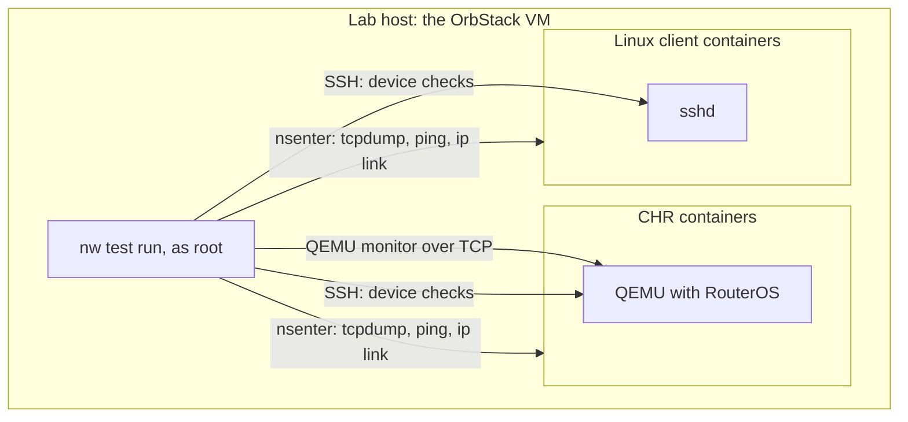

# Walkthrough: one run of a Networka lab test

This page follows one run of Networka's lab test prototype on the Small lab. Networka is the test engine. This MLAG repo holds the lab and the test files. One command, `nw test run`, runs a test.

Networka paths are in the Networka repo at branch `lab-tests`, commit `dddf9c7`, under `src/network_toolkit/`. MLAG paths are relative to this repo. The run shown here used the test files of the commit that last changed this page, on 2026-11-26, and passed.

## The parts

| Part | Repository | File | What it is |
| --- | --- | --- | --- |
| The nw command | Networka | `commands/test.py` | `nw test run` and `nw test replay`. It reads the test files, opens the device inventory and prints the result tables. |
| The test engine | Networka | `labtest.py` | Reads the test and state files, runs the fixed order of a test, judges the outages and writes the result. |
| Lab access | Networka | `lab.py` | Reads the lab folder, finds each container's process ID, runs tcpdump, ping and ip link inside a node's network namespace, and talks to the QEMU monitor of a CHR. |
| The outage measurement | Networka | `traffic.py` | Reads the pcaps with tshark and computes, per stream and per step, the lost probes and the outage with a lower and an upper bound. |
| The device checks | Networka | `intent.py`, `platforms/mikrotik_routeros/intent.py`, `platforms/linux/intent.py` | Reads the CHRs and the Linux clients over SSH and compares what they show with the expected values. |
| The test file | MLAG repo | [tests/small/bond-member-loss.yaml](../tests/small/bond-member-loss.yaml), [tests/small/baseline.yaml](../tests/small/baseline.yaml) | The streams, the extra capture points and the steps with their limits. |
| The state file | MLAG repo | [tests/small/state.yaml](../tests/small/state.yaml) | 4 statements with 22 device checks that must hold before and after the test. |
| The lab topology | MLAG repo | [labs/small/small.clab.yml](../labs/small/small.clab.yml) | The containerlab topology: two CHRs, three Linux clients, a syslog collector and the cables between them. |
| The lab folder that containerlab writes | Written at deploy | `<labs copy>/small/clab-<lab name>/` | Written by `containerlab deploy`. Networka reads `topology-data.json` from it for the node and cable list. |
| The device list with logins | MLAG repo | [labs/networka/small.yml](../labs/networka/small.yml) | The Networka profile: management address, device type and login per node. [labs/campaign.sh](../labs/campaign.sh) rewrites the addresses in the labs copy for instance 1 to 3. |
| The Linux image | MLAG repo | [labs/shared/client.Dockerfile](../labs/shared/client.Dockerfile) | Alpine with iproute2, iputils and sshd, so that Networka can log in to the clients as root. |

## Where things run



Everything runs on the lab host, the OrbStack VM, in one `nw` process started as root. The process starts tcpdump, ping and ip link with `nsenter -t <container PID> -n` (`lab.py:128`), so they run in a node's network namespace and use the VM's own binaries. nsenter replaces itself with the command, so the process list shows tcpdump and ping as direct children of `nw`. It sets the carrier of a CHR's virtual NIC through the QEMU monitor, from a thread that enters the CHR container's network namespace (`lab.py:289`). The device checks go over SSH to the management addresses of the two CHRs and of the Linux clients (`intent.read` at `intent.py:103` calls `NetworkaClient.run`). The process list in the bond member loss run showed this. The chain was `sudo`, then `uv run`, then the `nw` process as root. That one `nw` process was the parent of 4 ssh, 12 tcpdump and 5 ping processes. The 4 ssh clients ran in the VM's own network namespace and stayed open across both tests. Each tcpdump and each ping ran in the network namespace of its node. No nsenter process and no ip link process showed, because ip link ends at once.

## The run, step by step

All rows are for `tests/small/bond-member-loss.yaml`. The function column names the line that starts the step. The times in `timeline.tsv` are seconds from the start of the baseline window.

| Step | What happens | Started by | Where it runs | Reads or writes |
| --- | --- | --- | --- | --- |
| 1. Load the test files and the state file | Every field is checked. The 22 checks are validated against the check definitions. All test files load before the first test runs. | `commands/test.py:113` calls `labtest.load_test` (`labtest.py:198`) | nw process | Reads the YAML files |
| 2. Open the inventory | The device list with logins is loaded once for all tests. The SSH sessions it opens stay open until the last test ends. | `commands/test.py:119` | nw process | Reads `labs/networka/small.yml` |
| 3. Load the lab | nw checks that it is root, reads the node and cable list and asks Docker for each container's PID. It checks that every capture point node and the cable `dc1-traffic-host1:eth1` exist. | `labtest.py:371` calls `lab.load_lab` (`lab.py:207`) | nw process, `docker inspect` | Reads `clab-<lab name>/topology-data.json` |
| 4. Copy the inputs | The test file and the state file are copied into the saved folder. | `labtest.py:378` | nw process | Writes `test.yaml`, `state/` |
| 5. Check state before | All 22 checks run in one pass. If the state does not pass, no cable goes down. | `labtest.py:384` calls `intent.run_intent` | ssh children of nw, to the 2 CHRs and 2 clients | Writes `state-before/` |
| 6. Start captures | 12 tcpdump processes, one per capture point: the 3 stream ends plus 9 extra points, including the QEMU tap interfaces in the CHR containers. nw waits until each one listens. | `labtest.py:407` calls `Session.start_capture` (`lab.py:403`) | tcpdump in the node's namespace | Writes `captures/` |
| 7. Start streams | 5 ping streams, numbered 101, 102, 201, 202 and 302. The number is the ICMP identifier. Each sends one ping every 100 ms. | `labtest.py:409` calls `Session.start_stream` (`lab.py:437`) | ping in the sending client's namespace | Writes `streams/<id>.log` |
| 8. Baseline window | 2 s wait for neighbour discovery, then 5 s baseline. Each stream needs 30 replies with no lost probe and no duplicate, read from the ping logs. Otherwise no cable goes down. | `labtest.py:412` to `labtest.py:415` (`live_baseline`) | nw process | Writes `events.jsonl` |
| 9. Step "Member down" | The cable from client 1 eth1 to CHR 1 eth2 (RouterOS ether3, bond client1) goes down. The CHR end runs in QEMU, so nw sets the container interface down with ip link and the NIC down through the QEMU monitor, both at the same time. The client end then loses carrier. nw confirms the carrier at both ends within 2 s, then holds 8 s. | `labtest.py:422` calls `Session.set_link` (`lab.py:479`) | ip link in the CHR namespace, QEMU monitor from a thread of nw | Writes `events.jsonl` |
| 10. Step "Member back" | The same cable comes back the same way. nw holds 11 s. | `labtest.py:422` | as step 9 | Writes `events.jsonl` |
| 11. Check state after | 2 s for late replies, then the same 22 checks again. The streams and captures still run. | `labtest.py:426` calls `intent.run_intent` | ssh children of nw, to the 2 CHRs and 2 clients | Writes `state-after/` |
| 12. Stop | Any cable still down comes back. The streams stop, then the captures. nw writes the pcap checksums and the clock difference. This also runs after an error or Ctrl-C. | `lab.py:376` calls `Session.stop` (`lab.py:568`) when the `with` block at `labtest.py:382` ends | nw process | Writes `captures/pcap.sha256`, `events.jsonl` |
| 13. Measure | tshark decodes each pcap. Each probe counts as delivered or lost per step. The validity checks run here. | `labtest.py:393` calls `evaluate`, which calls `traffic.measure` at `labtest.py:598` | tshark on the VM | Reads `captures/`, `events.jsonl` |
| 14. Judge | Per step and stream: pass when the upper bound of the outage is at most the limit, fail when the lower bound is above it, error when the bounds straddle it. | `labtest.py:623` calls `judge` (`labtest.py:300`) | nw process | Nothing |
| 15. Save | The result and a timeline are written, and the tables are printed. | `labtest.py:394`, `labtest.py:395`, `commands/test.py:124` | nw process | Writes `result.json`, `timeline.tsv` |

The limits in both steps are the same. The streams that may stop, 101, 201 and 302, use client 1's bond and may stop for up to 3 s. The streams 102 and 202 do not use the cut member and must not lose a probe.

The output below comes from the run. In lines from `events.jsonl`, `...` marks fields that are left out.

Steps 5 and 11 printed these state tables, cut to their rows.

```text
State before
┃ Statement                                                                                                                 ┃ Verdict ┃
│ Both MLAG peers show mlag-state connected.                                                                                │ pass    │
│ Each MLAG peer carries each client bond on its one member, which LACP shows as synchronized, collecting and distributing. │ pass    │
│ Both MLAG peers run with spanning tree off and forward both client bonds on the bridge.                                   │ pass    │
│ Each client bonds both members, and both members have carrier and are in the active aggregator.                           │ pass    │
State after
│ Both MLAG peers show mlag-state connected.                                                                                │ pass    │
│ Each MLAG peer carries each client bond on its one member, which LACP shows as synchronized, collecting and distributing. │ pass    │
│ Both MLAG peers run with spanning tree off and forward both client bonds on the bridge.                                   │ pass    │
│ Each client bonds both members, and both members have carrier and are in the active aggregator.                           │ pass    │
```

Steps 6 and 7 wrote these first and last lines. The 12 captures started within 0.6 s. The 5 streams started within 4 ms of each other.

```text
{"name": "capture_started", "epoch_ns": 1795689343198017407, ..., "point": "dc1-core-mlag1:eth2", ...}
{"name": "capture_started", "epoch_ns": 1795689343776801212, ..., "point": "dc1-traffic-host2:bond0", ...}
{"name": "stream_started", "epoch_ns": 1795689343778044462, ..., "id": 101, "source": "dc1-traffic-host1:bond0", "destination": "dc1-mac-move-host:bond0", ...}
{"name": "stream_started", "epoch_ns": 1795689343781323046, ..., "id": 302, "source": "dc1-traffic-host1:bond0", "destination": "dc1-traffic-host2:bond0", ...}
```

Step 8 started the baseline window 2 s after the streams. `result.json` counts the baseline again from the captures. Stream 201 had 47 delivered probes and every other stream had 48, none lost and no duplicate, as shown here for stream 101.

```text
{"name": "baseline_start", "epoch_ns": 1795689345781734738, "mono_ns": 264288405649731}
    "streams": {
      "101": {
        "delivered": 48,
        "lost": 0,
        "duplicates": 0,
        "ok": true
```

Steps 9, 10 and 12 wrote these lines. The carrier was confirmed at both ends after at most 13 ms. No process ended early, no capture dropped a packet, and the wall clock and the monotonic clock drifted apart by 1291 ns during the run.

```text
{"name": "link_start", "epoch_ns": 1795689350797351510, ..., "state": "down", "ends": ["dc1-traffic-host1:eth1", "dc1-core-mlag1:eth2"]}
{"name": "link_applied", "epoch_ns": 1795689350804902261, ..., "ip_link": ["dc1-core-mlag1:eth2"], ..., "qmp": {"dc1-core-mlag1:eth2": {..., "request": {"execute": "set_link", "arguments": {"name": "nic2", "up": false}, "id": 2}, ...}}, "errors": []}
{"name": "link_observed", "epoch_ns": 1795689350810158053, ..., "flags": {"dc1-traffic-host1:eth1": ["NO-CARRIER", "BROADCAST", "MULTICAST", "SLAVE", "UP"], "dc1-core-mlag1:eth2": ["BROADCAST", "MULTICAST"]}, ..., "max_latency_s": 0.012793001}
{"name": "link_start", "epoch_ns": 1795689358820336321, ..., "state": "up", "ends": ["dc1-traffic-host1:eth1", "dc1-core-mlag1:eth2"]}
{"name": "link_applied", "epoch_ns": 1795689358825255280, ..., "ip_link": ["dc1-core-mlag1:eth2"], ..., "qmp": {"dc1-core-mlag1:eth2": {..., "request": {"execute": "set_link", "arguments": {"name": "nic2", "up": true}, "id": 2}, ...}}, "errors": []}
{"name": "link_observed", "epoch_ns": 1795689358828124405, ..., "flags": {"dc1-traffic-host1:eth1": ["BROADCAST", "MULTICAST", "SLAVE", "UP", "LOWER_UP"], "dc1-core-mlag1:eth2": ["BROADCAST", "MULTICAST", "UP", "LOWER_UP"]}, ..., "max_latency_s": 0.007779792}
{"name": "stopped", ..., "early_exits": [], "kernel_drops": {"dc1-core-mlag1:eth2": 0, ..., "dc1-traffic-host2:bond0": 0}, "restore_errors": [], "clock_delta_ns": -1291}
```

Steps 13 and 14 wrote these outage rows to `timeline.tsv`. "Reply absent at source" means the destination sent the reply, but the capture at the sender never saw it. "Request absent at destination" means the request never reached the destination.

```text
time_s	what	detail
5.020267	stream 201	lost 1 probes, seq 68 to 68, outage 0.0 to 0.206587 s, request absent at destination
5.065706	stream 101	lost 1 probes, seq 69 to 69, outage 0.0 to 0.210719 s, reply absent at source
13.091990	stream 201	lost 24 probes, seq 146 to 169, outage 2.408236 to 2.614067 s, request absent at destination
13.095607	stream 302	lost 24 probes, seq 146 to 169, outage 2.404619 to 2.606912 s, reply absent at source, request absent at destination
13.127307	stream 101	lost 24 probes, seq 147 to 170, outage 2.412502 to 2.617448 s, reply absent at source, request absent at destination
```

## What the run showed

Both tests passed, and `nw test run` exited 0. All 4 statements passed before and after each test. The table shows the outage per stream and step, with the lost probes. The limit was 3 s for streams 101, 201 and 302 in both steps of the bond member loss test, and 0 s for every other cell.

| Stream | Steady state (baseline test) | Member down | Member back |
| --- | --- | --- | --- |
| 101 | none | 0.000 to 0.211 s, 1 lost | 2.413 to 2.617 s, 24 lost |
| 102 | none | none | none |
| 201 | none | 0.000 to 0.207 s, 1 lost | 2.408 to 2.614 s, 24 lost |
| 202 | none | none | none |
| 302 | none | none | 2.405 to 2.607 s, 24 lost |

These figures come from one run. Counts across runs come only from `mlag-lab export`. Both replays computed the same result as the saved `result.json` and exited 0. The lab `mlag-small-i1` is still up on instance 1, and the last command in "Run it yourself" destroys it.

## Run it yourself

Run these in the OrbStack VM (`orb -m mlag-external bash`) from the root of this repo. Networka needs uv 0.13.10 exactly (`required-version` in its `pyproject.toml`). The VM's system uv is 0.13.9, so the run put a 0.13.10 binary first on `PATH` from `/var/tmp/pt1-tools`.

```sh
export MLAG_INSTANCE=1 MLAG_LABS_COPY=/var/tmp/pt1-labs UV_PROJECT_ENVIRONMENT=/var/tmp/pt1-nwk-venv
export NW_USER_DEFAULT=admin NW_PASSWORD_DEFAULT=admin NWK=/Users/md/git/narrowin/networka.worktrees/lab-tests LABS=/var/tmp/pt1-labs-i1
export PATH=/var/tmp/pt1-tools:$PATH COLUMNS=200
UV_PROJECT_ENVIRONMENT=/var/tmp/pt1-venv labs/campaign.sh small /var/tmp/pt1/small "baseline:--bridge-mode none --case baseline"
ssh-keyscan -T 5 172.30.225.11 172.30.225.12 172.30.225.16 172.30.225.17 > /var/tmp/pt1-keys
sudo tee -a /root/.ssh/known_hosts < /var/tmp/pt1-keys > /dev/null
cat /var/tmp/pt1-keys >> ~/.ssh/known_hosts
uv run --locked --project "$NWK" nw run dc1-core-mlag1,dc1-core-mlag2 \
  "/interface bridge set bridge protocol-mode=none" --config "$LABS/networka/small.yml"
sudo -E env "PATH=$PATH" uv run --locked --project "$NWK" nw test run \
  tests/small/baseline.yaml tests/small/bond-member-loss.yaml \
  --lab "$LABS/small/clab-mlag-small-i1" --config "$LABS/networka/small.yml" --save /var/tmp/pt1-out
uv run --locked --project "$NWK" nw test replay /var/tmp/pt1-out/bond-member-loss
```

`labs/campaign.sh` deploys the lab as `mlag-small-i1` from the labs copy `/var/tmp/pt1-labs-i1` and runs the suite's own baseline case. Without `--destroy` the lab stays up. The management network is `172.30.<net>.0/27`, where `<net>` is 215 plus 10 times the instance, so 225 here.

The `ssh-keyscan` line and the two lines after it add the host keys of the two CHRs and the two clients to root's and your own known hosts, because the profile checks host keys. Remove old keys for these addresses first with `ssh-keygen -R`. `nw test run` runs as root, and `nw run` runs as your user. `nw run` sets spanning tree off on both CHRs. The campaign's baseline case leaves RSTP on, and without this step the state check fails.

`nw test run` runs both tests in order as root and saves one folder per test under the `--save` folder. A test folder that already holds evidence stops the run. The exit status is 0 for pass, 1 for fail and 2 for error. The run printed these lines after the tables. It saved to its own `--save` folder in this repo.

```text
Test: Small baseline with spanning tree off
Test verdict: pass
Evidence saved in /Users/md/git/narrowin/mlag-suite-yaml/test-results/suite-yaml-verify/prototype/live-no-bypass/out/baseline
Test: MLAG bond member loss and return
Test verdict: pass
Evidence saved in /Users/md/git/narrowin/mlag-suite-yaml/test-results/suite-yaml-verify/prototype/live-no-bypass/out/bond-member-loss
exit 0
```

Each test folder holds the files named in the last column of the step table. `nw test replay` computes the result again from that folder only, with tshark and without the lab. It does not rewrite `result.json`. It exits 2 when the computed result differs from the saved one.

```sh
orb -m mlag-external bash -c 'cd /var/tmp/pt1-labs-i1 && sudo env MLAG_LAB_NAME=mlag-small-i1 MLAG_MGMT_NET=225 MLAG_CHR_IMAGE=$(cat campaign-image.txt) MLAG_SYSLOG_IMAGE=$(sudo docker image inspect --format "{{index .RepoDigests 0}}" rsyslog/rsyslog:latest) containerlab destroy -t /var/tmp/pt1-labs-i1/small/small.clab.yml --cleanup'
```

This command destroys the lab with the variables it was deployed with. Afterwards, remove the four host keys from both known hosts files with `ssh-keygen -R`.

## Not built yet

- The Networka code at `dddf9c7` has not been reviewed.
- Spanning tree is set off by hand with `nw run` before the test.
- The lab is deployed by `labs/campaign.sh`, not by Networka.
- Host keys are added to the known hosts files by hand.
- Nothing checks that the cable that goes down carries the streams that may stop.
- The ping interval is fixed at 100 ms (`labtest.py:41`). The test file cannot change it.
- The only action is a cable that goes down or comes back. A step cannot wait for a state, such as a node that reboots.
- Streams are unicast pings. Floods, duplicates per capture point and the path a probe took are not checked.
