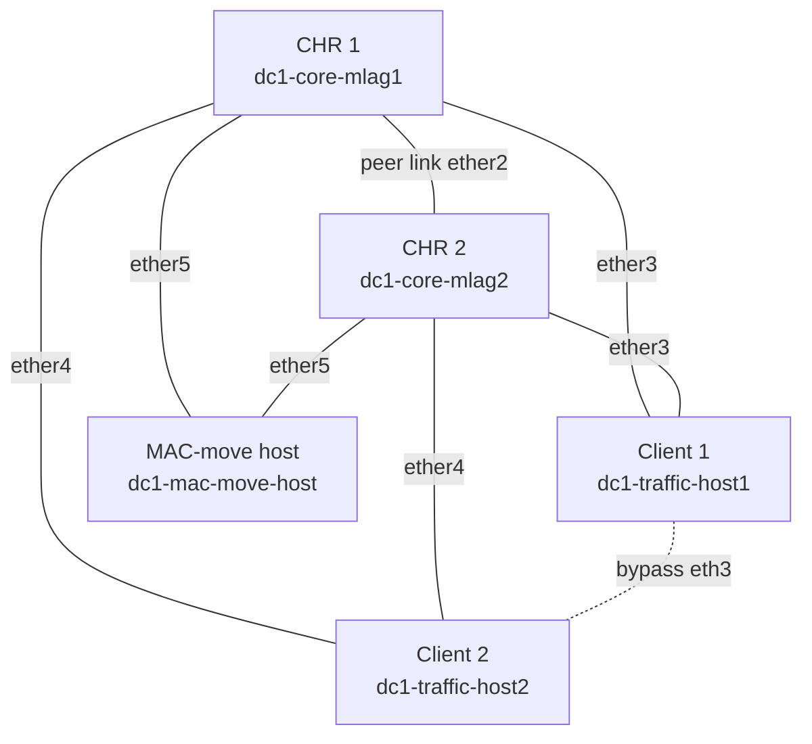

# Small lab walkthrough

This page describes the suite's own Python runner. The [Networka lab test walkthrough](walkthrough-networka-tests.md) follows the same lab through `nw test run`.

This page follows the Small lab from its wiring to one graded run.
Every link opens the file or function that does the step.
Line anchors point at the code as of 2026-11-26.
Device state comes from Networka intent gates.
Packet grading stays in the suite.
Section 6 explains the split.

## 1. The Small lab

The Small lab is one MLAG pair of two RouterOS CHRs, CHR 1 and CHR 2, joined by a peer link.
Client 1 and client 2 are Linux hosts with an 802.3ad bond that has one member to each CHR.
The MAC-move host has an active-backup bond with one link to each CHR.
A bypass cable joins client 1 and client 2 directly, so the bypass probes never cross the MLAG pair.
A syslog collector receives the RouterOS logs.
Containerlab deploys it as `mlag-small`, or `mlag-small-i<N>` for lab instance N.
Container port `ethN` on a CHR is RouterOS `ether(N+1)`.



Files:

- [labs/small/README.md](../labs/small/README.md): node table and deploy command.
- [labs/small/small.clab.yml](../labs/small/small.clab.yml#L68): nodes and the eight links.
- [labs/small/small.rsc](../labs/small/small.rsc): RouterOS startup config of both CHRs.
- [labs/networka/small.yml](../labs/networka/small.yml): Networka device profile the runner uses for SSH.
- [labs/shared/](../labs/shared/): client image, host network script and virtual cable script.
- [labs/campaign-image.txt](../labs/campaign-image.txt): the pinned CHR image every run checks.

The probe streams are numbered pings; the number is the ICMP identifier in the captures.
The two Small runners use the same numbers for different paths:

| Stream | Fault runner (`run_case`) | Direct runner (`external_attempt`) |
| --- | --- | --- |
| 101 | client 1 to MAC-move host | client 1 to client 2 |
| 102 | client 2 to MAC-move host | not sent |
| 201 | MAC-move host to client 1 | client 2 to client 1 |
| 202 | MAC-move host to client 2 | not sent |
| 302 | client 1 to client 2 | not sent |
| 301, 303 | bypass, both directions | bypass, both directions |
| 501, 502 | broadcast and unknown unicast from client 1 | same |

Definitions: [FLOWS](../src/mlag_lab/legacy.py#L21) and [FLOOD_FLOWS](../src/mlag_lab/legacy.py#L32) for the fault runner, [ROOT_FLOWS](../src/mlag_lab/root_topology.py#L44) as rewritten by [DIRECT_FLOWS](../src/mlag_lab/direct_topology.py#L21) for the direct runner.

## 2. Small cases

The case IDs come from the [case index](cases/README.md#small-lab).
Each case is one entry in the intent catalogue; the entry holds the action, the graded and control streams, and the phase limits.
`--case` takes the catalogue name or the selector.
Small selectors default to RSTP; pass `--bridge-mode none` for STP off.

| ID | Case | Catalogue entry | Selector | Runner | Fault |
| --- | --- | --- | --- | --- | --- |
| SMALL-01 | Baseline readiness | [baseline](../src/mlag_lab/intent/small.yaml#L3) | `direct-baseline` | [external_attempt](../src/mlag_lab/external_run.py#L300) | None. Bridge mode, gates and 4 s of loss-free probes. |
| SMALL-02 | One-way loss calibration | [reboot-calibration](../src/mlag_lab/intent/small.yaml#L112) | `direct-calibrate` | [external_attempt](../src/mlag_lab/external_run.py#L300) | A tc filter drops bypass stream 301 for 2 s ([filter_fault](../src/mlag_lab/run.py#L443)). |
| SMALL-03 | Client link loss and return | [bond-member-loss](../src/mlag_lab/intent/small.yaml#L36) | `carrier` | [run_case](../src/mlag_lab/run.py#L592) | Client 1's member to CHR 1 goes down at both ends for 8 s ([carrier](../src/mlag_lab/run.py#L368)). |
| SMALL-04 | LACP timeout and recovery | [lacp-timeout](../src/mlag_lab/intent/small.yaml#L60) | `silent-lacp` | [run_case](../src/mlag_lab/run.py#L592) | Client 1's LACPDUs to CHR 1 are dropped for 8 s with carrier up ([filter_fault](../src/mlag_lab/run.py#L443)). |
| SMALL-05 | MAC move and relearning | [mac-move](../src/mlag_lab/intent/small.yaml#L84) | `mobile-move` | [run_case](../src/mlag_lab/run.py#L592) | The MAC-move host switches its active link to CHR 2 and back after 4 s ([move_mobile](../src/mlag_lab/run.py#L463)). |
| SMALL-06 | Secondary core reboot | [secondary-reboot](../src/mlag_lab/intent/small.yaml#L128) | `direct-reboot-secondary` | [external_attempt](../src/mlag_lab/external_run.py#L300) | `/system reboot` on the MLAG secondary ([reboot_guest](../src/mlag_lab/root_run.py#L146)). |
| SMALL-07 | Primary core reboot | [primary-reboot](../src/mlag_lab/intent/small.yaml#L173) | `direct-reboot-primary` | [external_attempt](../src/mlag_lab/external_run.py#L300) | `/system reboot` on the MLAG primary ([reboot_guest](../src/mlag_lab/root_run.py#L146)). |
| SMALL-08 | Peer link loss and return | [peer-link-loss](../src/mlag_lab/intent/small-link.yaml#L3) | `peer-link-loss` | [run_case](../src/mlag_lab/run.py#L592) | The peer link goes down at both CHRs for 15 s ([peer_link](../src/mlag_lab/run.py#L397)). |
| SMALL-09 | Silent host past bridge ageing, then relearn | [mac-age-relearn](../src/mlag_lab/intent/small-link.yaml#L26) | `silent-mobile` | [run_case](../src/mlag_lab/run.py#L592) | The MAC-move host sends nothing for 25 s with a 10 s ageing time ([silence_mobile](../src/mlag_lab/run.py#L542)). |
| SMALL-10 | Repeated MLAG bond member flap | [member-flap-repeat](../src/mlag_lab/intent/small-link.yaml#L58) | `carrier-flap` | [run_case](../src/mlag_lab/run.py#L592) | Client 1's member to CHR 1 goes down for 1 s and up for 3 s, five times ([flap_member](../src/mlag_lab/run.py#L484)). |

The catalogue has five more Small entries without a case ID:

- [calibration](../src/mlag_lab/intent/small.yaml#L20) (`calibrate`) runs the 2 s bypass cut in the fault runner.
- [secondary-power-loss](../src/mlag_lab/intent/small.yaml#L200) and [primary-power-loss](../src/mlag_lab/intent/small.yaml#L231) run in the direct runner ([power_loss](../src/mlag_lab/root_run.py#L238)).
- [primary-pause](../src/mlag_lab/intent/small-link.yaml#L88), [primary-reboot-no-fallback](../src/mlag_lab/intent/small-link.yaml#L94), [both-peers-down](../src/mlag_lab/intent/small-link.yaml#L100) and [iccp-loss](../src/mlag_lab/intent/small-link.yaml#L106) are planned and have no selector.

Direct-runner cases and fault-runner cases cannot share one suite; [select_topology](../src/mlag_lab/run.py#L708) rejects the mix.
Put them in separate suites of one campaign instead.

## 3. Trigger a run

Live runs happen inside the OrbStack VM, from the worktree root, on lab instances 1 to 3.
Check first that no other session runs a campaign:

```sh
pgrep -af "mlag-lab|campaign.sh"
sudo containerlab inspect --all
```

Give this worktree its own `UV_PROJECT_ENVIRONMENT` and `MLAG_LABS_COPY`, because the defaults are shared by every checkout in the VM.
Then start one campaign per instance with [labs/parallel.sh](../labs/parallel.sh):

```sh
labs/parallel.sh --destroy \
  1 small /var/tmp/c-small-1 "direct:--bridge-mode none --case baseline" -- \
  2 small /var/tmp/c-small-2 "link:--bridge-mode none --case bond-member-loss"
```

Each campaign is one [labs/campaign.sh](../labs/campaign.sh) call with `MLAG_INSTANCE` set.
One campaign can also run several suites in a row, for example `labs/campaign.sh --destroy small /var/tmp/c-small-1 "direct:--bridge-mode none --case baseline" "link:--bridge-mode none --case bond-member-loss"`.

What `campaign.sh` does:

1. Syncs `labs/` to the instance copy and moves the syslog addresses to that instance ([sync](../labs/campaign.sh#L112)).
2. Deploys the six containers with the pinned CHR image ([deploy](../labs/campaign.sh#L162)).
3. Wires the CHR virtual cables and pins the probe neighbours on both clients ([Small wiring](../labs/campaign.sh#L176)).
4. Runs `uv sync --locked`, then `uv run --locked mlag-lab run --lab-dir <copy> --output <campaign dir>/<suite> ...` per suite ([run loop](../labs/campaign.sh#L201)).
5. With `--destroy`, removes the lab it deployed, by topology file and variables.

On a lab that is already deployed, the same run is one command in the VM:

```sh
MLAG_INSTANCE=1 uv run mlag-lab run --lab-dir /var/tmp/mlag-labs-i1 --output /var/tmp/c-small-1/direct \
  --bridge-mode none --case baseline
```

The entry point is [cli.py `run`](../src/mlag_lab/cli.py#L35).
It restarts itself under sudo with the same arguments ([restart_as_root](../src/mlag_lab/cli.py#L67)), because the runner enters container namespaces.
[run_suite](../src/mlag_lab/run.py#L751) picks the lab class, `DirectLab` or `Lab`, from the cases.

Results land in the `--output` folder, by default `test-results/<UTC time>`:

- `schedule.json`: the planned attempts, plus any `-retry` attempt the runner added.
- `builds.json` and `inputs/`: versions, image digests, git revision and a copy of every input file with its SHA-256.
- `NN-<case name>/`: one attempt folder per case and repeat.
- `suite.json`, `junit.xml` and `README.md`: the suite summary ([write_suite](../src/mlag_lab/report.py#L23)).
- `console.log` in the campaign folder: everything the campaign printed.

## 4. Walkthrough 1: SMALL-01 baseline readiness

SMALL-01 runs in the direct runner: [DirectLab](../src/mlag_lab/external_run.py#L174) and [external_attempt](../src/mlag_lab/external_run.py#L300).

Suite setup, once per suite:

1. [select_topology](../src/mlag_lab/run.py#L708) maps `direct-baseline` to the direct lab.
2. [run_suite](../src/mlag_lab/run.py#L751) checks root, the host tools and the topology file, and takes the suite lock.
3. The lab class checks that every container belongs to this deployment and that the veth pairs and QEMU NICs match the topology ([Lab.__init__](../src/mlag_lab/run.py#L88)).
4. [wait_ready](../src/mlag_lab/external_run.py#L82) waits up to 30 s for management SSH and the probe neighbours.
5. [versions](../src/mlag_lab/root_run.py#L106) and [verify_campaign_image](../src/mlag_lab/run.py#L695) record the build and stop the suite if a CHR runs another image or RouterOS version.

Per attempt:

1. [check_logins](../src/mlag_lab/run.py#L169) logs in afresh to both CHRs.
2. [case_mode](../src/mlag_lab/external_run.py#L222) calls [apply_bridge_mode](../src/mlag_lab/run.py#L261). It disables both bridges, sets `protocol-mode`, enables them, checks that guest uptime kept rising (no reboot) and reads the mode back ([reset_bridges](../src/mlag_lab/run.py#L232)).
3. [external_attempt](../src/mlag_lab/external_run.py#L300) creates the attempt folder and saves the resolved catalogue entry as `case-intent.yaml` ([save_case](../src/mlag_lab/cases.py#L122)).
4. [Capture.observe](../src/mlag_lab/run.py#L304) starts tcpdump on 20 capture points, `ip monitor link` on every lab port and one `ping -i 0.1 -e <stream>` per stream.
5. [start_floods](../src/mlag_lab/run.py#L561) starts streams 501 and 502 from client 1.
6. Samplers write `state-p1.jsonl`, `state-p2.jsonl` and `state-host.jsonl` about every 0.35 s ([sample_loop](../src/mlag_lab/run.py#L342)).
   Each CHR sample is one Networka read of several RouterOS JSON commands ([Sampler](../src/mlag_lab/device_state.py#L71)).
7. Both CHRs log a begin marker, and the running config goes to `effective-config.json`.
8. [wait_for_baseline_state](../src/mlag_lab/external_run.py#L128) repeats the baseline gate for up to 12 s until it shows no findings.
   The gate is [direct.yaml](../src/mlag_lab/intent/state/direct.yaml), [hosts.yaml](../src/mlag_lab/intent/state/hosts.yaml) and `direct-<bridge mode>.yaml` ([DirectLab.gate](../src/mlag_lab/external_run.py#L192)).
9. The runner marks `baseline_start` and probes for 4 s with no fault.
10. The baseline gate runs once more and is saved in `gate-baseline/` ([run_gate](../src/mlag_lab/device_state.py#L270), [save_gate](../src/mlag_lab/device_state.py#L279)).
    Networka collects the RouterOS items over SSH.
    The suite reads `/proc/net/bonding/bond0` on both clients through nsenter and adds it to the Networka evidence.
    Networka then evaluates all items and the suite saves `intent.yaml`, `evidence.json` and `results.json`.
    The gate checks MLAG connected, every client bond member in use (S, C, D) on both CHRs, both host bond members up, the bridge mode and the client ports forwarding.
11. [check_baseline](../src/mlag_lab/external_run.py#L212) takes the gate findings and adds the MLAG roles read from the gate evidence: one primary and one secondary ([gate_roles](../src/mlag_lab/device_state.py#L315)).
12. [check_links](../src/mlag_lab/external_run.py#L102) confirms carrier and transparent virtual cables.
13. [verify_probe_window](../src/mlag_lab/external_run.py#L276) requires at least 30 good probes per stream, no loss, no duplicates and no send gap above 0.45 s.
14. The runner marks `baseline_confirmed` or `baseline_rejected`. For SMALL-01 the attempt ends here ([no fault for `-baseline`](../src/mlag_lab/external_run.py#L393)).
    In the other direct cases the fault runs, and after the recovery window the same gate is saved in `gate-restored/` ([restored gate](../src/mlag_lab/external_run.py#L404)).
15. Collectors stop, the pcap hashes go to `pcap.sha256` ([seal_captures](../src/mlag_lab/evidence.py#L46)), and [analyze](../src/mlag_lab/evaluate.py#L167) grades the attempt.

Attempt folder:

| File | Content |
| --- | --- |
| `attempt.json` | case, name, lab instance, bridge mode, MLAG role target, device inventory |
| `case-intent.yaml` | the catalogue entry and shared limits used for grading |
| `events.jsonl` | every runner action with wall and monotonic time |
| `captures/`, `probes/`, `links/` | pcaps, ping logs, link monitor logs |
| `pcap.sha256` | hash of every pcap |
| `state-*.jsonl` | sampled CHR and host bond state |
| `gate-baseline/`, `gate-restored/` | Networka intent, evidence and results of each gate |
| `syslog.jsonl` | RouterOS logs between the markers |
| `effective-config.json`, `config-p1.txt`, `config-p2.txt` | running configs |
| `result.json` | checks, per-phase loss and verdict |
| `timeline.tsv` | packets, link events, state samples, syslog and actions on one time axis, second 0 at `baseline_start` |

Grading:

- [analyze](../src/mlag_lab/evaluate.py#L167) loads `case-intent.yaml`, never the current catalogue ([recorded_case](../src/mlag_lab/cases.py#L128)).
- [evaluate_external](../src/mlag_lab/external_evaluate.py#L151) writes the checks.
- Device-state checks come from replaying `gate-baseline/` and `gate-restored/` with Networka ([grade_gate](../src/mlag_lab/device_state.py#L330)).
- A failed Networka item is a `fail` check; an unverified item or a missing gate folder is an `error` check.
- Packet checks come from the pcaps and stay in the suite.
- Each check has a level: a failed `error` check makes the attempt `error` (the measurement is not valid), a failed `fail` check makes it `fail`.
- [phase_results](../src/mlag_lab/cases.py#L249) adds the loss of the graded streams per phase. SMALL-01 has one phase, `baseline`, with limit 0 s on streams 101 and 201.
- An `error` attempt is repeated once as `NN-<name>-retry` ([retry rule](../src/mlag_lab/run.py#L845)).
- In the direct runner, a failed baseline stops the suite.
- [keep_proof](../src/mlag_lab/proof.py#L191) then deletes `captures/`, `probes/` and `links/` of every graded attempt.
- A failed attempt keeps the packets of its failing windows in `proof.tar.gz` ([prune](../src/mlag_lab/proof.py#L168)).

Replay:

```sh
uv run mlag-lab evaluate /var/tmp/c-small-1/direct/01-baseline
uv run mlag-lab evaluate /var/tmp/c-small-1/direct
```

[cli.py `evaluate`](../src/mlag_lab/cli.py#L83) calls [replay](../src/mlag_lab/evaluate.py#L264) on one attempt or a whole suite.
It rebuilds `result.json`, `timeline.tsv`, `suite.json`, `junit.xml` and `README.md` from the saved evidence.
A pruned attempt has no pcaps left, so replay keeps its saved verdict ([pruned check](../src/mlag_lab/evaluate.py#L169)).
Only an attempt that still has its pcaps is graded again from packets.

A gate folder replays on its own with Networka, without the lab:

```sh
uv run --locked nw intent replay /var/tmp/c-small-1/direct/01-baseline/gate-baseline
```

It prints the same pass, fail or error per item that the suite graded.
Pruning keeps the gate folders, so a pruned attempt still replays its device state.

## 5. Walkthrough 2: SMALL-03 client link loss

SMALL-03 is the catalogue entry `bond-member-loss` with selector `carrier`.
It runs in the fault runner: [Lab](../src/mlag_lab/run.py#L74) and [run_case](../src/mlag_lab/run.py#L592).
The case page is [cases/small-client-link.md](cases/small-client-link.md).

Steps that differ from Walkthrough 1:

1. [run_suite](../src/mlag_lab/run.py#L838) applies the bridge mode and calls [Lab.wait_ready](../src/mlag_lab/run.py#L185), which repeats the `direct` and `hosts` gates for up to 90 s until MLAG is connected and LACP is in use.
2. [run_case](../src/mlag_lab/run.py#L592) saves `case-intent.yaml` and `attempt.json`, then starts the same kinds of collectors with the fault runner's streams.
3. After 2 s for neighbour discovery it marks `baseline_start`, probes for 4 s and requires at least 30 replies per stream.
4. The baseline gate (`direct`, `hosts` and `direct-<bridge mode>`) runs and is saved in `gate-baseline/` ([baseline gate](../src/mlag_lab/run.py#L641)).
   If the gate does not pass, the runner marks `baseline_rejected` and withholds the fault.
5. The fault: [carrier](../src/mlag_lab/run.py#L368) sets container `eth2` on CHR 1 down and sets QEMU NIC 2 (RouterOS ether3) link-down over QMP at the same time. It then polls until client 1 `eth1` lost carrier and RouterOS reports ether3 down, and records how long that took.
6. The member stays down for 8 s ([hold](../src/mlag_lab/run.py#L651)).
7. [carrier](../src/mlag_lab/run.py#L368) brings both ends up again and confirms carrier the same way.
8. The runner probes for another 8 s, then marks a 3 s recovery window.
9. The same gate runs again and is saved in `gate-restored/` ([restored gate](../src/mlag_lab/run.py#L671)).
10. The runner logs the end markers and stops the collectors.

Phases and limits, from `case-intent.yaml`:

| Phase | Window | Limit | Graded streams | Control streams |
| --- | --- | --- | --- | --- |
| withdrawal, "Member down" | `down_start` to `up_start` | 3.0 s | 101, 201, 302 | 102, 202, 301, 303 must lose nothing |
| restoration, "Member back" | `up_start` to `recovery_start` | 3.0 s | 101, 201, 302 | same |

The evaluator also requires both drivers to confirm each change within 0.5 s, no probe to client 1 on the withdrawn CHR TAP, no unicast at a host outside the conversation for more than 1 s, no flood copy returning to client 1, and the bridge host table back on the expected ports after recovery ([evaluate_legacy](../src/mlag_lab/evaluate.py#L63)).

### Example: local evidence

This attempt is local evidence: `test-results/` is ignored by Git, so the files exist only in this worktree.
Path: `test-results/suite-yaml-verify/live/w2-small-link/link/01-bond-member-loss/`.
It ran on Small instance 1 with STP off, RouterOS 7.26beta7, git revision `3e2489b`, on 2026-11-26.
It predates the gate folders, so it has no `gate-baseline/`; the pcaps are still there.
A newer local attempt with both gate folders, on code commit 4763100, is in `test-results/suite-yaml-verify/live/final-4763100/w1-small-link/link/01-bond-member-loss/`.
It failed on the flood check: flood frame 501 came back at its sender in restoration.
The numbers below are from the 3e2489b run.

`result.json` says `"status": "pass"`, with 95 of 95 checks passing.
The per-phase loss bounds of the graded streams:

| Phase | Limit | 101 | 201 | 302 |
| --- | --- | --- | --- | --- |
| withdrawal | 3.0 s | 0 to 0.209 s, 1 probe | 0 to 0.208 s, 1 probe | 0 to 0.209 s, 1 probe |
| restoration | 3.0 s | 2.399 to 2.610 s, 24 probes | 2.392 to 2.601 s, 24 probes | 2.394 to 2.601 s, 24 probes |

A loss is a range because probes are sent every 0.1 s ([score_flows](../src/mlag_lab/measure.py#L23)).
The lower bound runs from the first to the last lost probe.
The upper bound runs from the last good probe before the gap to the first good probe after it.
Control streams 102, 202, 301 and 303 lost nothing.
Down was confirmed at both drivers 0.266 s after actuation, and up 0.077 s after.

The checks list in `result.json` has these groups:

- Evidence (`error` level): clocks agree within 50 ms, every collector stayed up, zero kernel drops on 14 captures, pcap hashes match, state samples no more than 1.5 s apart, syslog begin and end markers.
- Per stream (`error` and `fail`): baseline cadence, sends within 450 ms, no loss away from the fault, reply paths agree, delivery recovered, no duplicates.
- Forwarding (`fail`): no unicast outside the conversation, no reflected unicast, host table after recovery, no MLAG sync warnings, one LACP system ID per client bond.
- Fault (`error` and `fail`): driver confirmation within 0.5 s, no probes on the withdrawn TAP, client 2 and bypass up in both phases.
- Floods (`fail`): streams 501 and 502 reached each receiver once and never came back to client 1.

`timeline.tsv` (83 lines) shows the sequence, in seconds from `baseline_start`:

| Second | Source | Event |
| --- | --- | --- |
| 4.004 | action | `down_start` |
| 4.079 | icmp-101 | 1 probe lost, withdrawal |
| 4.130 | syslog CHR 1 | `client1 link down` |
| 4.135 | syslog CHR 1 | host 02:00:00:11:00:11 moved from client1 to ether2 |
| 4.269 | action | `down_observed` at both drivers |
| 12.272 | action | `up_start` |
| 12.403 | syslog CHR 1 | host 02:00:00:11:00:11 moved from ether2 back to client1 |
| 12.481 | icmp-101 | 24 probes lost, restoration |
| 15.059 | CHR 1 state | ether3 flags `ATGSCD--` again |
| 20.352 | action | `recovery_start` |

The first lost restoration probe left client 1 at 12.408 s, 5 ms after the host entry moved back to `client1` and 2.65 s before ether3 showed S, C, D.

## 6. Where device-state checks come from

The suite grades two kinds of evidence.
Device state is checked with Networka intent gates.
Device state covers MLAG connected, LACP member flags, bond members, bridge mode and bridge port state.
The MLAG roles and the LACP system ID compare the two CHRs, so the suite checks them on the gate's saved replies.
The gate files are YAML under [intent/state/](../src/mlag_lab/intent/state).
The Small lab uses [direct.yaml](../src/mlag_lab/intent/state/direct.yaml), [hosts.yaml](../src/mlag_lab/intent/state/hosts.yaml) and one of [direct-none.yaml](../src/mlag_lab/intent/state/direct-none.yaml), [direct-rstp.yaml](../src/mlag_lab/intent/state/direct-rstp.yaml) or [direct-mstp.yaml](../src/mlag_lab/intent/state/direct-mstp.yaml).
[device_state.py](../src/mlag_lab/device_state.py) runs each gate and saves it in the attempt folder as `gate-baseline/` or `gate-restored/`.
Each gate folder holds `intent.yaml`, `evidence.json` and `results.json` in the layout Networka uses.
`nw intent replay ATTEMPT/gate-baseline` gives the same results as the suite.
The runner also copies every gate file into the suite's `inputs/` folder as `state-<name>.yaml`.
The Networka side is described in [Networka docs/intent.md](https://github.com/narrowin/networka/blob/main/docs/intent.md).
The design and its reasons are in [Device state and packet grading](test-framework.md#device-state-and-packet-grading).
Packet grading stays in the suite.
Probe loss, phase windows, floods and forwarding checks come from the pcaps ([measure.py](../src/mlag_lab/measure.py), [evaluate.py](../src/mlag_lab/evaluate.py), [external_evaluate.py](../src/mlag_lab/external_evaluate.py)).
