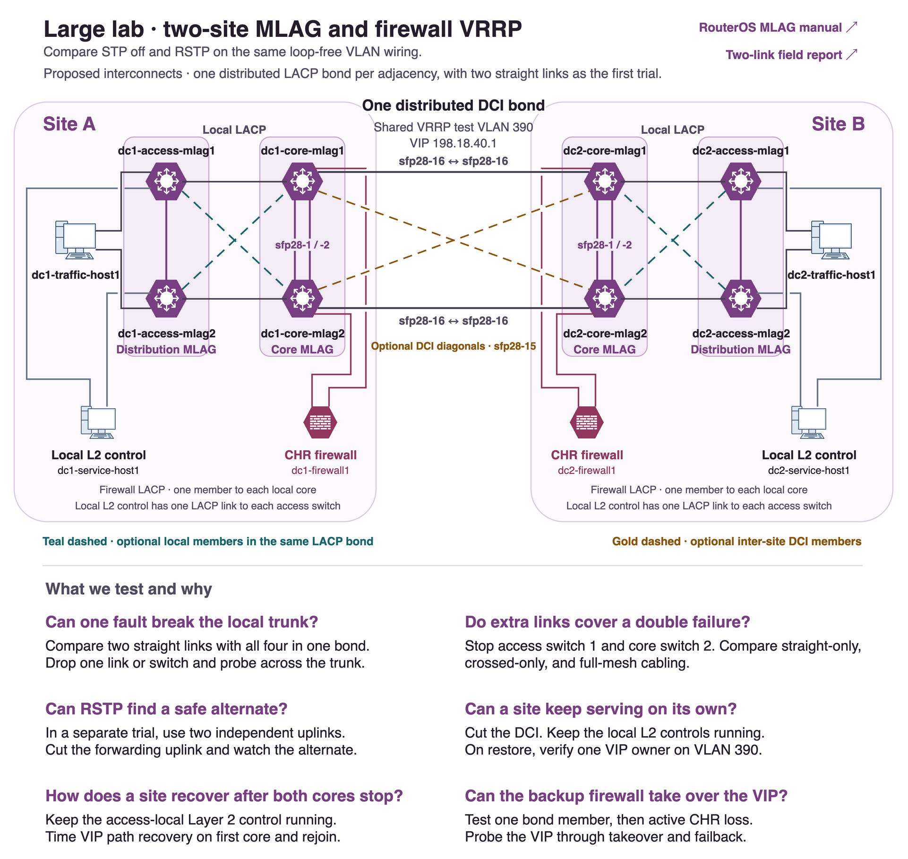

# Large lab



The Large lab spans Site A (`dc1`) and Site B (`dc2`). Each site has a core MLAG pair, a distribution MLAG pair, one RouterOS CHR firewall, a traffic host and a service host. The deployment is **`mlag-large`**, management network `mlag-large-mgmt`, subnet `172.30.220.0/27`. Containerlab prefixes Docker names with `clab-mlag-large-`. Each RouterOS guest uses the pinned image from [campaign-image.txt](../campaign-image.txt).

The topology and startup configs are written but not yet deployed. The runner has no Large cases yet.

| Node and hostname | Role and runtime | Management IP |
| --- | --- | --- |
| `dc1-core-mlag1` | Site A RouterOS CHR core switch, preferred MLAG primary | `172.30.220.11` |
| `dc1-core-mlag2` | Site A RouterOS CHR core switch | `172.30.220.12` |
| `dc1-access-mlag1` | Site A RouterOS CHR distribution switch, preferred MLAG primary | `172.30.220.13` |
| `dc1-access-mlag2` | Site A RouterOS CHR distribution switch | `172.30.220.14` |
| `dc1-firewall1` | Site A RouterOS CHR firewall, VRRP priority 150 | `172.30.220.15` |
| `dc1-traffic-host1` | Linux traffic host, VLAN 110 `10.110.0.16`, VLAN 390 `198.18.40.16` | `172.30.220.16` |
| `dc1-service-host1` | Linux service host, VLAN 110 `10.110.0.17` | `172.30.220.17` |
| `dc1-syslog-collector` | rsyslog Linux container for both sites | `172.30.220.20` |
| `dc2-core-mlag1` | Site B RouterOS CHR core switch, preferred MLAG primary | `172.30.220.21` |
| `dc2-core-mlag2` | Site B RouterOS CHR core switch | `172.30.220.22` |
| `dc2-access-mlag1` | Site B RouterOS CHR distribution switch, preferred MLAG primary | `172.30.220.23` |
| `dc2-access-mlag2` | Site B RouterOS CHR distribution switch | `172.30.220.24` |
| `dc2-firewall1` | Site B RouterOS CHR firewall, VRRP priority 100 | `172.30.220.25` |
| `dc2-traffic-host1` | Linux traffic host, VLAN 120 `10.120.0.26`, VLAN 390 `198.18.40.26` | `172.30.220.26` |
| `dc2-service-host1` | Linux service host, VLAN 120 `10.120.0.27` | `172.30.220.27` |

The lab runs ten CHRs: eight switches and two firewalls. Each CHR gets one vCPU and about 290 MiB of guest memory, so plan for at least 10 vCPUs and 4 GiB of free memory on the lab VM.

## Wiring

This is the two-member straight interconnect variant. Each pair has a single-member peer link. Distribution connects to core with one distributed LACP trunk of two straight members. The DCI is one distributed LACP trunk of two straight members between the core pairs. The four-member full mesh and the crossed variant are not built yet.

These are the Containerlab port names. On a RouterOS CHR, Containerlab data port `eth1` appears as guest `ether2`, `eth2` as `ether3`, and so on. The Linux hosts use the Containerlab names directly. Site B uses the same ports with `dc2-`.

| Link | Endpoint A | Endpoint B |
| --- | --- | --- |
| Core peer link | `dc1-core-mlag1:eth1` | `dc1-core-mlag2:eth1` |
| Distribution peer link | `dc1-access-mlag1:eth1` | `dc1-access-mlag2:eth1` |
| Distribution-to-core member 1 | `dc1-core-mlag1:eth2` | `dc1-access-mlag1:eth2` |
| Distribution-to-core member 2 | `dc1-core-mlag2:eth2` | `dc1-access-mlag2:eth2` |
| DCI member 1 | `dc1-core-mlag1:eth3` | `dc2-core-mlag1:eth3` |
| DCI member 2 | `dc1-core-mlag2:eth3` | `dc2-core-mlag2:eth3` |
| Firewall bond member, CHR `ether2` | `dc1-core-mlag1:eth4` | `dc1-firewall1:eth1` |
| Firewall bond member, CHR `ether3` | `dc1-core-mlag2:eth4` | `dc1-firewall1:eth2` |
| Traffic host bond member 1 | `dc1-access-mlag1:eth3` | `dc1-traffic-host1:eth1` |
| Traffic host bond member 2 | `dc1-access-mlag2:eth3` | `dc1-traffic-host1:eth2` |
| Service host bond member 1 | `dc1-access-mlag1:eth4` | `dc1-service-host1:eth1` |
| Service host bond member 2 | `dc1-access-mlag2:eth4` | `dc1-service-host1:eth2` |
| Independent bypass | `dc1-traffic-host1:eth3` at `198.51.100.1` | `dc2-traffic-host1:eth3` at `198.51.100.2` |

## Bonds and VLANs

Every bridge starts with spanning tree off (`protocol-mode=none`) and VLAN filtering on. The `mlag-id` values are local to each pair, so both sites use the same numbers.

| Switch | Bond | Bond member | `mlag-id` | VLANs |
| --- | --- | --- | --- | --- |
| Core | `access-downlink` | `ether3` | 31 | 390 tagged |
| Core | `firewall1` | `ether5` | 32 | 390 tagged |
| Core | `dci` | `ether4` | 33 | 390 tagged |
| Distribution | `core-uplink` | `ether3` | 21 | 390 tagged |
| Distribution | `traffic1` | `ether4` | 22 | Site VLAN untagged, 390 tagged |
| Distribution | `service1` | `ether5` | 23 | Site VLAN untagged |

The peer port `ether2` carries every VLAN of its pair tagged. The site VLAN is 110 at Site A and 120 at Site B. It stays on the distribution pair as the access-local Layer 2 control between the traffic host and the service host. It does not reach the cores or the DCI. VLAN 390 runs from each traffic host through distribution, the cores and the DCI to both firewalls. Each traffic host pins its local service host's MAC, and the reverse.

## Firewall attachments

Each firewall uses the pinned CHR image and an ordinary two-member LACP bond. The two local cores use `mlag-id` 32 on `ether5` for the firewall attachment.

| Firewall | CHR `ether2` to | CHR `ether3` to | VLAN 390 address | VRRP priority |
| --- | --- | --- | --- | --- |
| `dc1-firewall1` | `dc1-core-mlag1` `ether5` | `dc1-core-mlag2` `ether5` | `198.18.40.2/24` | 150 |
| `dc2-firewall1` | `dc2-core-mlag1` `ether5` | `dc2-core-mlag2` `ether5` | `198.18.40.3/24` | 100 |

Both firewalls use `kind: mikrotik_chr` and [large-firewall.rsc](large-firewall.rsc) as the `startup-config`. It selects the settings by CHR identity and enables VRRPv3 with VRID 39, VIP `198.18.40.1`, one-second advertisements and preemption. CHR `ether1` stays on management. The firewalls do not send syslog. Keep VLAN 390 isolated to the test lab. [Firewall VRRP test plan](../../docs/plans/two-site-design.md#target--local-distribution-and-firewall-vrrp)

[Editable draw.io · Large lab](../../docs/diagrams/mlag-scenarios.drawio) · [Drawing](../../docs/diagrams/large-lab.png) · [Wiring and test stages](../../docs/plans/two-site-design.md) · [Test plan](../../docs/validation-plan.md#large-lab-bridge-mode-comparison)

## Files

| File | Job |
| --- | --- |
| [large.clab.yml](large.clab.yml) | Two-site topology, two-member straight interconnect variant |
| [large.rsc](large.rsc) | RouterOS startup config for the eight MLAG switches, selected by identity |
| [large-firewall.rsc](large-firewall.rsc) | RouterOS startup config for the two VRRP CHR firewalls |
| [../networka/large.yml](../networka/large.yml) | Networka profile for the ten CHRs |
| `logs/` | RouterOS syslog, ignored by Git |

## Deploy

From the repository root, after building the traffic-host image described in [labs/README.md](../README.md#deploy-and-remove-a-lab):

```sh
syslog=$(sudo docker image inspect --format '{{index .RepoDigests 0}}' rsyslog/rsyslog:latest)
sudo env MLAG_CHR_IMAGE="$(cat labs/campaign-image.txt)" MLAG_SYSLOG_IMAGE="$syslog" \
  containerlab deploy -t labs/large/large.clab.yml
```

[Networka checkpoints](../../docs/operator-guide.md#collect-a-networka-checkpoint)
