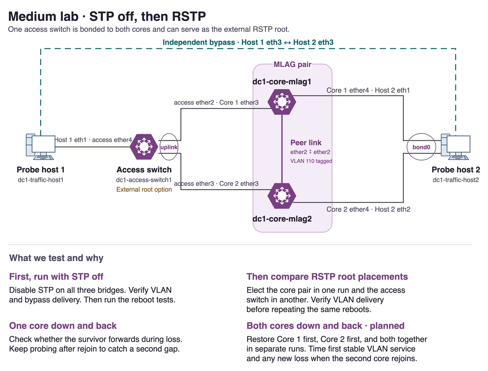

# Medium lab



Open **`mlag-medium`** in Containerlab. It runs inside the **`mlag-external` OrbStack Linux VM** on the Mac. DC1 is the simulated site. Containerlab prefixes Docker names with `clab-mlag-medium-`. The management network is `mlag-medium-mgmt`, subnet `172.30.218.0/27`. Each RouterOS guest uses the pinned image from [campaign-image.txt](../campaign-image.txt).

| Node and hostname | Role and runtime | Management IP | Saved capture ID |
| --- | --- | --- | --- |
| `dc1-core-mlag1` | RouterOS CHR core switch, preferred MLAG primary | `172.30.218.11` | `p1` |
| `dc1-core-mlag2` | RouterOS CHR core switch, preferred MLAG secondary | `172.30.218.12` | `p2` |
| `dc1-access-switch1` | RouterOS CHR access switch for Host 1. One two-member LACP uplink to the MLAG pair. | `172.30.218.13` | `witness` |
| `dc1-traffic-host1` | Linux container behind the access switch, VLAN 110 address `10.110.0.11` | `172.30.218.16` | `c1` |
| `dc1-traffic-host2` | Linux container with an LACP bond to both cores, VLAN 110 address `10.110.0.12` | `172.30.218.17` | `c2` |
| `dc1-syslog-collector` | rsyslog Linux container on the management network | `172.30.218.20` | `syslog` |

The access switch is the single external RSTP root candidate. It stays bonded to both cores in every mode. Host 1 attaches to the access switch and reaches either core through that bond. The retired five-CHR wiring and its root bridge IDs remain in the archived measurements.

## Link map

These are the Containerlab port names. On a RouterOS CHR, Containerlab data port `eth1` appears as guest `ether2`, `eth2` as `ether3`, and so on. The Linux hosts use the Containerlab names directly.

| Link | Endpoint A | Endpoint B |
| --- | --- | --- |
| MLAG peer link | `dc1-core-mlag1:eth1` | `dc1-core-mlag2:eth1` |
| Access switch LACP member on MLAG1 | `dc1-core-mlag1:eth2` | `dc1-access-switch1:eth1` |
| Access switch LACP member on MLAG2 | `dc1-core-mlag2:eth2` | `dc1-access-switch1:eth2` |
| Probe host 2 LACP member on MLAG1 | `dc1-core-mlag1:eth3` | `dc1-traffic-host2:eth1` |
| Probe host 2 LACP member on MLAG2 | `dc1-core-mlag2:eth3` | `dc1-traffic-host2:eth2` |
| Probe host 1 VLAN 110 access | `dc1-access-switch1:eth3` | `dc1-traffic-host1:eth1` |
| Independent bypass | `dc1-traffic-host1:eth3` at `198.51.100.1` | `dc1-traffic-host2:eth3` at `198.51.100.2` |

[Containerlab topology](medium.clab.yml) · [Operator commands](../../docs/operator-guide.md#deploy-the-three-chr-medium-lab)

## Files

| File | Job |
| --- | --- |
| [medium.clab.yml](medium.clab.yml) | Three-CHR topology used for the STP-off and RSTP comparison |
| [medium.rsc](medium.rsc) | RouterOS startup config for the three CHRs |
| [medium-pair-root.clab.yml](medium-pair-root.clab.yml), [medium-pair-root.rsc](medium-pair-root.rsc) | Pair-root variant, below |
| `logs/`, `pair-root-logs/` | RouterOS syslog for each variant, ignored by Git |

## Deploy

From the repository root, after building the traffic-host image described in [labs/README.md](../README.md#deploy-and-remove-a-lab):

```sh
syslog=$(sudo docker image inspect --format '{{index .RepoDigests 0}}' rsyslog/rsyslog:latest)
sudo env MLAG_CHR_IMAGE="$(cat labs/campaign-image.txt)" MLAG_SYSLOG_IMAGE="$syslog" \
  containerlab deploy -t labs/medium/medium.clab.yml
```

[Run the three bridge modes](../../docs/operator-guide.md#introduce-rstp-after-the-all-bridges-off-run) · [Cases](../../docs/cases/README.md#medium-lab)

## Pair-root variant

`medium-pair-root.clab.yml` makes the MLAG pair the RSTP root on management subnet `172.30.216.0/27`. It uses the same deployment name, so remove the other Medium topology first. [Wiring and fault target](../../docs/cases/medium-core-reboot.md) · [Commands](../../docs/operator-guide.md#reboot-the-root-pair)

## Two-pair variant

[medium-two-pair.clab.yml](medium-two-pair.clab.yml) replaces the access switch with a second MLAG pair (`dc1-access-mlag1`, `dc1-access-mlag2`) on management subnet `172.30.219.0/27`. It tests whether STP root stays on the core pair when a pair's primary reboots. [Case, reasons and commands](../../docs/cases/medium-two-pair-root.md)
