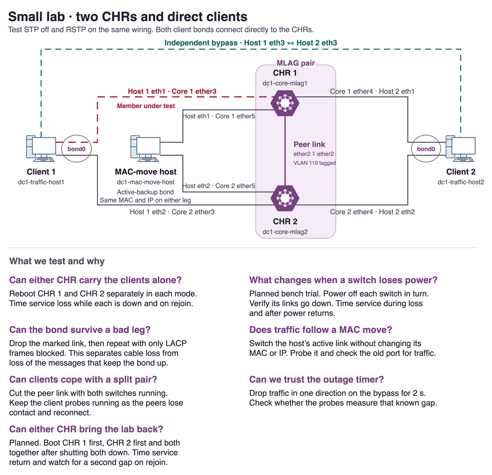

# Small lab



Two RouterOS switches form one MLAG pair. Linux containers provide test traffic, MAC moves and logging. Containerlab names this deployment `mlag-small`.

| Node | Role | Management address |
| --- | --- | --- |
| `dc1-core-mlag1` | MLAG switch 1 | `172.30.215.11` |
| `dc1-core-mlag2` | MLAG switch 2 | `172.30.215.12` |
| `dc1-traffic-host1` | Linux LACP client | `172.30.215.16` |
| `dc1-traffic-host2` | Linux LACP client | `172.30.215.17` |
| `dc1-mac-move-host` | Linux MAC-move endpoint | `172.30.215.18` |
| `dc1-syslog-collector` | Log collector | `172.30.215.20` |

Each client has one LACP member to each switch. The mobile endpoint uses an active-backup bond. A separate cable connects the two clients for bypass probes.

[Editable draw.io · Small lab](../../docs/diagrams/mlag-scenarios.drawio) · [Drawing](../../docs/diagrams/small-lab.png) · [Topology and port map](small.clab.yml) · [Run commands](../../docs/test-framework.md#execute-locally)

Saved captures use `p1` and `p2` for the core switches, `c1` and `c2` for traffic hosts, and `mobile` for the MAC-move host. New deployments use the names above. [Verified renamed lab](../../results/2026-11-24-medium-lab-readiness/README.md#verification-after-renaming)

## Files

| File | Job |
| --- | --- |
| [small.clab.yml](small.clab.yml) | Containerlab topology: nodes, links and binds |
| [small.rsc](small.rsc) | RouterOS startup config imported by both CHRs |
| `logs/` | RouterOS syslog written by the collector, ignored by Git |

## Deploy

From the repository root, after building the traffic-host image described in [labs/README.md](../README.md#deploy-and-remove-a-lab):

```sh
sudo env MLAG_CHR_IMAGE="$(cat labs/campaign-image.txt)" containerlab deploy -t labs/small/small.clab.yml
```

When both CHRs are healthy, follow the operator guide to wire the data path and pin the probe neighbors before running direct-client cases. The quickstart handles those steps for a fresh lab. [Operator guide](../../docs/operator-guide.md#reboot-the-direct-client-pair) · [Quick start](../../README.md#quick-start) · [Cases](../../docs/cases/README.md#small-lab)
