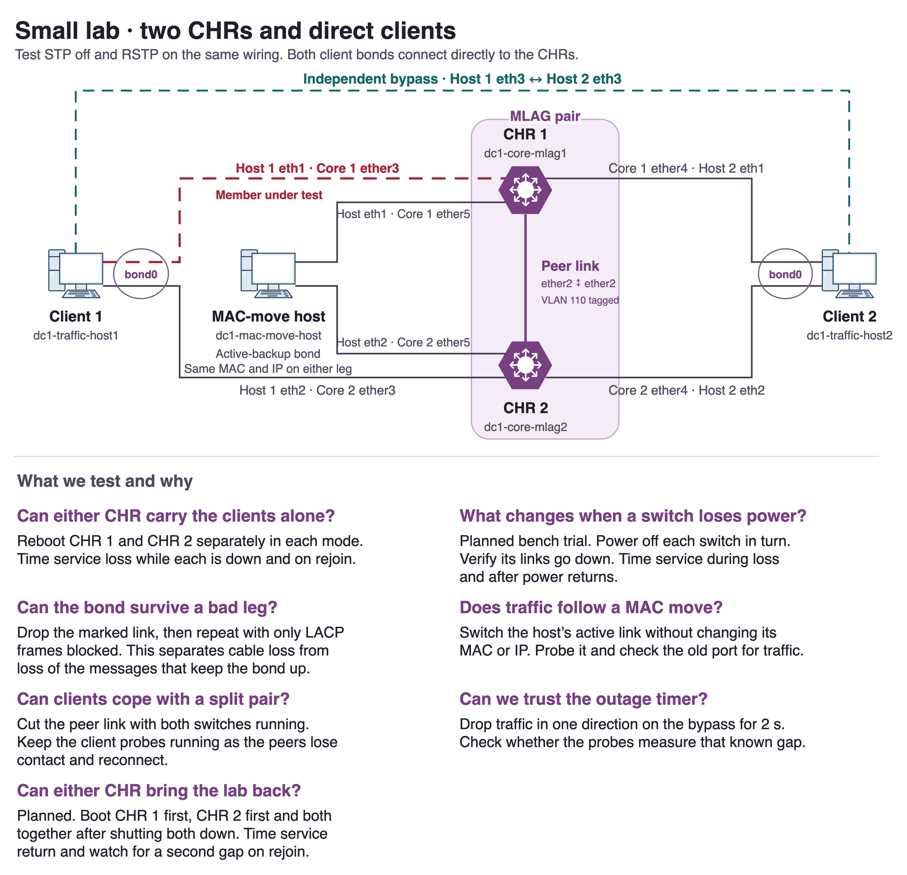

# Small lab: MLAG pair failover on RouterOS 7.26beta7

## Setup

| | |
| --- | --- |
| Lab | Small lab: one MLAG pair with directly attached clients. [Inventory](../../labs/small/README.md) · [Editable drawing](../../docs/diagrams/mlag-scenarios.drawio) |
| Devices | 5: two MikroTik CHR switches (CHR 1 and CHR 2) forming one MLAG pair, two Linux clients each bonded with LACP to both switches, and one Linux host that moves between the switches |
| RouterOS | 7.26beta7 · [Image digest](../../labs/campaign-image.txt) |
| Lab platform | Containerlab 0.83.0 in an OrbStack Linux VM on an ARM64 Mac |
| Spanning tree | RSTP on both switches. The same tests with STP off are still pending. |
| Date | 24 November 2026 |

Each test keeps pings running between the hosts, makes one change, and measures how long traffic stops.

## TL;DR

- **Bringing a client link back fails the 1 s limit.** Traffic to that client stopped for 2.2–2.6 s each time the link returned, in all 3 runs. Losing the link cost at most 0.21 s.
- **Rebooting either switch passed.** Traffic stopped for at most 2.9 s when the primary rebooted and not at all for the secondary. The limit is 5 s.
- **Two tests gave different results on the same build.** The LACP timeout and host-move tests each failed twice in the automated suite, then passed in a later rerun. The root cause is not established.
- **Cutting the link between the two switches stopped traffic to both clients for 12–13 s.** This was a single exploratory run without a limit.
- **The measurements are reliable.** A deliberate 2 s cut was measured correctly in all 8 checks.

## Results

Each run link opens that run's verdict file. On GitHub, links to failed runs highlight the failed checks. The run's packet timeline, `timeline.tsv`, is in the same folder.

| Test | What was done | Limit | Result |
| --- | --- | --- | --- |
| SMALL-01 · Baseline | Check MLAG, both client bonds and loss-free pings before each test | No lost pings | **Passed 4 of 4** separate checks before the rerun tests: [1](reports/rerun/baseline-before-calibrate/result.json), [2](reports/rerun/baseline-before-carrier/result.json), [3](reports/rerun/baseline-before-silent-lacp/result.json), [4](reports/rerun/baseline-before-mobile-move/result.json). The suite and reboot runs check their baseline inside each verdict. |
| SMALL-02 · Measurement check | Block traffic in one direction for 2 s | The measured gap contains the 2 s cut | **Passed 8 of 8:** [suite 1](reports/01-calibrate/result.json), [suite 2](reports/02-calibrate/result.json), [rerun](reports/rerun/calibrate/result.json), [reboot run](reports/reboots/calibrate/result.json), [manual 1](reports/manual-run-1/calibration-metrics.json), [manual 2](dual-homed.md#one-way-timing-calibration), [manual 3, two cuts](postmortem.md#measurements). Measured 1.87–2.19 s. |
| SMALL-03 · Client link loss and return | Take client 1's link to CHR 1 down for 8 s, then bring it back | 1 s on loss, 1 s on return | **Failed 3 of 3:** [suite 1](reports/01-carrier/result.json#L340-L354), [suite 2](reports/02-carrier/result.json#L340-L354), [rerun](reports/rerun/carrier/result.json#L340-L354). Loss cost at most 0.21 s. Return cost 2.2–2.6 s. Client 2 lost nothing. |
| SMALL-04 · LACP timeout | Keep client 1's link to CHR 1 up, but block its LACP messages for 8 s | 4 s while LACP times out, 1 s on return | **Failed 2 of 3:** failed in [suite 1](reports/01-silent-lacp/result.json#L345-L364) and [suite 2](reports/02-silent-lacp/result.json#L345-L359), passed in the [rerun](reports/rerun/silent-lacp/result.json). Every run lost 3.1–3.4 s while LACP timed out. The failed runs lost about 3 s more around the return. In suite 1, the two gaps merged into one 6.2 s outage between the clients. Client 2 lost nothing. |
| SMALL-05 · Host move | Move a host from CHR 1 to CHR 2 and back, keeping its IP and MAC address | No lost pings and no traffic for the host on its old port | **Passed 4 of 6:** passed in [manual 1](reports/manual-run-1/mobility-metrics.json), [manual 2](dual-homed.md#consecutive-mac-moves), [manual 3](postmortem.md#measurements) and the [rerun](reports/rerun/mobile-move/result.json). Failed in [suite 1](reports/01-mobile-move/result.json#L325-L344) and [suite 2](reports/02-mobile-move/result.json#L325-L344). Each failed run lost one ping and sent one packet to the old port on the move to CHR 2. |
| SMALL-06 · Secondary switch reboot | Reboot the MLAG secondary | 5 s | **Passed 1 of 1:** [reboot run](reports/reboots/reboot-secondary/result.json). No lost pings. |
| SMALL-07 · Primary switch reboot | Reboot the MLAG primary | 5 s | **Passed 1 of 1:** [reboot run](reports/reboots/reboot-primary/result.json). Longest gap 2.9 s while it went down, under 0.25 s on return. |
| Peer link cut · exploratory | Disable the link between CHR 1 and CHR 2, then restore it | None set | **Not scored, 1 run:** [manual 3](postmortem.md#measurements). Both clients lost 12–13 s. |

### Why the failures happened

- **Client link return:** In the diagnostic runs, CHR 1 sent traffic out of the returning link while the client was still negotiating LACP on it, and those packets were lost. [Diagnostic timeline](carrier-comparison.md#what-the-combined-timeline-shows) · [Suite 1 packet timeline](reports/01-carrier/timeline.tsv)
- **LACP timeout:** In both failed runs, CHR 1's LACP state for the blocked link fell back to defaults after about 6 s. CHR 1 then sent client 1's traffic over the blocked link, and 59 pings were lost there. In the rerun, that state did not fall back to defaults during the 8 s block. Why it differed is not established. [Suite 1](reports/01-silent-lacp/result.json#L701-L706) · [Suite 2](reports/02-silent-lacp/result.json#L756-L761) · [Rerun](reports/rerun/silent-lacp/result.json#L549-L554)
- **Host move:** One packet for the host left through its old port right after the move to CHR 2. The cause is not established. [Suite 1](reports/01-mobile-move/result.json#L466-L468) · [Suite 2](reports/02-mobile-move/result.json#L466-L468)
- **Peer link cut:** CHR 1 detected the cut and presented itself to the clients as a separate switch, while CHR 2 still reported the MLAG session as connected. [Event reconstruction](postmortem.md#reconstructing-the-events)

### Lab limits

- The virtual links stay up while a CHR reboots, so the reboot tests do not show what happens when a switch loses power. Power-loss tests need hardware.
- The client LACP bonds only formed after the virtual NICs were set to 10 Gbit/s full duplex. Manual run 1 therefore used single-homed clients.
- A link cut in this virtual lab reaches only one side unless both ends are cut. SMALL-03 cuts both ends. The one-sided cuts in manual run 3 are excluded from the results. [Link-cut diagnosis](carrier-comparison.md)

## Reproduce

[Deploy the Small lab](../../labs/small/README.md#deploy) · [Run the tests](../../docs/test-framework.md#execute-locally) · [What each test checks](../../docs/test-framework.md#what-the-cases-assert) · [Reboot commands](../../docs/operator-guide.md#reboot-the-direct-client-pair) · [Replay saved evidence offline](../../docs/test-framework.md#dry-run-with-saved-evidence)

## Evidence

| Run | Tests | Verdicts | Captures |
| --- | --- | --- | --- |
| Manual run 1 | Measurement check, host move | [Measurements](reports/manual-run-1) | [Captures and configuration](evidence.tar.gz) |
| Manual run 2 | Measurement check, host move | [Report](dual-homed.md) | [Captures](dual-homed-evidence.tar.gz) |
| Manual run 3 | Measurement check, host move, one-sided link cuts, peer link cut | [Report](postmortem.md) | [Captures](postmortem-evidence.tar.gz) |
| Link-cut diagnosis | How the virtual lab signals a cut link | [Report](carrier-comparison.md) · [Timeline](carrier-comparison-timeline.tsv) | [Captures](carrier-comparison-evidence.tar.gz) |
| Automated suite, 2 repeats | Measurement check, link loss, LACP timeout, host move | [Per test](reports) · [Summary](reports/suite.json) · [JUnit](reports/junit.xml) | [Captures](test-suite-evidence.tar.gz) |
| Rerun | Baseline, measurement check, link loss, LACP timeout, host move | [Per test](reports/rerun) | [Captures](../2026-11-24-medium-lab/small-l2-evidence.tar.gz) |
| Reboot run | Measurement check, both reboots | [Per test](reports/reboots) | [Captures](../2026-11-24-medium-lab/final-runs-evidence.tar.gz) |

The files in `reports/` are unchanged copies from these archives. Each archive contains its checksums and an offline reader. The SHA-256 of `evidence.tar.gz` is `377c9c0380c21cc11c41e610f943429eeec95b871160035baf82d7d279eebfb5`.
